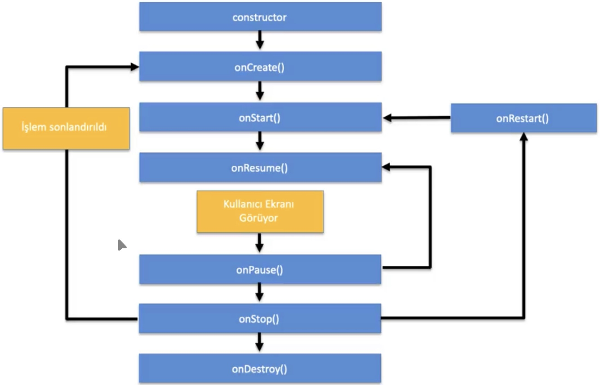

# Activity Yapısı ve Yaşam Döngüsü

## Activity Nedir?

Activity, Android uygulamalarında kullanıcı arayüzünü temsil eden temel uygulama bileşenidir. Uygulamadaki her ekran genellikle bir Activity ile temsil edilir.

Activity'ler birer Kotlin veya Java sınıfıdır. Bir Activity oluşturmak için `Activity` sınıfından ya da AndroidX üzerinden sunulan `ComponentActivity`, `AppCompatActivity` gibi türevlerinden kalıtım alınır.

```kotlin
class MainActivity : AppCompatActivity() {
    // Activity implementation
}
```

Activity sınıfları, kalıtım yoluyla Android tarafından tanımlanmış çeşitli metotları kullanabilir. Bu metotlar, Activity'nin oluşturulması, görünür hâle gelmesi, kullanıcı etkileşimine açılması, arka plana geçmesi ve sonlandırılması gibi aşamalarda Android işletim sistemi tarafından çağrılır.

Bu metotlara **Activity Lifecycle Callbacks** denir.

## Activity Lifecycle

Bir Activity başlatıldığı andan itibaren belirli yaşam döngüsü aşamalarından geçer. Android sistemi, gerçekleşen olaylara ve kullanıcı etkileşimlerine göre ilgili callback metotlarını tetikler.

<p align="center">
  
</p>

### 1. Constructor

Bir Activity nesnesi oluşturulurken öncelikle sınıfın constructor'ı çalışır.

Kotlin'de sınıfın birincil constructor'ı, nesne oluşturulurken devreye girer. Ancak constructor, Android'in yönettiği resmi Activity lifecycle callback'lerinden biri değildir.

Activity'nin arayüzünü oluşturmak, View bileşenlerini bağlamak ve Activity'ye ait başlangıç işlemlerini gerçekleştirmek için `onCreate()` kullanılmalıdır.

### 2. onCreate()

`onCreate()`, Activity ilk kez oluşturulduğunda çağrılan yaşam döngüsü metodudur.

Activity'nin temel başlangıç işlemleri bu metot içerisinde gerçekleştirilir.

Örneğin:

- Layout dosyasının Activity'ye bağlanması.
- View bileşenlerinin hazırlanması.
- ViewModel gibi bileşenlerin ilişkilendirilmesi.
- Gerekli başlangıç değişkenlerinin tanımlanması.
- İlk ekran verilerinin hazırlanması.

XML tabanlı bir arayüz kullanıldığında `setContentView()` genellikle bu metot içerisinde çağrılır.

```kotlin
class MainActivity : AppCompatActivity() {

    override fun onCreate(savedInstanceState: Bundle?) {
        super.onCreate(savedInstanceState)
        setContentView(R.layout.activity_main)
    }
}
```

**Jetpack Compose ile kullanım:**

Geleneksel XML tabanlı arayüzlerin yanında Jetpack Compose kullanıldığında da Activity'nin `onCreate()` metodu içerisinde `setContent {}` çağrılarak arayüz oluşturulabilir.

```kotlin
class MainActivity : ComponentActivity() {

    override fun onCreate(savedInstanceState: Bundle?) {
        super.onCreate(savedInstanceState)

        setContent {
            Greeting("Android")
        }
    }
}
```

Bu yaklaşımda arayüz, XML layout dosyaları yerine Kotlin fonksiyonları ve `@Composable` fonksiyonlar aracılığıyla tanımlanır.

**ViewModel kullanımı:**

ViewModel, UI ile ilgili verilerin Activity veya Fragment gibi UI bileşenlerinden bağımsız şekilde tutulmasını sağlar.

Özellikle ekran döndürme gibi configuration change durumlarında Activity yeniden oluşturulsa bile ViewModel örneği korunabilir.

```kotlin
class MainViewModel : ViewModel() {
    var counter = 0
}
```

ViewModel, Activity'nin tüm yaşamı boyunca değil, ilişkili olduğu ViewModelStoreOwner'ın kapsamı boyunca yaşar.

### 3. onStart()

`onCreate()` tamamlandıktan sonra `onStart()` çağrılır.

Bu aşamada Activity kullanıcıya görünür hâle gelmeye başlar. Ancak henüz kullanıcı etkileşimini almaya hazır olduğu Resumed durumuna geçmemiştir.

Bu metot içerisinde:

- Arayüzün görünür olması için gereken hazırlıklar yapılabilir.
- Kullanıcı arayüzünün ihtiyaç duyduğu lifecycle-aware bileşenler başlatılabilir.
- Activity görünür olduğu sürece devam etmesi gereken bazı işlemler başlatılabilir.

**Güncel Android'de Lifecycle kullanımı:**

AndroidX Lifecycle kütüphanesi, Activity ve Fragment gibi bileşenlerin yaşam döngülerini gözlemlemeyi sağlar.

`LifecycleOwner`, bir yaşam döngüsüne sahip bileşeni temsil eder. Lifecycle-aware bileşenler, Activity'nin hangi durumda olduğunu takip ederek gerekli işlemleri uygun zamanda gerçekleştirebilir.

Örneğin Activity görünür olduğunda veri gözlemlemeye başlamak ve görünürlüğünü kaybettiğinde bu işlemi durdurmak için lifecycle-aware API'lerinden yararlanılabilir.

### 4. onResume()

`onStart()` sonrasında `onResume()` çağrılır.

Bu aşamada Activity ön plana gelir ve kullanıcı etkileşimlerini almaya hazır hâle gelir.

Örneğin:

- Kamera önizlemesinin başlatılması.
- Kullanıcının etkileşimde bulunduğu ekrana ait işlemlerin etkinleştirilmesi.
- Ön planda çalışması gereken kaynakların hazırlanması.
- Ekran tekrar ön plana geldiğinde güncel verilerin kontrol edilmesi.

`onResume()` metodu, Activity'nin kullanıcıyla etkileşimde olduğu Resumed durumuna geçişini temsil eder.

**Önemli:** `onResume()` her zaman yalnızca Activity ilk açıldığında çalışmaz. Activity duraklatıldıktan sonra tekrar ön plana geldiğinde de çağrılır.

Bu nedenle yalnızca `onCreate()` içerisinde veri yüklemek, her zaman güncel veriyi göstermek için yeterli değildir. Activity tekrar ön plana geldiğinde yenilenmesi gereken veriler uygun yaşam döngüsü aşamasında tekrar kontrol edilmelidir.

### 5. onPause()

Activity ön plandaki durumunu kaybettiğinde `onPause()` çağrılır.

Örneğin:

- Kullanıcı başka bir Activity açtığında.
- Kullanıcı başka bir uygulamaya geçtiğinde.
- Ekranın önüne kısmen görünen başka bir Activity geldiğinde.
- Sistem veya kullanıcı etkileşimi nedeniyle Activity odağını kaybettiğinde.

Bu aşamada Activity henüz tamamen görünmez hâle gelmemiş olabilir. Özellikle çoklu pencere kullanımında Activity görünür olmasına rağmen Paused durumunda bulunabilir.

Bu metot içerisinde:

- Ön planda çalışması gereken işlemler durdurulabilir.
- Kamera önizlemesi gibi kaynaklar serbest bırakılabilir.
- Animasyonlar veya geçici işlemler duraklatılabilir.
- Kullanıcı etkileşimine bağlı işlemler geçici olarak durdurulabilir.

`onPause()` mümkün olduğunca kısa sürmelidir. Uzun süren ağ istekleri, veritabanı işlemleri ve ağır hesaplamalar burada gerçekleştirilmemelidir. Çünkü bu metodun tamamlanması, sonraki Activity'nin ön plana geçmesini geciktirebilir.

**Güncel Android'de Lifecycle kullanımı:**

Activity'nin Paused durumuna geçmesiyle birlikte bazı UI işlemlerinin durdurulması için lifecycle-aware bileşenlerden yararlanılabilir.

Örneğin `repeatOnLifecycle()` kullanılarak belirli bir yaşam döngüsü durumuna ulaşıldığında Coroutine başlatılabilir, bu durumdan çıkıldığında ise otomatik olarak iptal edilebilir.

Bu yaklaşım özellikle Kotlin Coroutines ve Flow ile veri gözlemlerken kullanışlıdır.

### 6. onStop()

Activity artık kullanıcı tarafından görülemeyecek duruma geldiğinde `onStop()` çağrılır.

Örneğin başka bir Activity mevcut ekranı tamamen kapladığında veya kullanıcı başka bir uygulamaya geçtiğinde bu metot çalışabilir.

Activity Stopped durumundayken bellekte bulunmaya devam edebilir. Yani `onStop()` çağrılması, Activity nesnesinin hemen bellekten silindiği anlamına gelmez.

Bu metot içerisinde:

- Ekran görünür değilken gerekmeyen işlemler durdurulabilir.
- UI güncellemeleri ve animasyonlar durdurulabilir.
- Görünürlük süresince kullanılan kaynaklar serbest bırakılabilir.
- Daha sonra tekrar kullanılabilecek bazı işlemler duraklatılabilir.

### 7. onRestart()

Activity, Stopped durumundan yeniden görünür hâle getirilecekse `onRestart()` çağrılır.

Bu metot, Activity'nin durdurulduktan sonra tekrar başlatılma sürecini temsil eder.

`onRestart()` sonrasında her zaman `onStart()` çağrılır. Ardından Activity ön plana geldiğinde `onResume()` çalışır.

Bu nedenle Activity'nin Stopped durumundan geri dönmesi genel olarak şu sırayla gerçekleşir:

```text
onRestart()
    ↓
onStart()
    ↓
onResume()
```

`onRestart()` yalnızca Stopped durumundan geri dönüşte çağrılır. Activity yalnızca Paused durumundaysa tekrar ön plana geldiğinde doğrudan `onResume()` çağrılır.

### 8. onDestroy()

`onDestroy()`, Activity yok edilmeden önce çağrılan son yaşam döngüsü metodudur.

İki temel durumda çağrılabilir:

- Activity `finish()` ile sonlandırıldığında.
- Ekran döndürme gibi bir configuration change nedeniyle Activity örneği yeniden oluşturulurken.

Bu metot içerisinde Activity'ye ait ve daha önce serbest bırakılmamış kaynaklar temizlenebilir.

Activity yok edildiğinde aynı nesne yeniden kullanılmaz. Yeniden açılması veya oluşturulması gerektiğinde yeni bir Activity örneği meydana gelir ve yaşam döngüsü `onCreate()` ile yeniden başlar.

**Önemli:** Android işletim sistemi bellek ihtiyacı nedeniyle uygulamanın bulunduğu süreci doğrudan sonlandırabilir. Bu durumda `onDestroy()` callback'inin çağrılması garanti değildir. Bu nedenle uygulamanın önemli verilerini yalnızca `onDestroy()` içerisinde kaydetmek doğru değildir.

ViewModel de Activity'nin yok edilmesi ve yeniden oluşturulması gibi durumlarda kendi kapsamına göre yönetilir. Configuration change sırasında korunabilir; ancak süreç sonlandırıldığında ViewModel nesnesinin de korunacağı garanti edilmez. Süreç yeniden oluşturulduğunda verilerin geri yüklenmesi için `SavedStateHandle` veya kalıcı veri saklama yöntemleri değerlendirilmelidir.

## Activity Yaşam Döngüsünün Örnek Akışı

Bir Activity'nin normal açılış süreci:

```text
Constructor
    ↓
onCreate()
    ↓
onStart()
    ↓
onResume()
```

Activity Paused durumuna geçtiğinde:

```text
onPause()
    ↓
onResume()
```

Activity tamamen görünmez hâle geldiğinde:

```text
onPause()
    ↓
onStop()
```

Stopped durumundaki Activity tekrar açıldığında:

```text
onRestart()
    ↓
onStart()
    ↓
onResume()
```

Activity sonlandırıldığında:

```text
onPause()
    ↓
onStop()
    ↓
onDestroy()
```

Bu akışlar genel senaryoları gösterir. Gerçek callback sırası, Activity'nin bulunduğu duruma ve gerçekleşen olaya göre değişebilir.

## Yaşam Döngüsü ve Performans

Activity yaşam döngüsünde dikkat edilmesi gereken önemli konulardan biri performanstır.

`onCreate()`, `onStart()` ve `onResume()` gibi metotlarda uzun süren işlemler gerçekleştirilmesi, ekranın hazırlanmasını ve kullanıcı etkileşiminin başlamasını geciktirebilir.

Özellikle Activity geçişlerinde bu durum takılmalara ve kullanıcı deneyiminin kötüleşmesine neden olabilir.

Benzer şekilde `onPause()` metodunun uzun sürmesi de yeni Activity'nin ön plana geçmesini geciktirebilir.

Bu nedenle:

- UI oluşturma işlemleri uygun lifecycle callback'lerinde yapılmalıdır.
- Ağ istekleri ve uzun süren işlemler ana thread üzerinde bloklayıcı şekilde çalıştırılmamalıdır.
- Arka plan işlemleri için Kotlin Coroutines, WorkManager gibi uygun araçlar kullanılmalıdır.
- Ekran verilerinin korunması için ViewModel ve SavedStateHandle gibi yapılar değerlendirilmelidir.
- Activity tekrar ön plana geldiğinde güncellenmesi gereken veriler uygun yaşam döngüsü aşamasında yenilenmelidir.

## Güncel Android'de Yaşam Döngüsü Yönetimi

Activity lifecycle callback'leri günümüzde de Android uygulamalarının temel parçalarından biridir. Ancak modern Android geliştirmede bu callback'lerin doğrudan her bileşen içerisinde yönetilmesi yerine lifecycle-aware bileşenlerden yararlanılması önerilir.

### Lifecycle ve LifecycleOwner

AndroidX Lifecycle kütüphanesi, Activity ve Fragment gibi bileşenlerin yaşam döngülerini gözlemlemeyi sağlar.

`LifecycleOwner`, bir yaşam döngüsüne sahip bileşeni temsil eder. Bu yapı sayesinde uygulama bileşenleri Activity veya Fragment'in yaşam döngüsüne göre davranabilir.

### ViewModel

ViewModel, UI ile ilgili verilerin Activity veya Fragment gibi UI bileşenlerinden bağımsız şekilde tutulmasını sağlar.

Özellikle ekran döndürme gibi configuration change durumlarında Activity yeniden oluşturulsa bile ViewModel örneği korunabilir.

Ancak ViewModel, süreç sonlandırılmasına karşı kalıcı veri saklama mekanizması değildir.

### Kotlin Coroutines ve Flow

Modern Android uygulamalarında asenkron işlemler ve veri akışları için Kotlin Coroutines ve Flow yaygın olarak kullanılır.

Lifecycle-aware yaklaşımlarla birlikte kullanıldığında, ekran görünür durumdayken veri gözlemleme gibi işlemler daha kontrollü şekilde gerçekleştirilebilir.

### Jetpack Compose

Jetpack Compose kullanıldığında da Activity yaşam döngüsü geçerliliğini korur.

Compose arayüzleri çoğunlukla `setContent {}` içerisinde oluşturulur. UI tarafında lifecycle-aware davranışlar için Lifecycle API'lerinden yararlanılabilir.

Compose'un kendi Composition ve Side Effect mekanizmaları da bulunur. Bunlar Activity lifecycle ile aynı kavram değildir; ancak yaşam döngüsüne bağlı işlemlerin yönetilmesinde birlikte kullanılabilir.

## Önemli Kavramlar

| Kavram | Açıklama |
|---|---|
| Activity | Android uygulamasında kullanıcı arayüzünü temsil eden bileşen |
| Lifecycle | Activity'nin yaşam döngüsü |
| Callback | Android sistemi tarafından belirli olaylarda çağrılan metot |
| Paused | Activity'nin ön plandaki odağını kaybettiği durum |
| Stopped | Activity'nin artık kullanıcı tarafından görünmediği durum |
| Destroyed | Activity örneğinin yok edildiği durum |
| Configuration Change | Ekran yönü veya dil gibi yapılandırma değişiklikleri nedeniyle Activity'nin yeniden oluşturulması |
| ViewModel | UI ile ilgili verileri UI bileşeninin yeniden oluşturulmasından bağımsız tutmaya yardımcı olan bileşen |
| LifecycleOwner | Bir yaşam döngüsüne sahip bileşeni temsil eden arayüz |

## Sonuç

Activity yaşam döngüsü, Android işletim sisteminin uygulama ekranlarını nasıl oluşturduğunu, yönettiğini ve sonlandırdığını anlamak için temel konulardan biridir.

Her callback'in hangi durumda çağrıldığını ve hangi işlemler için uygun olduğunu bilmek; kaynak yönetimi, performans, veri korunması ve kullanıcı deneyimi açısından önemlidir.

Özellikle `onCreate()`, `onResume()`, `onPause()` ve `onStop()` metotlarının görevlerini anlamak, Android uygulamalarının yaşam döngüsüne uygun şekilde geliştirilmesine yardımcı olur.

## Kaynaklar

- [The Activity Lifecycle | Android Developers](https://developer.android.com/guide/components/activities/activity-lifecycle)
- [Activity | Android API Reference](https://developer.android.com/reference/android/app/Activity)
- [ViewModel Overview | Android Developers](https://developer.android.com/topic/libraries/architecture/viewmodel)
- [Lifecycle | Android Developers](https://developer.android.com/topic/libraries/architecture/lifecycle)
- [Lifecycle-aware coroutines | Android Developers](https://developer.android.com/topic/libraries/architecture/coroutines)