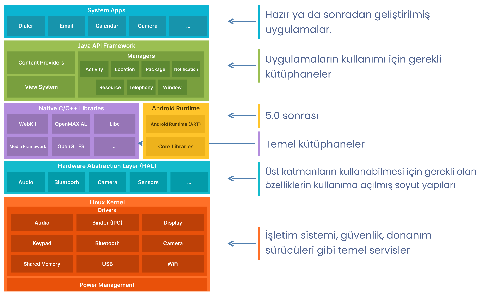

# Android Mimarisi

## Android Çalışma Yapısı

Android, 2005 yılında Google tarafından satın alınmış ve 2007 yılında ilk kez tanıtılmıştır. Android işletim sisteminin temeli Linux çekirdeğine dayanır. Ancak bu durum Android'in doğrudan bir Linux dağıtımı olduğu anlamına gelmez. Android, Linux kernel üzerine inşa edilmiş; kendi çalışma zamanı, sistem servisleri, kütüphaneleri ve uygulama framework'ü bulunan bir işletim sistemidir.

Android'in çalışma yapısı, farklı sorumluluklara sahip katmanlardan oluşur. Bu katmanlar donanımdan uygulamalara kadar uzanan bir yapı meydana getirir.

<p align="center">
   
</p>

> **Not:** Diyagram, Android'in katmanlı mimarisini kavramak için hazırlanmış kavramsal bir gösterimdir. Android sürümleri ilerledikçe katmanların içindeki teknolojiler ve bu katmanlar arasındaki iletişim yöntemleri gelişmiştir.

## 1. Linux Kernel

Linux Kernel, Android mimarisinin en alt katmanıdır. İşletim sisteminin temel servislerini ve donanımla iletişimini yönetir.

Bu katmanda bulunan temel bileşenler ve sorumluluklar:

- **Drivers:** Ses, ekran, kamera, Bluetooth, USB ve Wi-Fi gibi donanım bileşenleri için sürücüler.
- **Binder (IPC):** Android süreçleri ve sistem servisleri arasında süreçler arası iletişimi (Inter-Process Communication) sağlayan mekanizma.
- **Power Management:** Cihazın güç tüketimini ve enerji yönetimini düzenleyen mekanizmalar.
- **Memory Management:** Bellek yönetimi.
- **Process Management:** Süreçlerin yönetimi.
- **Security:** Süreç izolasyonu, erişim kontrolleri ve diğer düşük seviyeli güvenlik mekanizmaları.

### Güncel Android'de neler değişti?

Android hâlâ Linux kernel kullanmaktadır. Ancak Android için kullanılan kernel, yalnızca standart Linux çekirdeğinden ibaret değildir. Google, Linux LTS çekirdeklerini Android'e özgü yamalarla birleştirerek **Android Common Kernel (ACK)** sürümlerini oluşturur.

Güncel mimaride öne çıkan gelişmelerden biri **Generic Kernel Image (GKI)** yaklaşımıdır. GKI, donanımdan bağımsız çekirdek kodunu üreticiye özgü kernel modüllerinden ayırmayı amaçlar. Böylece kernel güncellemelerinin ve farklı cihaz üreticilerinin donanım desteğinin yönetilmesi kolaylaşır.

Bir diğer önemli gelişme **Project Mainline** yaklaşımıdır. Bazı Android sistem bileşenlerinin, işletim sisteminin tamamının güncellenmesine gerek kalmadan Google Play sistem güncellemeleri üzerinden güncellenebilmesini sağlar.

**Kısacası:** Linux Kernel, Android'in donanım ve düşük seviyeli sistem işlemlerinin temelini oluşturur. GKI ve Mainline gibi yaklaşımlar ise sistemin güncellenebilirliğini ve sürdürülebilirliğini geliştirir.

## 2. Hardware Abstraction Layer (HAL)

HAL, donanım özelliklerinin üst katmanlara standart arayüzler aracılığıyla sunulmasını sağlar.

Android framework'ü, donanım özelliklerine doğrudan erişmek yerine ilgili HAL arayüzleri üzerinden iletişim kurabilir. Böylece framework ile donanımın üreticiye özgü uygulama detayları birbirinden ayrılır.

Diyagramda yer alan HAL bileşenlerine örnekler:

- **Audio HAL:** Ses donanımıyla iletişim.
- **Bluetooth HAL:** Bluetooth donanım özelliklerine erişim.
- **Camera HAL:** Kamera donanımının kullanılması.
- **Sensors HAL:** İvmeölçer, jiroskop ve benzeri sensörlere erişim.

### Güncel Android'de neler değişti?

HAL yaklaşımı hâlâ kullanılmaktadır. Ancak HAL arayüzlerinin tanımlanması ve sistemin farklı bölümleri arasında iletişim kurulması konusunda önemli değişiklikler yapılmıştır.

- **Project Treble:** Android 8 ile birlikte gelen bu mimari değişiklik, Android framework'ü ile donanım üreticilerinin uyguladığı vendor katmanı arasındaki sınırları belirginleştirmiştir. Böylece Android sürüm güncellemelerinin üreticiler tarafından uyarlanması kolaylaşmıştır.
- **HIDL (HAL Interface Definition Language):** Project Treble ile birlikte HAL arayüzlerinin tanımlanması için kullanılmaya başlanmıştır.
- **AIDL (Android Interface Definition Language):** Android 11 ile HAL geliştirmelerinde de kullanılabilir hâle gelmiştir. Yeni HAL geliştirmelerinde mümkün olduğunda Stable AIDL tercih edilmektedir.
- **Binder IPC:** HAL bileşenleri ile framework arasındaki süreçler arası iletişimde kullanılan mekanizmalardan biridir.

Android 10 itibarıyla HIDL kullanımı deprecated olarak işaretlenmiş ve yeni geliştirmelerde AIDL yönünde geçiş önerilmiştir. Bununla birlikte eski HAL uygulamalarında HIDL hâlâ bulunabilir.

**Kısacası:** HAL, Android framework'ünün donanım üreticisine özgü ayrıntılardan bağımsız olarak donanım özelliklerini kullanabilmesini sağlar. Project Treble ise bu katmanlar arasındaki uyumluluğu ve güncelleme sürecini iyileştirmiştir.

## 3. Native C/C++ Libraries

Android, temel sistem işlevlerinin önemli bir bölümünde C ve C++ ile geliştirilmiş native kütüphanelerden yararlanır.

Bu kütüphaneler Android framework'ü, sistem servisleri ve gerektiğinde native uygulama kodları tarafından kullanılabilir.

Diyagramda yer alan kütüphaneler:

### WebKit

Web içeriklerinin görüntülenmesi için geliştirilmiş bir web motorudur. Eski Android mimarisinde web sayfalarının uygulama içerisinde görüntülenmesinde kullanılmıştır.

**Güncel durum:** Android WebView, günümüzde Chromium tabanlıdır. Bu nedenle WebKit, güncel Android WebView altyapısını açıklamak için doğru bir örnek değildir.

### OpenMAX AL

OpenMAX Application Layer, ses ve video gibi multimedya işlemleri için geliştirilmiş native bir API'dir. Medya oynatma ve medya kaynaklarının yönetimi gibi işlemlerde kullanılmıştır.

**Güncel durum:** OpenMAX AL eski Android multimedya mimarisinde karşılaşılan bir teknolojidir. Yeni geliştirmelerde Android'in Media API'leri tercih edilmelidir.

### libc (Bionic libc)

C programlama dilinin temel işlevlerini sağlayan standart kütüphane altyapısıdır.

Android, standart Linux sistemlerinde yaygın olarak kullanılan glibc yerine kendi C kütüphanesi olan **Bionic libc**'yi kullanır.

Örnek işlevler:

- Bellek yönetimi: `malloc()`, `free()`
- String işlemleri: `strlen()`, `strcmp()`
- Dosya işlemleri ve düşük seviyeli sistem çağrıları.

### Media Framework

Ses ve video oynatma, medya kodlama ve kod çözme gibi multimedya işlemlerini sağlayan altyapıdır.

Günümüzde Android'in Media Framework altyapısı kullanılmaya devam etmektedir. Uygulama geliştiricileri bu işlevlere çoğunlukla `MediaPlayer`, `MediaCodec` ve ilgili Android API'leri üzerinden erişir.

### OpenGL ES

OpenGL for Embedded Systems, mobil cihazlar ve gömülü sistemler için geliştirilmiş bir grafik API'sidir.

GPU üzerinden 2D ve 3D grafiklerin işlenmesini sağlar.

Örnek kullanım alanları:

- 3D nesnelerin oluşturulması ve çizilmesi.
- Oyun grafiklerinin işlenmesi.
- Texture uygulamaları.
- Işıklandırma ve gölgelendirme.

**Güncel durum:** OpenGL ES Android'de hâlâ desteklenmektedir. Bununla birlikte daha modern ve düşük seviyeli grafik işlemleri için **Vulkan** da sunulmaktadır.

Vulkan, GPU üzerinde daha düşük seviyeli kontrol ve grafik işlemlerinde daha fazla esneklik sağlar. Özellikle yüksek performans gerektiren oyun ve grafik uygulamalarında önemlidir.

## 4. Android Runtime (ART)

Android Runtime, Android uygulamalarının çalıştırıldığı yönetilen çalışma zamanı ortamıdır.

Android'in ilk dönemlerinde uygulamaları çalıştırmak için **Dalvik Virtual Machine (DVM)** kullanılıyordu. Dalvik, Android için geliştirilmiş bir sanal makineydi ve uygulamaların DEX bytecode formatını çalıştırıyordu.

Daha sonra performans ve çalışma zamanı iyileştirmeleriyle birlikte Android Runtime (ART) geliştirildi.

### Dalvik ve ART arasındaki geçiş

- **Android 4.4 (KitKat):** ART, Dalvik'e alternatif olarak deneysel/seçilebilir bir seçenek şeklinde sunuldu.
- **Android 5.0 (Lollipop):** ART varsayılan çalışma zamanı hâline geldi ve Dalvik'in yerini aldı.

ART, DEX (Dalvik Executable) bytecode formatını çalıştırır. Dolayısıyla Dalvik'in yerini almış olması DEX formatının da ortadan kalktığı anlamına gelmez.

### ART nasıl çalışır?

ART, uygulama kodunu çalıştırırken farklı derleme yöntemlerinden yararlanır:

- **AOT (Ahead-of-Time Compilation):** Kodun çalışma öncesinde makine koduna derlenmesi.
- **JIT (Just-in-Time Compilation):** Kodun çalışma sırasında derlenmesi.
- **Interpretation:** Bytecode'un yorumlanarak çalıştırılması.

Android 7 ile birlikte ART, AOT ve JIT yöntemlerini birlikte kullanan hibrit bir yapıya geçmiştir. Profil bilgileri kullanılarak sık çalıştırılan kodların optimize edilmesi de mümkündür.

ART'nin diğer sorumlulukları arasında:

- Garbage Collection (GC) ile bellek yönetimi.
- DEX bytecode doğrulama.
- Uygulamaların çalışma zamanı optimizasyonları.
- Java ve Kotlin ile geliştirilen uygulamaların çalıştırılmasına yönelik altyapı.

**Kısacası:** ART, Android uygulamalarının DEX bytecode üzerinden çalışmasını sağlayan ve uygulamaların performansını optimize eden çalışma zamanı ortamıdır.

## 5. Core Libraries

Core Libraries, Android Runtime ile birlikte sunulan temel çalışma zamanı kütüphaneleridir.

Java programlama dilinin temel işlevlerini ve koleksiyonlar, dosya işlemleri, tarih ve zaman gibi birçok ortak programlama özelliğini sağlar.

Kotlin ile geliştirme yaparken de bu altyapıdan yararlanılır. Kotlin'in Java ve Android platformuyla birlikte çalışabilmesi sayesinde bu kütüphanelerin sunduğu birçok işlev Kotlin kodlarından da kullanılabilir.

**Önemli:** Core Libraries ile Java API Framework aynı şey değildir. Core Libraries temel çalışma zamanı işlevlerini sağlarken Java API Framework, Android platformuna özgü uygulama API'lerini sunar.

## 6. Java API Framework (Application Framework)

Java API Framework, Android uygulama geliştiricilerinin doğrudan kullandığı platform API'lerini ve sistem servislerine erişim sağlayan arayüzleri içerir.

Bazı kaynaklarda Application Framework olarak da adlandırılır.

Diyagramda bu katman altında üç temel grup gösterilmektedir:

### Content Providers

Uygulamaların verilerini diğer uygulamalarla kontrollü bir şekilde paylaşabilmesini sağlayan yapıdır.

Content Provider, veriye erişim ve veri paylaşımı için standart bir arayüz sunar.

Örneğin:

- Kişi rehberindeki verilere erişim.
- Medya dosyalarının paylaşılması.
- Uygulama verilerinin diğer uygulamalara açılması.

### View System

Android'in geleneksel kullanıcı arayüzü oluşturma ve yönetme sistemidir.

Ekrandaki görsel bileşenlerin oluşturulmasını, düzenlenmesini ve kullanıcı etkileşimlerinin yönetilmesini sağlar.

Örnekler:

- `TextView`
- `EditText`
- `Button`
- `ImageView`
- `LinearLayout`
- `ConstraintLayout`

**Güncel Android'de neler değişti?**

Geleneksel View System günümüzde de kullanılmaktadır. Ancak kullanıcı arayüzü geliştirmek için modern bir alternatif olarak **Jetpack Compose** sunulmuştur.

- **View System:** XML layout dosyaları ve `View` sınıflarıyla arayüz oluşturma.
- **Jetpack Compose:** Kotlin ile deklaratif arayüz geliştirme.

Jetpack Compose ile arayüz, XML dosyaları yerine Kotlin fonksiyonları kullanılarak tanımlanır.

```kotlin
@Composable
fun Greeting(name: String) {
    Text(text = "Hello $name")
}
```

Jetpack Compose, View System'in tamamen ortadan kalktığı anlamına gelmez. İki yaklaşım aynı uygulama içerisinde birlikte kullanılabilir.

### Managers

Android'de sistem özelliklerine ve servislerine erişmek için çeşitli Manager sınıfları bulunur.

Diyagramdaki örnekler:

- **ActivityManager:** Sistem süreçleri ve Activity'lerle ilişkili bilgiler ve yönetim işlemleri.
- **LocationManager:** Konum servislerine erişim.
- **PackageManager:** Cihazda yüklü uygulamalar ve paketlerle ilgili işlemler.
- **NotificationManager:** Bildirimlerin yönetilmesi.
- **Resource:** Uygulama kaynaklarına erişim ve kaynak yönetimi. Bu örnek güncel Android'de `Resources` sınıfı ve ilgili kaynak API'leriyle karşılanır; bir Manager sınıfı değildir.
- **TelephonyManager:** Telefon ve mobil ağ servisleriyle ilgili bilgilere erişim.
- **WindowManager:** Pencere ve ekran yerleşimiyle ilgili işlemler.

### Kotlin ve AndroidX

Java API Framework adı günümüzde de kullanılabilen bir kavramdır; ancak Android geliştirme yalnızca Java ile sınırlı değildir. Kotlin, Android geliştirmede Google tarafından önerilen birincil dildir.

AndroidX ve Jetpack kütüphaneleri, platform API'lerini tamamlayan ve uygulama geliştirmeyi kolaylaştıran araçlar sunar.

Öne çıkan örnekler:

- **Lifecycle:** Activity ve Fragment gibi bileşenlerin yaşam döngüsünü yönetmeye yardımcı olur.
- **ViewModel:** UI ile ilişkili verilerin yapılandırma değişiklikleri sırasında korunmasını sağlar.
- **Navigation:** Ekranlar arasındaki geçişlerin yönetilmesini sağlar.
- **Room:** SQLite üzerinde veritabanı işlemlerini kolaylaştırır.
- **WorkManager:** Ertelenebilir ve güvenilir arka plan işlerini yönetir.

Bu kütüphaneler Android platformunun temel katmanlarıyla aynı şey değildir; uygulama geliştiricilerine sunulan ek mimari ve geliştirme araçlarıdır.

## 7. System Apps

Android mimarisinin en üst katmanında uygulamalar bulunur.

Bu katmanda hem Android ile birlikte gelen sistem uygulamaları hem de kullanıcı veya geliştiriciler tarafından yüklenen uygulamalar yer alır.

Diyagramdaki örnekler:

- Dialer
- Email
- Calendar
- Camera

Bu uygulamalar Android platformunun sunduğu API'lerden yararlanarak çalışır. Ancak tüm sistem uygulamaları aynı ayrıcalıklara sahip değildir. Sistem uygulamalarının izinleri ve erişimleri, imza izinleri, sistem rolleri ve diğer güvenlik mekanizmalarına göre değişebilir.

## 8. Platform Mimarisi ve Uygulama Mimarisi Arasındaki Fark

Android platform mimarisi ile Android uygulamasının kendi yazılım mimarisi birbirinden farklı kavramlardır.

**Platform mimarisi**, işletim sisteminin kernel, HAL, native kütüphaneler, ART ve framework gibi katmanlarının nasıl çalıştığını açıklar.

**Uygulama mimarisi** ise geliştirdiğimiz uygulamanın kodunu ve sorumluluklarını nasıl organize ettiğimizi açıklar.

Modern Android uygulamalarında önerilen temel katmanlar şunlardır:

- **UI Layer:** Kullanıcı arayüzünü ve kullanıcı etkileşimlerini yönetir.
- **Data Layer:** Verilerin alınması, saklanması ve iş mantığının büyük bölümünden sorumludur.
- **Domain Layer:** Gerektiğinde tekrar kullanılabilir iş kurallarını ve use case yapılarını içerir. Her uygulamada bulunması zorunlu değildir.

Modern uygulama mimarisinde ayrıca aşağıdaki yaklaşımlar önerilmektedir:

- Unidirectional Data Flow (UDF)
- ViewModel
- Kotlin Coroutines ve Flow
- Repository Pattern
- Dependency Injection
- Lifecycle-aware state management

Bu yaklaşımlar Android işletim sisteminin katmanları değil, uygulama geliştirirken kullandığımız mimari tasarım prensipleridir.

## Sonuç

Android'in katmanlı mimarisini anlamak, uygulamaların donanımdan başlayarak işletim sistemi servislerine ve uygulama API'lerine kadar nasıl çalıştığını kavramamızı sağlar.

Bir Android geliştiricisi olarak hangi işlevin hangi katmanda sunulduğunu bilmek; doğru API'yi seçmek, platformun sunduğu imkânları anlamak, performans ve güvenlik konularında daha bilinçli kararlar vermek açısından önemlidir.

Özellikle eski Android mimarisindeki teknolojiler ile güncel karşılıklarını ayırt edebilmek, Android platformunun zaman içinde nasıl geliştiğini anlamamıza yardımcı olur.

## Kaynaklar

- [Android Platform Architecture](https://developer.android.com/guide/platform)
- [Android Runtime (ART) and Dalvik](https://source.android.com/docs/core/runtime)
- [Android Kernel Overview](https://source.android.com/docs/core/architecture/kernel)
- [HIDL](https://source.android.com/docs/core/architecture/hidl)
- [AIDL for HALs](https://source.android.com/docs/core/architecture/aidl/aidl-hals)
- [Project Treble](https://source.android.com/docs/core/architecture/treble)
- [Project Mainline](https://source.android.com/docs/core/ota/modular-system)
- [Guide to App Architecture](https://developer.android.com/topic/architecture)
- [Android Architecture Recommendations](https://developer.android.com/topic/architecture/recommendations)
- [Jetpack Compose](https://developer.android.com/compose)
- [Vulkan on Android](https://developer.android.com/games/develop/vulkan)
