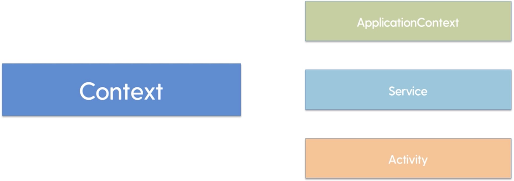

# Android Uygulama Çalıştırma

## Android Uygulamalarının Çalışma Yapısı

Android'de bir uygulamanın veya ekranın başlatılması, işletim sisteminin yönetimi altında gerçekleşir. Uygulama geliştiricisi bir Activity ya da Service oluşturabilir; ancak bu bileşenlerin yaşam döngülerini Android işletim sistemi yönetir.

Kullanıcı uygulama ikonuna dokunduğunda Android sistemi, uygulamanın başlangıç noktası olarak tanımlanan Activity'yi bulur ve başlatma sürecini gerçekleştirir. Başlatılacak yapı bir ekran değil, arka planda çalışan bir Service ise yine Android sistemi ilgili bileşenin oluşturulmasını ve yaşam döngüsünü yönetir.

Bir Activity başlatıldıktan sonra kullanıcı uygulamayla etkileşime geçebilir. Ekrandaki işlemlerini gerçekleştirir ve ihtiyaç duyduğunda başka bir ekrana geçebilir. Yeni bir Activity açıldığında Android sistemi bu Activity için de gerekli başlatma adımlarını uygular.

Dolayısıyla bir Activity'nin uygulama içerisinden başka bir Activity tarafından başlatılması veya dışarıdan bir Intent aracılığıyla açılması, temel yaşam döngüsü mekanizmasını değiştirmez. Her iki durumda da Activity'nin yaşam döngüsünü Android sistemi yönetir.

## Activity ve Ekranların Yaşam Döngüsü

Bir uygulama içerisinde birden fazla Activity bulunabilir. Yeni bir Activity açıldığında önceki Activity genellikle arka plana geçer ve durdurulmuş (Stopped) duruma gelir. Yeni Activity ise ön plana çıkar.

Örneğin:

1. Kullanıcı uygulamayı açar ve `MainActivity` başlatılır.
2. Kullanıcı uygulamayı kullanmaya başlar.
3. Başka bir ekrana geçmek istediğinde `DetailActivity` açılır.
4. `MainActivity` arka planda kalır ve yaşam döngüsünde uygun duruma geçer.
5. `DetailActivity` ön planda çalışır.
6. Kullanıcı geri tuşuna bastığında `DetailActivity` sonlandırılır ve önceki Activity tekrar ön plana gelir.

Bu yapıda Activity'ler Android'in yönettiği bir **Back Stack** içerisinde tutulur. Back Stack, son giren ilk çıkar (LIFO - Last In, First Out) mantığıyla çalışır.

Bir Activity sonlandırıldığında genellikle yalnızca ilgili Activity örneği yok edilir. Önceki Activity ise Back Stack içerisinde bulunuyorsa yeniden ön plana getirilebilir.

### Activity'nin sonlandırılması

Bir Activity aşağıdaki durumlarda sonlandırılabilir:

- Kullanıcı geri tuşuna veya geri hareketine bastığında.
- Uygulama kodu içerisinde `finish()` çağrıldığında.
- Android sistemi bellek ihtiyacı nedeniyle uygulamanın bulunduğu süreci sonlandırdığında.

Burada önemli bir ayrım vardır: Android, bellek ihtiyacı oluştuğunda doğrudan tek tek Activity nesnelerini silmek yerine uygulamanın çalıştığı Linux sürecini sonlandırabilir. Bu durumda aynı süreçte bulunan diğer bileşenler de etkilenir.

Activity'nin `onDestroy()` metodu her durumda çağrılacağı garanti edilen bir metot değildir. Sistem süreci doğrudan sonlandırırsa bu callback çalışmadan da süreç ortadan kaldırılabilir.

### Uygulamanın arka plana alınması ve sonlandırılması

Kullanıcı Home tuşuna bastığında veya uygulamadan başka bir uygulamaya geçtiğinde mevcut uygulamanın Task yapısı arka plana alınır. Bu durum uygulamanın tamamen sonlandırıldığı anlamına gelmez.

Android, bellek ihtiyacına göre arka plandaki uygulamaların süreçlerini sonlandırabilir. Kullanıcı uygulamaya tekrar döndüğünde sistem, gerekli durumlarda Activity'yi yeniden oluşturabilir.

Son uygulamalar (Recents) ekranından bir uygulamanın görevini kaldırmak da uygulama sürecinin her durumda kesin olarak sonlandırılacağı anlamına gelmez. Bu davranış, uygulamanın ve sistemin durumuna bağlıdır.

## Android'de Context Kavramı

Android uygulamalarında `Context`, uygulamanın mevcut ortamına ve sistem kaynaklarına erişmek için kullanılan temel sınıflardan biridir.

Context üzerinden;

- Uygulama kaynaklarına erişilebilir.
- String, drawable ve diğer resource dosyaları kullanılabilir.
- Sistem servislerine erişilebilir.
- Yeni Activity başlatılabilir.
- Uygulama ve sistem seviyesindeki bazı işlemler gerçekleştirilebilir.

Android işletim sistemi uygulamaların ve bileşenlerinin yönetimini gerçekleştirirken Context yapısından da yararlanır.

Eğitimde Context ile ilişkili yapılar üç başlık altında ele alınmaktadır:

<p align="center">
    
</p>

### 1. Application Context

Application Context, uygulama genelinde geçerli olan Context yapısıdır.

Uygulamanın genelinde kullanılacak ve belirli bir Activity'nin yaşam döngüsüne bağlı olmaması gereken işlemlerde tercih edilir.

Örneğin:

- Uygulama genelinde kullanılacak kaynaklara erişim.
- Sistem servislerine erişim.
- Activity yaşam döngüsünden bağımsız olması gereken bazı işlemler.
- Singleton nesneler içerisinde uygulama Context'inin kullanılması.

Application Context'e `getApplicationContext()` metodu üzerinden erişilebilir.

```kotlin
val appContext = applicationContext
```

**Dikkat:** Activity Context'i yerine her durumda Application Context kullanmak doğru değildir. Özellikle ekran veya tema bilgisine ihtiyaç duyan işlemlerde Activity Context'i gerekebilir. Application Context, Activity'nin yaşam döngüsüne bağlı olmadığı için uzun süre yaşayan nesnelerde Activity referansından kaynaklanabilecek bellek sızıntılarını önlemeye yardımcı olur.

### 2. Service

Service, kullanıcı arayüzü bulunmayan ve arka plan işlemlerinin yürütülmesi için kullanılan Android uygulama bileşenidir.

Örneğin:

- Müzik oynatma.
- Dosya indirme.
- Ağ üzerinden veri aktarımı.
- Kullanıcı uygulamanın ekranında değilken devam etmesi gereken belirli işlemler.

Service, bir Activity gibi ekranda görsel bir arayüz sunmaz.

Service sınıfı da `Context` yapısından türemiştir. Bu nedenle Service içerisinde sistem servislerine erişim ve Context gerektiren işlemler gerçekleştirilebilir.

```kotlin
class MusicService : Service() {

    override fun onBind(intent: Intent?): IBinder? {
        return null
    }
}
```

**Güncel Android notu:** Her arka plan işlemi için Service kullanılması gerekmez. Günümüzde ertelenebilir ve koşullara bağlı arka plan işleri için çoğunlukla `WorkManager` tercih edilir. Kullanıcının farkında olduğu ve kesintisiz yürütülmesi gereken işler için ise uygun koşullarda Foreground Service kullanılabilir. Foreground Service çalışırken kullanıcıya bildirim gösterilmesi gerekir.

### 3. Activity

Activity, Android uygulamalarında kullanıcı arayüzünü temsil eden temel uygulama bileşenidir.

Kullanıcının etkileşimde bulunduğu ekranlar Activity üzerinden oluşturulur ve yönetilir.

Örneğin:

- Giriş ekranı.
- Ana sayfa.
- Profil ekranı.
- Detay ekranı.

Activity sınıfı da Context yapısından türemiştir. Bu sayede Activity içerisinde kaynaklara erişebilir, sistem servislerini kullanabilir ve başka Activity'ler başlatabiliriz.

```kotlin
class MainActivity : AppCompatActivity() {

    override fun onCreate(savedInstanceState: Bundle?) {
        super.onCreate(savedInstanceState)
        setContentView(R.layout.activity_main)
    }
}
```

Activity'nin yaşam döngüsü Android sistemi tarafından yönetilir.

Temel yaşam döngüsü metotları:

- `onCreate()`
- `onStart()`
- `onResume()`
- `onPause()`
- `onStop()`
- `onDestroy()`

Bu metotlar, Activity'nin oluşturulması, görünür hâle gelmesi, kullanıcı etkileşimine açılması, arka plana geçmesi ve sonlandırılması gibi aşamalarda çağrılır.

## Fragment ve Context İlişkisi

Fragment, bir Activity'nin kullanıcı arayüzünü daha küçük ve yeniden kullanılabilir parçalara ayırmamızı sağlayan yapıdır.

Bir Activity içerisinde birden fazla Fragment kullanılabilir. Örneğin tek bir Activity içerisinde profil, ayarlar ve liste ekranlarının farklı Fragment'lerle oluşturulması mümkündür.

Fragment'ler Activity'lerden farklı olarak bağımsız bir uygulama bileşeni değildir. Bir Activity'ye bağlanarak çalışırlar ve kendilerine ait ayrı bir yaşam döngüsüne sahiptirler.

Fragment'in yaşam döngüsü, bağlı olduğu Activity'nin yaşam döngüsüyle ilişkilidir.

Fragment içerisinde Context gerektiren işlemler için:

```kotlin
requireContext()
```

veya Activity Context'ine ihtiyaç duyulduğunda:

```kotlin
requireActivity()
```

kullanılabilir.

**Güncel Android notu:** Modern Android uygulamalarında tek Activity yaklaşımı (Single-Activity Architecture) oldukça yaygındır. Bu yaklaşımda genellikle tek bir Activity içerisinde birden fazla Fragment veya Jetpack Compose ekranı kullanılarak uygulama navigasyonu gerçekleştirilir. Ancak çoklu Activity kullanımı da hâlâ desteklenmektedir.

## Özet

Android uygulamalarının çalışması ve bileşenlerinin yönetilmesi işletim sistemi tarafından gerçekleştirilir.

Bu bölümde ele alınan temel kavramlar:

- **Context:** Android uygulamasının ortamına, kaynaklarına ve sistem servislerine erişim sağlayan temel yapı.
- **Application Context:** Uygulama genelinde kullanılabilen Context.
- **Activity:** Kullanıcı arayüzünü ve ekranları temsil eden uygulama bileşeni.
- **Service:** Kullanıcı arayüzü olmadan arka plan işlemleri gerçekleştiren uygulama bileşeni.
- **Fragment:** Activity içerisinde kullanılabilen, kendi yaşam döngüsüne sahip arayüz bileşeni.
- **Back Stack:** Activity'lerin açılma sırasına göre tutulduğu ve geri navigasyonun yönetildiği yapı.

Bu kavramları anlamak, Android uygulamalarının nasıl başlatıldığını, ekranların nasıl yönetildiğini ve uygulamanın arka plan işlemlerinin nasıl yürütüldüğünü kavramak açısından önemlidir.

## Kaynaklar

- [Context | Android Developers](https://developer.android.com/reference/android/content/Context)
- [Activity Lifecycle | Android Developers](https://developer.android.com/guide/components/activities/activity-lifecycle)
- [Tasks and the Back Stack | Android Developers](https://developer.android.com/guide/components/activities/tasks-and-back-stack)
- [Processes and App Lifecycle | Android Developers](https://developer.android.com/guide/components/activities/process-lifecycle)
- [Services Overview | Android Developers](https://developer.android.com/develop/background-work/services)
- [Background Tasks Overview | Android Developers](https://developer.android.com/develop/background-work/background-tasks)
- [Fragments | Android Developers](https://developer.android.com/guide/fragments)