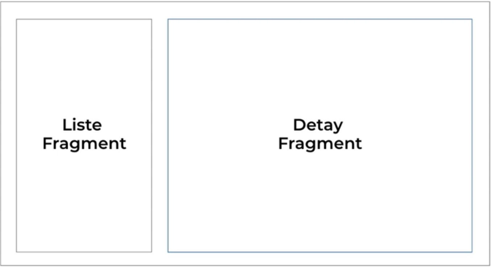
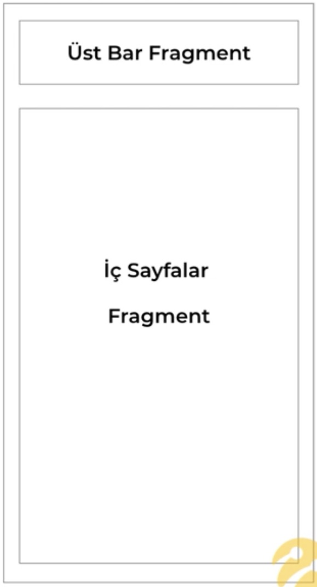
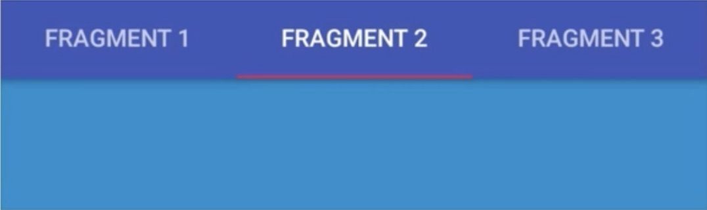
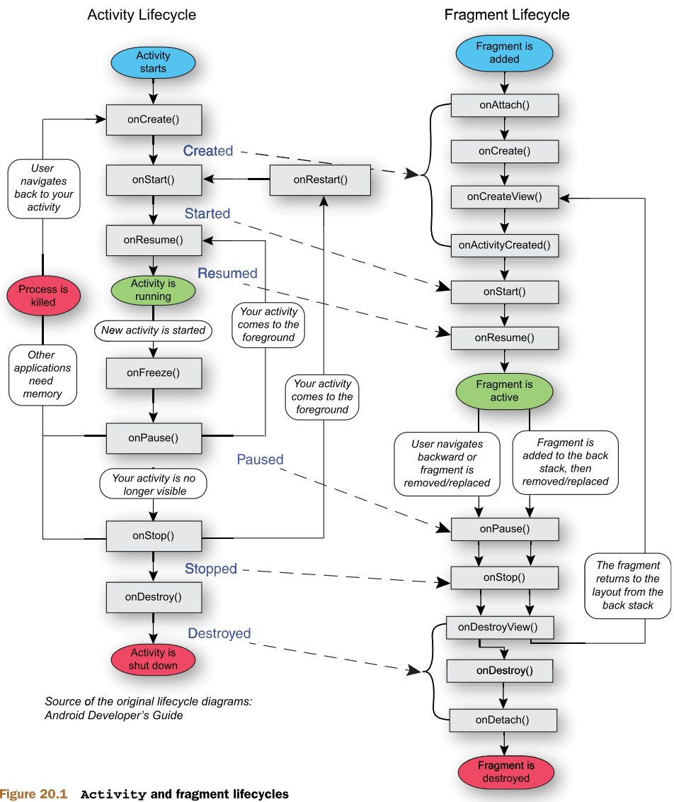

# Android Fragments

## Fragment Nedir?

Fragment'lar, bir Activity içerisinde kullanıcı arayüzünü daha küçük ve yeniden kullanılabilir parçalara ayırmamızı sağlayan yapılardır.

Bir Activity içerisinde birden fazla Fragment kullanılabilir. Bu sayede tek bir ekran içerisinde farklı işlevlere sahip bölümler oluşturabiliriz.

Fragment'lar kendi başlarına bağımsız bir Android uygulama bileşeni değildir. Yaşamlarını sürdürebilmeleri için bir Activity veya başka bir Fragment gibi bir host yapıya ihtiyaç duyarlar.

Fragment'lar, bağlı oldukları Activity içerisinde **FragmentManager** tarafından yönetilir. FragmentManager; Fragment'ların eklenmesi, kaldırılması, değiştirilmesi ve yaşam döngülerinin yönetilmesinden sorumludur.

**Güncel Android geliştirmelerinde** Fragment yönetimi için AndroidX Fragment kütüphanesi kullanılır. XML tabanlı arayüzlerde Fragment yerleştirmek için `FragmentContainerView` tercih edilir.

Her Fragment'ın kendine ait bir yaşam döngüsü bulunur. Ancak bu yaşam döngüsü bağlı olduğu Activity'nin yaşam döngüsünden bağımsız değildir.

**Güncel yaklaşım:** Jetpack Compose ile kullanıcı arayüzleri Fragment kullanmadan da oluşturulabilir. Ancak Fragment'lar mevcut View tabanlı uygulamalarda ve Activity içerisinde modüler ekranlar oluştururken hâlâ kullanılmaktadır.

## Çoklu Fragment Kullanımı

Bir Activity içerisinde birden fazla Fragment aynı anda kullanılabilir. Böylece tek bir ekran üzerinde farklı işlevlere sahip bölümleri birlikte gösterebiliriz.

Fragment'lar kendi arayüzlerini ve ilgili işlemlerini yönetirler. Birbirlerinin iç işleyişinden bağımsız olabilirler; ancak gerektiğinde Activity, ortak ViewModel veya Fragment Result API gibi mekanizmalar aracılığıyla iletişim kurabilirler.

### 1. Liste ve Detay Yapısı

Çoklu Fragment kullanımının özellikle tabletlerde sık karşılaşılan örneklerinden biri liste ve detay ekranlarıdır.

Ekranın bir tarafında listeyi gösteren bir Fragment, diğer tarafında ise seçilen öğenin detaylarını gösteren başka bir Fragment bulunabilir.

Kullanıcı soldaki listeden bir öğe seçtiğinde sağ taraftaki detay bölümü güncellenir. Böylece kullanıcı aynı anda hem listeyi hem de seçilen öğenin detaylarını görebilir.

<p align="center">
  
</p>

Bu yaklaşım yalnızca tabletlerle sınırlı değildir. Ekran boyutuna ve uygulamanın tasarımına bağlı olarak telefonlarda da farklı çoklu Fragment düzenleri kullanılabilir.

**Güncel Android geliştirmelerinde** bu tür düzenler, farklı ekran boyutlarına uyum sağlayan adaptive layout yaklaşımlarıyla da oluşturulabilir.

### 2. Sabit Bölümler ve İç Sayfalar

Bir uygulamada kullanıcının sürekli görmesini istediğimiz sabit bir bölüm olabilir.

Örneğin ekranın üst kısmında uygulama başlığını veya kullanıcı bilgilerini gösteren bir bölüm, alt kısmında ise değişen içerikler bulunabilir.

Bu durumda üst bölümü bir Fragment, alt bölümdeki içerikleri de farklı Fragment'lar olarak geliştirebiliriz.

<p align="center">
  
</p>

Bu sayede ortak kullanılan arayüz bölümlerini tekrar tekrar oluşturmak yerine yeniden kullanılabilir hâle getirebiliriz.

### 3. Tab Yapıları

Fragment'ların sık kullanıldığı alanlardan biri de Tab yapılarıdır.

Tab yapısında kullanıcı farklı sekmeler arasında geçiş yaparak farklı içeriklere erişebilir. Bu içerikler Fragment'lar aracılığıyla gösterilebilir.

Örneğin üç sekmeden oluşan bir uygulamada her sekme farklı bir Fragment ile temsil edilebilir.

<p align="center">
  
</p>

Tab yapıları genellikle ekranın üst bölümünde bulunur. Android'de bu yapı için `TabLayout` ve `ViewPager2` birlikte kullanılabilir.

### 4. Bottom Navigation

Tab yapısının bir başka yaygın kullanımı ekranın alt bölümünde bulunan Bottom Navigation yapısıdır.

Bottom Navigation, kullanıcının uygulamanın temel bölümleri arasında geçiş yapmasını sağlar.

Örneğin:

- Home
- Dashboard
- Notifications

<p align="center">
  
</p>

Bu yapıda `BottomNavigationView` kullanılarak sekmeler oluşturulabilir. Her sekmede farklı bir Fragment gösterilebilir.

**Güncel Android uygulamalarında** bu yapı için AndroidX Navigation Component ile birlikte `NavHostFragment` ve `BottomNavigationView` kullanılabilir. Navigation Component, ekran geçişlerini ve geri navigasyon yığınını yönetmeyi kolaylaştırır.

## Fragment Yaşam Döngüsü

Fragment'ların kendilerine ait bir yaşam döngüsü vardır. Bu yaşam döngüsü, Fragment'ın bir Activity'ye bağlanmasıyla başlar ve ilgili Fragment örneğinin yok edilmesiyle sona erer.

Fragment yaşam döngüsü, bağlı olduğu Activity'nin yaşam döngüsüyle ilişkilidir. Activity'nin durumu Fragment'ın ulaşabileceği yaşam döngüsü durumunu sınırlar.

Örneğin Activity durdurulduğunda içerisindeki Fragment'lar da Started veya Resumed durumunda kalamaz.

Aşağıdaki görselde Activity ve Fragment yaşam döngüleri arasındaki ilişki gösterilmektedir.

<p align="center">
  
</p>

### Fragment Lifecycle Metotları

#### 1. onAttach()

Fragment bir Activity'ye veya host Context'e bağlandığında çağrılır.

Bu aşamada Fragment, bağlı olduğu host ile ilişki kurmuş olur.

#### 2. onCreate()

Fragment ilk oluşturulduğunda çağrılır.

Fragment'a ait temel başlangıç işlemleri ve View'dan bağımsız durum verilerinin hazırlanması bu metotta gerçekleştirilebilir.

#### 3. onCreateView()

Fragment'ın kullanıcı arayüzünü oluşturduğu metottur.

XML tabanlı geliştirmede layout dosyası burada inflate edilerek Fragment'ın View hiyerarşisi oluşturulur.

```kotlin
override fun onCreateView(
    inflater: LayoutInflater,
    container: ViewGroup?,
    savedInstanceState: Bundle?
): View? {
    return inflater.inflate(
        R.layout.fragment_home,
        container,
        false
    )
}
```

#### 4. onViewCreated()

`onCreateView()` tarafından oluşturulan View hazır olduğunda çağrılır.

View bileşenlerinin hazırlanması, adapter'ların tanımlanması ve LiveData veya Flow gibi veri kaynaklarının gözlemlenmesi için uygun bir noktadır.

```kotlin
override fun onViewCreated(
    view: View,
    savedInstanceState: Bundle?
) {
    super.onViewCreated(view, savedInstanceState)

    // Initialize views and observe data
}
```

**Güncel Android notu:** Fragment'ın View yaşam döngüsü, Fragment'ın kendi yaşam döngüsünden ayrıdır. Bu nedenle View ile ilişkili veri gözlemlerinde `viewLifecycleOwner` kullanılmalıdır.

Örneğin:

```kotlin
viewModel.data.observe(viewLifecycleOwner) { data ->
    // Update UI
}
```

Böylece Fragment'ın View hiyerarşisi yok edildiğinde ilgili gözlem de uygun şekilde sona erer.

#### 5. onActivityCreated() — Eski API

2021 eğitimindeki yaşam döngüsü diyagramında `onActivityCreated()` metodu da bulunmaktadır.

Bu metot geçmişte Activity'nin `onCreate()` işlemi tamamlandıktan sonra Fragment'ın Activity ile ilişkili başlangıç işlemlerinde kullanılıyordu.

Ancak AndroidX Fragment 1.3.0 ile deprecated olarak işaretlenmiştir. Güncel geliştirmelerde bu metodun yerine:

- Fragment'ın temel başlangıç işlemleri için `onCreate()`.
- View oluşturulduktan sonraki işlemler için `onViewCreated()`.

kullanılmalıdır.

#### 6. onStart()

Fragment görünür hâle geldiğinde çağrılır.

Bu aşamada Fragment'ın kullanıcıya gösterilmesi için gerekli işlemler gerçekleştirilir.

#### 7. onResume()

Fragment kullanıcı etkileşimine hazır hâle geldiğinde çağrılır.

Fragment ön plana geldiğinde kullanıcı etkileşimlerini almaya başlayabilir.

#### 8. onPause()

Fragment ön plandaki etkileşim durumunu kaybettiğinde çağrılır.

Geçici olarak durdurulması gereken işlemler bu aşamada ele alınabilir.

#### 9. onStop()

Fragment artık görünür olmadığında çağrılır.

Görünürlük gerektiren işlemler durdurulabilir.

#### 10. onDestroyView()

Fragment'ın View hiyerarşisi yok edildiğinde çağrılır.

Fragment örneği yaşamaya devam etse bile View nesneleri yok edilebilir. Örneğin Fragment back stack içerisinde tutulurken View hiyerarşisi kaldırılabilir ve daha sonra yeniden oluşturulabilir.

Bu nedenle View referanslarının temizlenmesi önemlidir.

#### 11. onDestroy()

Fragment örneği yok edilmeden önce çağrılır.

Fragment'a ait sonlandırma işlemleri burada gerçekleştirilebilir.

#### 12. onDetach()

Fragment host Activity veya Context ile olan bağlantısını kaybettiğinde çağrılır.

Bu aşamada Fragment artık host yapıya bağlı değildir.

## Activity ve Fragment Yaşam Döngüsü Arasındaki İlişki

Fragment'lar bağlı oldukları Activity'nin yaşam döngüsünden etkilenir. Ancak Activity'nin yaşam döngüsü Fragment'ın yaşam döngüsüne doğrudan bağlı değildir.

Eğitimdeki diyagramda gösterilen genel başlangıç sırası şöyledir:

```text
Activity.onCreate()
    ↓
Fragment.onAttach()
    ↓
Fragment.onCreate()
    ↓
Fragment.onCreateView()
    ↓
Fragment.onActivityCreated()  [Eski API]
    ↓
Activity.onStart()
    ↓
Fragment.onStart()
    ↓
Activity.onResume()
    ↓
Fragment.onResume()
```

Bu sıralama, eğitimdeki eski yaşam döngüsü diyagramını anlamak için korunmuştur. Güncel AndroidX Fragment geliştirmelerinde `onActivityCreated()` adımı bulunmaz; onun yerine `onViewCreated()` kullanılır.

Activity duraklatıldığında ve durdurulduğunda Fragment da uygun yaşam döngüsü aşamalarına geçer.

Fragment kaldırıldığında veya ilgili View hiyerarşisi yok edildiğinde ise View ve Fragment yaşam döngülerinin sonlandırma adımları gerçekleşir.

**Önemli:** Gerçek callback sırası Fragment'ın eklenme, kaldırılma, gizlenme ve geri yığınında tutulma durumuna göre değişebilir.

## Özet

Fragment'lar, Android uygulamalarında kullanıcı arayüzünü modüler ve yeniden kullanılabilir parçalara ayırmamızı sağlar.

Bu bölümde ele alınan temel kavramlar:

- **Fragment:** Activity içerisinde kullanılabilen, kendi yaşam döngüsüne sahip arayüz bileşeni.
- **FragmentManager:** Fragment'ların eklenmesini, kaldırılmasını ve yönetilmesini sağlayan yapı.
- **Multiple Fragments:** Tek Activity içerisinde birden fazla Fragment kullanılması.
- **TabLayout:** Üst sekme yapısı oluşturmak için kullanılan bileşen.
- **BottomNavigationView:** Ekranın alt bölümünde navigasyon sunan bileşen.
- **Fragment Lifecycle:** Fragment'ın oluşturulmasından yok edilmesine kadar geçen süreç.
- **View Lifecycle:** Fragment'ın View hiyerarşisinin yaşam döngüsü.

Fragment'ların yaşam döngüsünü anlamak, özellikle ekran geçişlerinde, veri paylaşımında ve kaynak yönetiminde doğru uygulamalar geliştirmek açısından önemlidir.

## Kaynaklar

- [Fragments | Android Developers](https://developer.android.com/guide/fragments)
- [Fragment Lifecycle | Android Developers](https://developer.android.com/guide/fragments/lifecycle)
- [Fragment API Reference](https://developer.android.com/reference/androidx/fragment/app/Fragment)
- [FragmentManager | Android Developers](https://developer.android.com/reference/androidx/fragment/app/FragmentManager)
- [Navigation Component | Android Developers](https://developer.android.com/guide/navigation)
- [TabLayout | Android Developers](https://developer.android.com/reference/com/google/android/material/tabs/TabLayout)
- [BottomNavigationView | Android Developers](https://developer.android.com/reference/com/google/android/material/bottomnavigation/BottomNavigationView)
- [Jetpack Compose | Android Developers](https://developer.android.com/compose)