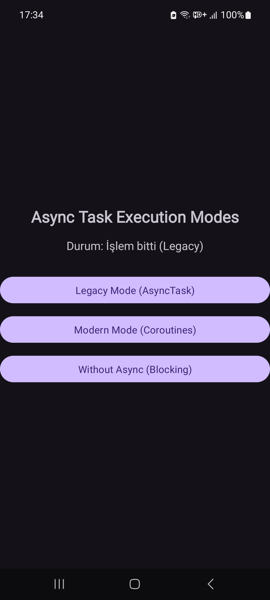

# AsyncTaskBasics

Bu proje, Android uygulamalarında uzun süren işlemlerin ana iş parçacığını (Main Thread) nasıl etkilediğini ve arka plan işlemlerinin nasıl yönetilebileceğini ele alır.

Uygulamada üç farklı çalışma modeli karşılaştırılır:

- **Legacy:** Android'in eski `AsyncTask` yaklaşımı.
- **Modern:** Kotlin Coroutines ile arka plan işlemlerinin yönetilmesi.
- **Without Async:** Asenkron işlem kullanmadan ana iş parçacığında bekleme.

Modern yaklaşım olarak Kotlin Coroutines kullanılmıştır. Özellikle `lifecycleScope`, `Dispatchers.IO` ve `withContext()` yapıları üzerinde durulmuştur.

## Ekran Görüntüsü

<p align="center">
    
</p>

## Ele Alınan Konular

- Main Thread ve Background Thread
- Senkron ve asenkron işlemler
- `AsyncTask` ve yaşam döngüsü metotları
- Kotlin Coroutines
- `lifecycleScope`
- `Dispatchers.IO`
- `withContext()`
- `launch()`
- Coroutine lifecycle yönetimi
- UI Thread üzerinde arka plan işlemlerinin etkisi

## 1. Main Thread Nedir?

Android uygulamalarında kullanıcı arayüzünün çizilmesi, kullanıcı etkileşimlerinin işlenmesi ve UI güncellemeleri Main Thread üzerinde gerçekleşir.

Main Thread üzerinde uzun süren işlemler çalıştırılırsa uygulamanın arayüzü yanıt veremez hale gelebilir. Bu durum kullanıcı etkileşimlerinin gecikmesine ve uygulamanın donmuş gibi görünmesine neden olur.

Örneğin bir ağ isteği, büyük bir dosya okuma işlemi veya yoğun bir hesaplama doğrudan Main Thread üzerinde çalıştırılmamalıdır.

Bu tür işlemler uygun bir arka plan iş parçacığında yürütülmeli, arayüz güncellemeleri ise Main Thread üzerinde yapılmalıdır.

## 2. Senkron İşlem: Without Async

Projede senkron işlem davranışını göstermek için `Thread.sleep()` doğrudan Main Thread üzerinde çağrılmıştır.

```kotlin
ExecutionMode.WITHOUT_ASYNC -> {
    tvStatus.text = "Durum: Async olmadan çalışıyor (UI Bloklu)..."

    Toast.makeText(this, "pre call", Toast.LENGTH_SHORT).show()

    Thread.sleep(5000)

    Toast.makeText(this, "Çağrım yapıldı (Sync)", Toast.LENGTH_SHORT).show()

    onFinishTask("İşlem bitti (Without Async)")
}
```

`Thread.sleep(5000)`, mevcut thread'i yaklaşık 5 saniye boyunca bekletir.

Bu örnekte kod Main Thread üzerinde çalıştığı için arayüz de bu süre boyunca yeni çizim ve kullanıcı etkileşimlerini işleyemez.

Buradaki önemli ayrım şudur:

- **Senkron işlem:** Mevcut işlem tamamlanmadan sonraki kod satırlarına geçilmez.
- **Asenkron işlem:** Uzun süren iş yürütülürken ana akış diğer işlerini sürdürebilir.

Bu mod, arka plan işlemi kullanılmadığında ortaya çıkabilecek UI bloklanmasını gözlemlemek için eklenmiştir.

## 3. Legacy Yaklaşım: AsyncTask

`AsyncTask`, Android'de arka plan işlemlerini daha kolay yönetmek ve sonuçlarını UI Thread'e aktarmak amacıyla geliştirilmiş bir sınıftır.

Projede `BackgroundTask` isimli bir inner class tanımlanmıştır:

```kotlin
internal class BackgroundTask(
    activity: Activity
) : AsyncTask<Void, Void, String>() {

    var activity: Activity

    init {
        this.activity = activity
    }

    override fun onPreExecute() {
        super.onPreExecute()
    }

    override fun doInBackground(
        vararg params: Void?
    ): String? {
        Thread.sleep(5000)
        return "İşlem bitti (Legacy)"
    }

    override fun onPostExecute(result: String?) {
        super.onPostExecute(result)

        (activity as MainActivity).onFinishTask(result!!)
    }
}
```

### AsyncTask Generic Parametreleri

`AsyncTask<Params, Progress, Result>` üç generic parametre alır:

| Parametre  | Açıklama                                             |
| ---------- | ---------------------------------------------------- |
| `Params`   | Arka plan işlemine gönderilen parametreler           |
| `Progress` | İşlem devam ederken yayınlanabilecek ilerleme verisi |
| `Result`   | İşlem tamamlandığında döndürülen sonuç               |

Projede `AsyncTask<Void, Void, String>` kullanılmıştır. Yani işlem parametre almamakta, ilerleme bilgisi yayınlamamakta ve sonuç olarak String döndürmektedir.

### AsyncTask Yaşam Döngüsü

- `onPreExecute()`: Arka plan işlemi başlamadan önce Main Thread üzerinde çalışır.
- `doInBackground()`: Arka plan thread'i üzerinde çalışır.
- `onProgressUpdate()`: `publishProgress()` ile gönderilen ilerleme bilgisini Main Thread üzerinde işler.
- `onPostExecute()`: Arka plan işlemi tamamlandığında sonucu Main Thread üzerinde karşılar.

Bu projede `onProgressUpdate()` kullanılmamıştır.

İşlemi başlatmak için:

```kotlin
BackgroundTask(this).execute()
```

İşlem tamamlandığında `onPostExecute()` içerisinden `onFinishTask()` çağrılır ve ekrandaki durum güncellenir.

### AsyncTask Neden Deprecated Oldu?

`AsyncTask`, Android API 30 ile deprecated olarak işaretlenmiştir.

Başlıca problemleri:

- Activity veya Context referanslarının tutulması bellek sızıntısına neden olabilir.
- Ekran döndürme gibi configuration change durumlarında Activity yeniden oluşturulabilir ve eski task eski Activity referansını tutabilir.
- Callback'lerin Activity yaşam döngüsünden bağımsız kalması yönetimi zorlaştırır.
- İptal ve hata yönetimi yeterince esnek değildir.
- Modern concurrency araçlarına göre daha sınırlı bir yapı sunar.

Bu projedeki örnekte `BackgroundTask` doğrudan Activity referansı tutmaktadır. Bu, AsyncTask'ın yaşam döngüsüyle ilgili risklerini göstermek açısından da önemlidir.

**Not:** AsyncTask tarihsel ve eğitim amaçlı olarak incelenmelidir. Yeni Android uygulamalarında tercih edilmemelidir.

## 4. Modern Yaklaşım: Kotlin Coroutines

Kotlin Coroutines, uzun süren işlemleri asenkron biçimde yönetmek için kullanılan modern bir concurrency yapısıdır.

Callback zincirleri oluşturmadan, ardışık işlemleri daha okunabilir bir kod akışıyla yazmayı sağlar.

Projede Coroutines kullanımı için `lifecycleScope` tercih edilmiştir.

```kotlin
ExecutionMode.MODERN -> {
    tvStatus.text = "Durum: Modern Coroutines çalışıyor..."

    Toast.makeText(
        this,
        "Çağrım yapıldı (Modern)",
        Toast.LENGTH_SHORT
    ).show()

    lifecycleScope.launch {
        val result = withContext(Dispatchers.IO) {
            Thread.sleep(5000)
            "İşlem bitti (Modern)"
        }

        onFinishTask(result)
    }
}
```

Bu kodda üç önemli yapı bulunur:

### lifecycleScope

`lifecycleScope`, AndroidX Lifecycle kütüphanesi tarafından sağlanan bir CoroutineScope'tur.

```kotlin
lifecycleScope.launch {
    // Coroutine işlemleri
}
```

Bu scope, bağlı olduğu Activity veya Fragment'ın yaşam döngüsüne göre yönetilir.

Activity `DESTROYED` durumuna geldiğinde bu scope içerisinde başlatılmış ve hâlâ çalışan coroutine'ler otomatik olarak iptal edilir.

Böylece Activity sona erdikten sonra ona bağlı işlemlerin gereksiz yere devam etmesi engellenir.

### launch()

`launch()` yeni bir coroutine başlatmak için kullanılır.

```kotlin
lifecycleScope.launch {
    // Asenkron işlemler
}
```

`launch()` bir `Job` döndürür. Bu Job üzerinden coroutine'in iptal edilmesi veya durumunun takip edilmesi mümkündür.

Projede `launch()` içerisinde önce arka plan işlemi yürütülür, ardından elde edilen sonuç UI üzerinde gösterilir.

### Dispatchers.IO

Coroutine'lerin hangi dispatcher üzerinde çalışacağını belirlemek için kullanılır.

`Dispatchers.IO`, dosya okuma-yazma ve ağ erişimi gibi I/O ağırlıklı işlemler için tasarlanmıştır.

```kotlin
withContext(Dispatchers.IO) {
    Thread.sleep(5000)
    "İşlem bitti (Modern)"
}
```

Bu blok içerisindeki işlem IO dispatcher üzerinde yürütülür. Böylece Main Thread bloke edilmez.

### withContext()

`withContext()`, coroutine'in belirli bir dispatcher veya context üzerinde devam etmesini sağlar.

```kotlin
val result = withContext(Dispatchers.IO) {
    // Background işlem
}
```

Burada `withContext()` ile IO dispatcher'a geçilir. Blok tamamlandığında coroutine çağrıldığı context üzerinde devam eder.

Projede `lifecycleScope.launch` Main Thread üzerinde başlatıldığı için `withContext(Dispatchers.IO)` tamamlandıktan sonra kod yeniden Main Thread üzerinde yürütülür.

Bu nedenle `onFinishTask(result)` çağrısı güvenli biçimde UI güncellemesi yapabilir.

## 5. UI Güncellemesini Gerçekleştirmek

Her üç çalışma modunda işlem tamamlandığında ortak olarak `onFinishTask()` metodu çağrılır.

```kotlin
fun onFinishTask(string: String) {
    tvStatus.text = "Durum: $string"

    Toast.makeText(
        this,
        string,
        Toast.LENGTH_SHORT
    ).show()
}
```

Bu metot TextView içeriğini günceller ve kullanıcıya Toast mesajı gösterir.

Modern coroutine akışında `withContext(Dispatchers.IO)` sonrasında Main Thread'e dönüldüğü için UI güncellemesi gerçekleştirilebilir.

## 6. Üç Çalışma Modelinin Karşılaştırılması

| Özellik                | Without Async                  | AsyncTask         | Coroutines                               |
| ---------------------- | ------------------------------ | ----------------- | ---------------------------------------- |
| İşlem thread'i         | Main Thread                    | Background Thread | Dispatcher'a göre                        |
| UI bloke olur mu?      | Evet                           | Hayır             | Hayır (uygun dispatcher kullanıldığında) |
| Sonuç işleme           | Aynı akışta                    | `onPostExecute()` | `withContext()` sonrasında               |
| Yaşam döngüsü yönetimi | Manuel                         | Manuel            | `lifecycleScope` ile                     |
| Güncel kullanım        | Uzun işlemler için uygun değil | Deprecated        | Önerilen yaklaşım                        |

## 7. Önemli: Coroutine ve Thread Aynı Şey Değildir

Coroutine, doğrudan yeni bir thread oluşturmak anlamına gelmez.

Coroutine'ler mevcut thread'ler üzerinde çalıştırılabilir ve dispatcher aracılığıyla hangi thread havuzunun kullanılacağı belirlenebilir.

Bu nedenle:

- `launch()` coroutine başlatır.
- `Dispatchers.IO` I/O işlemleri için uygun thread havuzunu sağlar.
- `withContext()` çalışma context'ini geçici olarak değiştirir.
- Coroutine'in askıya alınabilmesi, thread'in gereksiz yere bloklanmasını önlemeye yardımcı olur.

Projede `Thread.sleep(5000)` kullanıldığı için IO dispatcher üzerindeki thread beş saniye boyunca bloke edilir. Gerçek uygulamalarda coroutine tabanlı bekleme gereken durumlarda `delay()` tercih edilir.

Örneğin:

```kotlin
lifecycleScope.launch {
    val result = withContext(Dispatchers.IO) {
        delay(5000)
        "İşlem bitti"
    }

    onFinishTask(result)
}
```

`delay()` coroutine'i askıya alır; thread'i bloke etmez.

Ancak gerçek dosya veya ağ işlemleri gibi bloklayıcı API'ler kullanılıyorsa uygun dispatcher üzerinde çalıştırılmaları gerekir.

## 8. Projedeki Önemli Bir İyileştirme Notu

Projede modern coroutine akışı Activity'nin `lifecycleScope`'u ile yönetilmektedir. Activity yok edildiğinde coroutine iptal edilir.

Bununla birlikte `Thread.sleep()` iptal edilebilir bir coroutine bekleme fonksiyonu değildir. Coroutine iptal edilse bile çalışan thread üzerindeki `Thread.sleep()` beklemesi otomatik olarak sona ermez.

Gerçek coroutine tabanlı bekleme için `delay()` kullanılmalıdır. Uzun süren işlemlerde ayrıca iptal edilebilirlik ve hata yönetimi de tasarlanmalıdır.

Bu örnek, coroutine kullanımı için temel bir gösterimdir. Gerçek projelerde iş mantığının Activity yerine ViewModel veya Repository katmanlarında tutulması tercih edilir. Ekran durumunu ViewModel üzerinden yönetmek için `viewModelScope` kullanılabilir.

## Öğrenilenler

- Android Main Thread ve Background Thread arasındaki fark
- Senkron işlemlerin UI üzerindeki etkisi
- AsyncTask'ın çalışma modeli ve yaşam döngüsü metotları
- AsyncTask'ın neden deprecated olduğu
- Kotlin Coroutines ile asenkron işlemler
- `lifecycleScope` ile yaşam döngüsüne bağlı coroutine yönetimi
- `Dispatchers.IO` ile I/O işlemlerini arka plan thread'lerinde yürütmek
- `withContext()` ile dispatcher değiştirmek
- `launch()` ile coroutine başlatmak
- Coroutine ve Thread arasındaki fark

## Kullanılan Teknolojiler

- Kotlin
- Android SDK
- Kotlin Coroutines
- AndroidX Lifecycle Runtime KTX
- AndroidX AppCompat
- AndroidX Core
- ConstraintLayout
- XML Layouts
