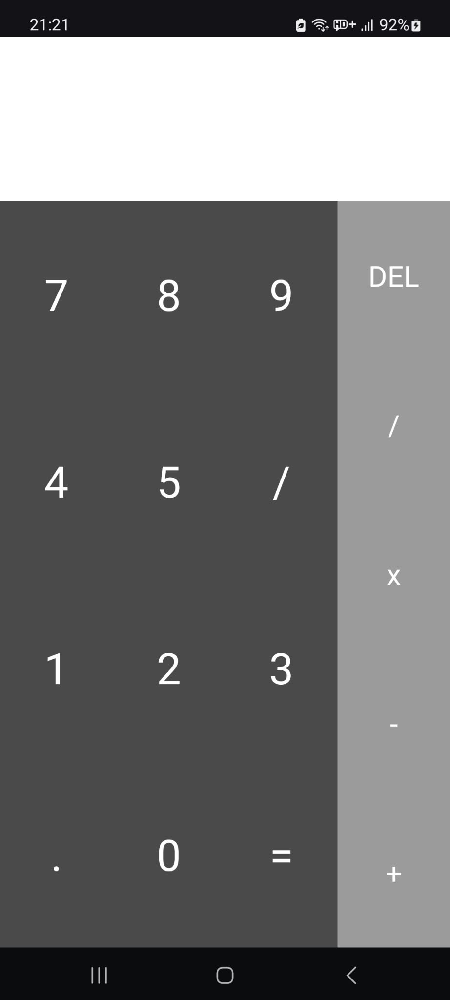

# Calculator UI

Bu uygulama, Android arayüz geliştirme sürecinde ConstraintLayout ve Constraint kullanımını pekiştirmek amacıyla hazırlanmış bir hesap makinesi arayüzü çalışmasıdır.

Arayüz, XML Layout ve Android Studio kullanılarak oluşturulmuştur.

## Ekran Görüntüsü

<p align="center">
  
</p>

## Konu: ConstraintLayout ve Constraints

Android uygulamalarında farklı ekran boyutlarına ve cihaz özelliklerine uyum sağlayan arayüzler oluşturmak için ConstraintLayout kullanılır.

ConstraintLayout, arayüz bileşenlerinin konumlarını ve boyutlarını sabit koordinatlar yerine birbirleriyle veya kapsayıcı görünümleriyle tanımlanan ilişkiler üzerinden belirler.

### Constraints Nedir?

Constraints, arayüz bileşenlerinin konumunu ve boyutunu belirleyen kurallardır.

Bir View bileşeninin başka bir View'a veya parent layout'a göre nerede konumlanacağını, genişliğini, yüksekliğini veya hizalamasını tanımlamak için kullanılır.

Başlıca constraint türleri:

| Constraint | Açıklama |
| --- | --- |
| Start / End | View bileşeninin yatay başlangıç ve bitiş konumlarını belirler. |
| Top / Bottom | View bileşeninin dikey başlangıç ve bitiş konumlarını belirler. |
| Width / Height | View bileşeninin genişliğini ve yüksekliğini belirler. |
| Center | View bileşenini yatay veya dikey eksende ortalamaya yardımcı olur. |
| Bias | Constraint ile sınırlandırılmış bir bileşenin iki bağlantı arasındaki konumunu belirler. |
| Baseline | Metin içeren bileşenlerin yazı taban çizgilerini hizalar. |

### Constraint İlişkileri

Constraints yalnızca sabit mesafeler tanımlamak için kullanılmaz. View bileşenleri arasında boyut ve konum ilişkileri de kurulabilir.

Örneğin:

- Bir butonun genişliği başka bir butonun genişliğine eşitlenebilir.
- Bir View bileşeninin yüksekliği başka bir View bileşeninin yüksekliğine bağlanabilir.
- Bir bileşenin başlangıç ve bitiş noktaları parent layout'a bağlanarak kullanılabilir alanı kaplaması sağlanabilir.
- Bir bileşenin konumu başka bir bileşenin konumuna göre belirlenebilir.

Bu ilişkiler sayesinde ekran bileşenleri birbirleriyle orantılı şekilde konumlandırılabilir ve boyutlandırılabilir.

### Guideline

Guideline, ConstraintLayout içerisinde görünmez referans çizgileri oluşturmak için kullanılan bir yardımcı bileşendir.

Diğer View bileşenleri bu çizgilere constraint verilerek konumlandırılabilir.

Guideline iki farklı yönde tanımlanabilir:

- **Vertical:** Dikey referans çizgisi oluşturur.
- **Horizontal:** Yatay referans çizgisi oluşturur.

Konumlandırma için aşağıdaki değerler kullanılabilir:

- **Begin:** Başlangıç noktasından itibaren sabit mesafe belirler.
- **End:** Bitiş noktasından itibaren sabit mesafe belirler.
- **Percent:** Parent layout'un boyutuna göre oransal konum belirler.

Bu projede dikey Guideline bileşenleri kullanılarak ekran yatay olarak dört eşit bölüme ayrılmıştır.

```xml
<androidx.constraintlayout.widget.Guideline
    android:id="@+id/guideline25"
    android:orientation="vertical"
    app:layout_constraintGuide_percent="0.25" />
```

Burada `layout_constraintGuide_percent="0.25"` değeri, Guideline'ın parent layout genişliğinin %25'i konumunda yer almasını sağlar.

Aynı yöntemle %50 ve %75 konumlarında iki Guideline daha oluşturulmuştur.

### Percent-Based Positioning

ConstraintLayout, View bileşenlerinin konumlarını ve boyutlarını parent layout'a göre oransal olarak belirlemeye olanak tanır.

Bu yaklaşım sayesinde sabit ekran koordinatları yerine ekran boyutuna bağlı yerleşimler oluşturulabilir.

Bu projede Guideline bileşenleri kullanılarak hesap makinesi butonlarının yerleşimi dört sütuna ayrılmıştır.

Böylece sayı ve işlem butonlarının bulunduğu alanlar ekran genişliğine göre düzenlenmiştir.

### Match Constraints (0dp)

ConstraintLayout içerisinde bir View bileşeninin genişliğini veya yüksekliğini constraint ilişkilerine göre belirlemek için `0dp` değeri kullanılır.

Bu değer, bileşenin ilgili boyutunun constraint'ler tarafından belirlenmesini sağlar.

Bu projede:

- Sonuç alanının genişliği parent layout'un başlangıç ve bitiş noktalarına bağlanmıştır.
- Buton gruplarının genişlikleri Guideline bileşenleri arasındaki mesafeye göre belirlenmiştir.
- Buton gruplarının yükseklikleri ekranın kullanılabilir alanına göre düzenlenmiştir.

### ConstraintLayout ve Farklı Ekran Boyutları

Farklı Android cihazlarının ekran boyutları ve kullanılabilir alanları birbirinden farklıdır.

ConstraintLayout, tanımlanan constraint kurallarına göre arayüz bileşenlerinin boyutlarını ve konumlarını yeniden hesaplar.

Guideline ve yüzde bazlı konumlandırma gibi özellikler, ekranın farklı boyutlarına uyum sağlayan düzenler oluşturmayı kolaylaştırır.

Ancak yalnızca constraint eklemek her ekran boyutunda kusursuz bir görünüm garantilemez. Constraint ilişkilerinin doğru kurulması ve farklı cihazlarda test edilmesi gerekir.

## Uygulama Arayüzü

Hesap makinesi arayüzü aşağıdaki bileşenlerden oluşur:

- **Display:** İşlem sonucunun gösterildiği alan.
- **Number Buttons:** 0–9 arasındaki sayısal tuşlar.
- **Operator Buttons:** Toplama, çıkarma, çarpma ve bölme işlemlerini temsil eden butonlar.
- **Utility Button:** Son karakteri silmek için kullanılan DEL butonu.
- **Decimal Button:** Ondalık sayı girişini temsil eden nokta butonu.
- **Equal Button:** Eşittir butonu.

### Uygulanan Constraint İlişkileri

- Sonuç alanı ekranın üst bölümüne yerleştirilmiştir.
- Sonuç alanının genişliği parent layout'un genişliğine bağlanmıştır.
- Dikey Guideline bileşenleri kullanılarak ekran dört eşit sütuna ayrılmıştır.
- Sayısal tuşların bulunduğu LinearLayout bileşenleri Guideline'lar arasına yerleştirilmiştir.
- İşlem butonları ekranın sağ bölümünde konumlandırılmıştır.
- Buton gruplarının yükseklikleri parent layout'un kullanılabilir alanına göre belirlenmiştir.

### LinearLayout ve Layout Weight

Hesap makinesi butonları, dikey yönlendirmeye sahip LinearLayout bileşenleri içerisinde gruplanmıştır.

`layout_weight` özelliği kullanılarak butonların container içerisindeki kullanılabilir yüksekliği eşit şekilde paylaşması sağlanmıştır.

Böylece aynı sütundaki butonların yükseklikleri birbirleriyle eşit olacak şekilde düzenlenmiştir.

## Kullanılan Teknolojiler

- Kotlin
- Android SDK
- Android Studio
- XML Layout
- ConstraintLayout
- Guideline
- LinearLayout

## Öğrenilenler

- ConstraintLayout çalışma mantığı
- Constraint türleri ve kullanım alanları
- View bileşenleri arasında boyut ve konum ilişkileri kurma
- Guideline kullanımı
- Yüzde bazlı konumlandırma
- Match Constraints (`0dp`) kullanımı
- LinearLayout ve layout_weight kullanımı
- ConstraintLayout ile farklı ekran boyutlarına uyum sağlayan arayüzler oluşturma