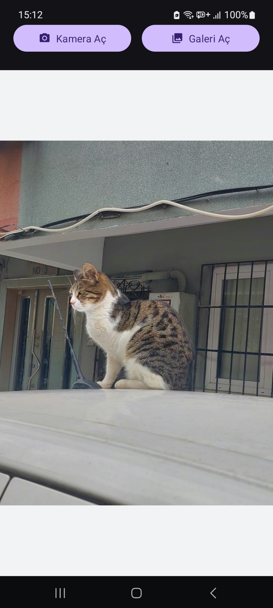

# Camera and Gallery

Bu proje, Android uygulamalarında cihaz kamerasını kullanarak fotoğraf çekmeyi ve galeriden görsel seçerek ekranda göstermeyi ele alır.

Kullanıcı, kamera veya galeri seçeneklerinden birini kullanarak görseli `ImageView` üzerinde görüntüleyebilir. Projede ayrıca eski Android geliştirme yaklaşımı ile güncel Activity Result API karşılaştırmalı olarak uygulanmıştır.

## Ekran Görüntüsü

<p align="center">
  
</p>

## Ele Alınan Konular

- Kamera ve galeri entegrasyonu
- Android Runtime Permissions
- Activity Result API
- `ActivityResultContracts.GetContent`
- `ActivityResultContracts.TakePicture`
- `ActivityResultContracts.RequestPermission`
- `FileProvider` ve güvenli dosya paylaşımı
- `Uri` ve `content://` URI yapısı
- `Bitmap`, `BitmapFactory` ve `ImageView`
- EXIF metadata ve görsel yönünün düzeltilmesi
- Eski `startActivityForResult()` ve `onActivityResult()` yaklaşımı

## 1. Galeriden Görsel Seçmek

Modern uygulamada galeri seçimi için `ActivityResultContracts.GetContent()` kullanılmıştır.

```kotlin
private val pickImageLauncher = registerForActivityResult(
    ActivityResultContracts.GetContent()
) { uri: Uri? ->
    uri?.let {
        imageView.setImageURI(it)
    }
}
```

Galeriyi açmak için:

```kotlin
pickImageLauncher.launch("image/*")
```

`image/*` MIME type ifadesi, kullanıcının yalnızca görsel içerik seçmesini sağlar.

Kullanıcı bir görsel seçtiğinde callback içerisinde `Uri` döndürülür. Kullanıcı seçim ekranını iptal ederse `null` döner.

`ImageView.setImageURI()` metodu, döndürülen URI üzerinden görselin görüntülenmesini sağlar.

### Galeri izinleri

Uygulamanın galeriye erişim yaklaşımı Android sürümüne göre farklılık gösterir.

Projede kullanılan modern akışta:

- Android 13 (API 33) ve sonrasında `GetContent()` doğrudan başlatılır.
- Android 12L (API 32) ve öncesinde `READ_EXTERNAL_STORAGE` izni kontrol edilir.

Android 13 ve sonrasında sistem görsel seçicisi, uygulamanın tüm galeriye erişmesine gerek kalmadan kullanıcının seçtiği görsele erişim sağlar.

```kotlin
private fun openGallery() {
    if (Build.VERSION.SDK_INT >= Build.VERSION_CODES.TIRAMISU) {
        pickImageLauncher.launch("image/*")
    } else {
        if (ContextCompat.checkSelfPermission(
                this,
                Manifest.permission.READ_EXTERNAL_STORAGE
            ) == PackageManager.PERMISSION_GRANTED
        ) {
            pickImageLauncher.launch("image/*")
        } else {
            requestGalleryPermissionLauncher.launch(
                Manifest.permission.READ_EXTERNAL_STORAGE
            )
        }
    }
}
```

İzin isteme işlemi:

```kotlin
private val requestGalleryPermissionLauncher = registerForActivityResult(
    ActivityResultContracts.RequestPermission()
) { isGranted ->
    if (isGranted) {
        pickImageLauncher.launch("image/*")
    } else {
        Toast.makeText(
            this,
            "Galeri erişim izni reddedildi",
            Toast.LENGTH_SHORT
        ).show()
    }
}
```

Burada `RequestPermission()` tek bir izin istemek için kullanılan Activity Result sözleşmesidir.

## 2. Kamera ile Fotoğraf Çekmek

Kamera işlemi için `ActivityResultContracts.TakePicture()` kullanılmıştır.

Bu sözleşme, çekilen fotoğrafın belirtilen `Uri` konumuna kaydedilmesini sağlar ve işlemin başarılı olup olmadığını `Boolean` olarak döndürür.

```kotlin
private val takePictureLauncher = registerForActivityResult(
    ActivityResultContracts.TakePicture()
) { success ->
    if (success) {
        tempFilePath?.let { path ->
            val image = getCorrectlyOrientedBitmap(path)

            image?.let {
                imageView.setImageBitmap(it)
            }
        }
    }
}
```

Fotoğraf çekimi başlamadan önce kaydedilecek dosyanın oluşturulması gerekir.

```kotlin
private fun launchCamera() {
    val directory = getExternalFilesDir(Environment.DIRECTORY_PICTURES)
        ?: return

    val tempImageFile = File.createTempFile(
        "captured_image_",
        ".jpg",
        directory
    )

    tempFilePath = tempImageFile.absolutePath

    val imageUri = FileProvider.getUriForFile(
        this,
        "${packageName}.fileprovider",
        tempImageFile
    )

    takePictureLauncher.launch(imageUri)
}
```

Bu örnekte dosya, uygulamanın harici uygulama dosyaları dizinindeki Pictures klasöründe oluşturulur.

### FileProvider Nedir?

Android'de bir uygulamanın özel dosya yolunu başka bir uygulamayla doğrudan paylaşması güvenli değildir.

`FileProvider`, dosyanın doğrudan `file://` adresini paylaşmak yerine güvenli bir `content://` URI oluşturulmasını sağlar.

Kamera uygulaması bu URI üzerinden fotoğrafı ilgili dosyaya kaydedebilir.

Manifest içerisinde provider tanımı yapılır:

```xml
<provider
    android:authorities="${applicationId}.fileprovider"
    android:name="androidx.core.content.FileProvider"
    android:exported="false"
    android:grantUriPermissions="true">

    <meta-data
        android:name="android.support.FILE_PROVIDER_PATHS"
        android:resource="@xml/file_provider_paths" />
</provider>
```

`file_provider_paths.xml`:

```xml
<paths>
    <external-files-path
        name="external_files"
        path="Pictures/" />
</paths>
```

Buradaki `external-files-path`, uygulamanın kendi external files alanındaki Pictures dizinini FileProvider aracılığıyla paylaşılabilir hale getirir.

`android:exported="false"` provider'ın diğer uygulamalar tarafından doğrudan keşfedilmesini engeller. `grantUriPermissions="true"` ise URI için geçici erişim izni verilmesine olanak tanır.

## 3. Kamera İzni

Projede kamera işlemi başlatılmadan önce `Manifest.permission.CAMERA` izni kontrol edilir.

İlk olarak `ContextCompat.checkSelfPermission()` ile uygulamanın kamera iznine sahip olup olmadığı kontrol edilir:

```kotlin
private fun openCamera() {
    if (ContextCompat.checkSelfPermission(
            this,
            Manifest.permission.CAMERA
        ) == PackageManager.PERMISSION_GRANTED
    ) {
        launchCamera()
    } else {
        requestCameraPermissionLauncher.launch(
            Manifest.permission.CAMERA
        )
    }
}
```

İzin zaten verilmişse `launchCamera()` çağrılarak fotoğraf çekme işlemi başlatılır. İzin verilmemişse `ActivityResultContracts.RequestPermission()` üzerinden kullanıcıdan izin istenir.

```kotlin
private val requestCameraPermissionLauncher = registerForActivityResult(
    ActivityResultContracts.RequestPermission()
) { isGranted ->
    if (isGranted) {
        launchCamera()
    } else {
        Toast.makeText(
            this,
            "Kamera izni reddedildi",
            Toast.LENGTH_SHORT
        ).show()
    }
}
```

İzin sonucuna göre iki farklı akış gerçekleşir:

- **İzin verilirse:** `launchCamera()` çalışır, geçici fotoğraf dosyası oluşturulur ve `FileProvider` aracılığıyla elde edilen URI, `TakePicture()` launcher'ına gönderilir.
- **İzin reddedilirse:** Kamera işlemi başlatılmaz ve kullanıcıya Toast mesajı gösterilir.

Bu projede kamera donanımına doğrudan erişmek yerine Android'in kamera uygulaması `TakePicture()` sözleşmesiyle açılır. Bununla birlikte örnekte `CAMERA` izni özellikle kontrol edilerek Runtime Permission süreci gösterilmiştir.

**Android geliştirme notu:** `TakePicture()` harici kamera uygulamasını başlatan bir sözleşmedir. Yalnızca bu yöntemi kullanan uygulamaların genellikle `CAMERA` izni istemesine gerek yoktur. İzin gereksinimi, kameraya doğrudan erişen CameraX veya Camera2 gibi API'ler kullanıldığında ortaya çıkar. Dolayısıyla bu projedeki izin kontrolü eğitim amaçlıdır; üretim uygulamasında gereksiz izin istemekten kaçınılmalıdır.

## 4. Fotoğrafın Yönünü Düzeltmek: EXIF

Kamera tarafından oluşturulan fotoğraflarda yön bilgisi her zaman piksel verisine fiziksel olarak uygulanmış olmayabilir. Görselin doğru yönde gösterilmesi için EXIF metadata kontrol edilebilir.

Projede `ExifInterface` ile fotoğrafın orientation bilgisi okunur.

```kotlin
private fun getCorrectlyOrientedBitmap(filePath: String): Bitmap? {
    val bitmap = BitmapFactory.decodeFile(filePath)
        ?: return null

    return try {
        val exif = ExifInterface(filePath)

        val orientation = exif.getAttributeInt(
            ExifInterface.TAG_ORIENTATION,
            ExifInterface.ORIENTATION_NORMAL
        )

        val matrix = Matrix()

        when (orientation) {
            ExifInterface.ORIENTATION_ROTATE_90 ->
                matrix.postRotate(90f)

            ExifInterface.ORIENTATION_ROTATE_180 ->
                matrix.postRotate(180f)

            ExifInterface.ORIENTATION_ROTATE_270 ->
                matrix.postRotate(270f)

            else -> return bitmap
        }

        Bitmap.createBitmap(
            bitmap,
            0,
            0,
            bitmap.width,
            bitmap.height,
            matrix,
            true
        )
    } catch (_: Exception) {
        bitmap
    }
}
```

Kullanılan sınıflar:

- `BitmapFactory`: Dosya yolundan Bitmap oluşturur.
- `ExifInterface`: Görselin EXIF metadata bilgilerini okur.
- `Matrix`: Görsele dönüşüm uygular.
- `Bitmap.createBitmap()`: Dönüştürülmüş yeni Bitmap nesnesini oluşturur.

Bu projedeki yöntem temel döndürme değerlerini ele alır. EXIF standardında yatay ve dikey yansıtma içeren farklı orientation değerleri de bulunur; daha kapsamlı bir görsel işleme uygulamasında bunlar da değerlendirilmelidir.

## 5. Legacy ve Modern Yaklaşım

Projede aynı işlevselliğin iki farklı uygulaması bulunmaktadır.

| İşlem | Legacy | Modern |
|---|---|---|
| Activity başlatma | `startActivityForResult()` | Activity Result API |
| Sonuç alma | `onActivityResult()` | Launcher callback |
| İzin isteme | `requestPermissions()` | `RequestPermission()` |
| İzin sonucu | `onRequestPermissionsResult()` | Permission callback |
| Galeri | `ACTION_PICK` | `GetContent()` |
| Kamera | `ACTION_IMAGE_CAPTURE` | `TakePicture()` |

### LegacyMainActivity

Eski yaklaşımda kamera ve galeri için Intent oluşturularak `startActivityForResult()` ile başka bir uygulama başlatılır.

```kotlin
val intent = Intent(
    Intent.ACTION_PICK,
    MediaStore.Images.Media.EXTERNAL_CONTENT_URI
)

startActivityForResult(intent, 2)
```

Dönen sonuç `onActivityResult()` içerisinde karşılanır.

```kotlin
override fun onActivityResult(
    requestCode: Int,
    resultCode: Int,
    data: Intent?
) {
    super.onActivityResult(requestCode, resultCode, data)

    if (resultCode == RESULT_OK) {
        when (requestCode) {
            2 -> {
                val uri = data?.data

                if (uri != null) {
                    imageView.setImageURI(uri)
                }
            }

            0 -> {
                tempFilePath?.let { path ->
                    val image = getCorrectlyOrientedBitmap(path)

                    if (image != null) {
                        imageView.setImageBitmap(image)
                    }
                }
            }
        }
    }
}
```

Burada `requestCode`, hangi işlemin sonucunun geldiğini ayırt etmek için kullanılır.

Bu yöntem artık önerilen yaklaşım değildir. Activity Result API, sonuç yönetimini önceden tanımlanmış sözleşmeler ve callback yapısıyla daha düzenli hale getirir.

### Modern MainActivity

Modern yöntemde her işlem için ayrı launcher tanımlanır.

Örneğin:

- `GetContent()` galeri seçimini,
- `TakePicture()` fotoğraf çekimini,
- `RequestPermission()` izin isteğini yönetir.

Bu sayede sonuçların hangi işleme ait olduğunu `requestCode` ile kontrol etmek gerekmez.

## 6. İzin Bildirimleri

Projede `AndroidManifest.xml` içerisinde şu izinler tanımlanmıştır:

```xml
<uses-permission android:name="android.permission.CAMERA" />

<uses-permission
    android:name="android.permission.READ_EXTERNAL_STORAGE"
    android:maxSdkVersion="32" />

<uses-permission
    android:name="android.permission.READ_MEDIA_IMAGES" />
```

`READ_EXTERNAL_STORAGE`, Android 12L ve öncesindeki sürümler için sınırlandırılmıştır.

`READ_MEDIA_IMAGES`, Android 13 ve sonrasında uygulamaların görsel kitaplığına geniş kapsamlı erişim talep etmesi gereken senaryolar içindir. Bu projedeki modern `GetContent()` akışında bu izne ihtiyaç duyulmaz.

Android 14 ve üzerindeki uygulamalarda, tüm galeriye erişim yerine kullanıcının seçtiği fotoğraflara erişim yaklaşımı ayrıca önem taşır.

**Önemli:** Bir galeri seçme ekranı açmak, tüm fotoğraflara erişim izni istemekle aynı şey değildir. Kullanıcıya yalnızca ihtiyaç duyulan erişim kapsamını sunmak gerekir.

## 7. Modernleştirme Notları

Bu projedeki modern akış, Activity Result API kullanımını göstermektedir. Daha güncel bir galeri deneyimi için `ActivityResultContracts.PickVisualMedia()` da tercih edilebilir.

```kotlin
private val pickMedia = registerForActivityResult(
    ActivityResultContracts.PickVisualMedia()
) { uri ->
    uri?.let {
        imageView.setImageURI(it)
    }
}
```

Başlatılması:

```kotlin
pickMedia.launch(
    PickVisualMediaRequest(
        ActivityResultContracts.PickVisualMedia.ImageOnly
    )
)
```

Photo Picker, uygulamaya tüm medya arşivini açmak yerine kullanıcının seçtiği görsele erişim sağlar. Uygulamanın fotoğrafları listelemesi veya tüm medya arşivinde arama yapması gerekmiyorsa bu yaklaşım daha uygun olabilir.

Ayrıca `TakePicture()` ile harici kamera uygulaması açıldığında, yalnızca bu akış için kamera izni istemek yerine gereksiz izin talebinden kaçınılmalıdır.

## Öğrenilenler

- Android uygulamasında kamera ve galeri entegrasyonu
- Runtime Permission kontrolü ve izin sonucu yönetimi
- Activity Result API ile modern sonuç yönetimi
- Eski Activity sonuç mekanizmasının çalışma biçimi
- FileProvider ile güvenli dosya paylaşımı
- `Uri` üzerinden başka uygulamalarla dosya paylaşımı
- Bitmap oluşturma ve ImageView üzerinde gösterme
- EXIF metadata üzerinden fotoğraf yönünü düzeltme
- Android sürümlerine göre medya erişim izinlerinin değişmesi
- İzinleri ihtiyaç duyulan en düşük kapsamda tutma yaklaşımı

## Kullanılan Teknolojiler

- Kotlin
- Android SDK
- AndroidX Activity Result API
- AndroidX Core
- AppCompat
- FileProvider
- ExifInterface
- XML Layouts