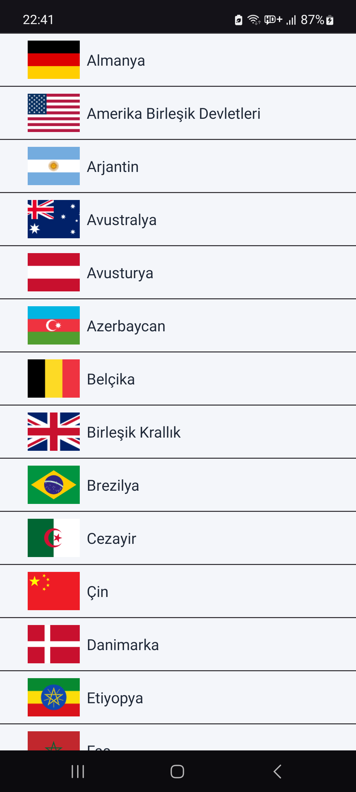

# Country ListView

Bu proje, Android'de `ListView` bileşeninin özel bir Adapter kullanılarak nasıl oluşturulabileceğini öğrenmek amacıyla hazırlanmıştır.

Uygulamada ülke isimleri ve bayrak görselleri ayrı kaynaklarda tanımlanır. Bu veriler `Country` modeli aracılığıyla bir araya getirilerek özel bir `CountryAdapter` ile ListView üzerinde görüntülenir.

## Ekran Görüntüsü

<p align="center">
  
</p>

## Ele Alınan Konular

- ListView
- Custom Adapter
- BaseAdapter
- Country model sınıfı
- ArrayList
- LayoutInflater
- `getCount()`
- `getItem()`
- `getItemId()`
- `getView()`
- `convertView`
- ViewHolder Pattern
- View Recycling
- String Array ve TypedArray kaynakları
- Drawable kaynaklarına erişim

## 1. ListView

`ListView`, verileri dikey bir liste içerisinde görüntülemeyi sağlayan Android UI bileşenidir.

ListView, görüntülenecek verileri bir Adapter aracılığıyla alır. Basit veri yapılarında `ArrayAdapter` kullanılabilirken her liste öğesinin farklı View bileşenlerinden oluştuğu durumlarda özel Adapter sınıfları oluşturulabilir.

Bu projede her satırda bir ülke bayrağı ve ülke adı gösterildiği için özel bir `CountryAdapter` kullanılmıştır.

## 2. Country Model

Ülke bilgilerini bir arada tutmak için `Country` model sınıfı kullanılır.

Her Country nesnesi bir ülke adını ve ilgili bayrak görselinin resource ID değerini temsil eder.

```kotlin
class Country(name: String, flagId: Int) {
    val name = name
    val flagId = flagId
}
```

Bu model sayesinde ülke adı ve bayrak bilgisi tek bir nesne üzerinden taşınabilir.

## 3. Ülke Verilerini Hazırlama

Ülke isimleri ve bayrak görselleri `strings.xml` içerisinde ayrı kaynaklar olarak tanımlanmıştır.

Ülke isimleri `string-array` içerisinde tutulurken bayrak görselleri `array` kaynağında mipmap resource referanslarıyla saklanır.

### String Array ile Ülke İsimleri

```xml
<string-array name="country_names">
    <item>Almanya</item>
    <item>Amerika Birleşik Devletleri</item>
    <item>Arjantin</item>
    <item>Avustralya</item>
    <item>Avusturya</item>
    <item>Azerbaycan</item>
    <!-- Diğer ülkeler -->
</string-array>
```

Kotlin tarafında `resources.getStringArray()` metodu ile bu kaynağa erişilebilir:

```kotlin
val names: Array<String> =
    resources.getStringArray(R.array.country_names)
```

### TypedArray ile Bayrak Görselleri

Bayrak görselleri `mipmap` kaynaklarından alınarak bir `array` içerisinde tanımlanmıştır.

```xml
<array name="country_flags">
    <item>@mipmap/flag_de</item>
    <item>@mipmap/flag_us</item>
    <item>@mipmap/flag_ar</item>
    <item>@mipmap/flag_au</item>
    <item>@mipmap/flag_at</item>
    <item>@mipmap/flag_az</item>
</array>
```

Bu kaynaklara Kotlin tarafından `resources.obtainTypedArray()` metodu ile erişilir:

```kotlin
val flags: TypedArray =
    resources.obtainTypedArray(R.array.country_flags)
```

`TypedArray`, XML kaynaklarında tanımlanan farklı türlerdeki değerleri okumak için kullanılır.

Bayrak görsellerinin resource ID değerleri `getResourceId()` metodu ile alınabilir:

```kotlin
val flagId = flags.getResourceId(i, 0)
```

Metodun ikinci parametresi, belirtilen konumda geçerli bir resource bulunamadığında kullanılacak varsayılan değerdir.

### Country Nesnelerini Oluşturma

Ülke isimleri ve bayrak resource ID değerleri aynı indeks üzerinden eşleştirilerek `Country` nesneleri oluşturulur.

```kotlin
private val countryList = ArrayList<Country>()

private fun createCountryList() {
    val names: Array<String> =
        resources.getStringArray(R.array.country_names)

    val flags: TypedArray =
        resources.obtainTypedArray(R.array.country_flags)

    for (i in names.indices) {
        val name = names[i]
        val flagId = flags.getResourceId(i, 0)

        countryList.add(Country(name, flagId))
    }

    flags.recycle()
}
```

Burada:

- `names.indices`: Ülke isimlerinin geçerli indeks aralığını sağlar.
- `getResourceId(i, 0)`: İlgili indeksteki bayrak görselinin resource ID değerini alır.
- `countryList.add()`: Oluşturulan Country nesnesini listeye ekler.
- `flags.recycle()`: Kullanımı tamamlanan TypedArray kaynağını serbest bırakır.

`TypedArray` kullanımı tamamlandığında `recycle()` çağrılması, kaynağın tekrar kullanılabilmesini sağlar.

## 4. Custom Adapter

Adapter, veri kaynağındaki öğelerin ListView tarafından görüntülenebilecek View bileşenlerine dönüştürülmesini sağlar.

Android'de özel Adapter oluşturmak için `BaseAdapter` sınıfından yararlanılabilir. `BaseAdapter`, liste verilerinin nasıl sayılacağını, nasıl alınacağını ve her öğenin nasıl görüntüleneceğini belirleyen metotları sunar.

Projede `CountryAdapter`, `BaseAdapter` sınıfından türetilmiştir.

### BaseAdapter Sınıfı

```kotlin
class CountryAdapter(
    context: Context,
    countries: ArrayList<Country>
) : BaseAdapter()
```

Constructor üzerinden iki parametre alınır:

- `context`: Adapter'ın kullanılacağı Activity context'idir. View oluşturma ve kaynaklara erişme işlemlerinde kullanılır.
- `countries`: ListView üzerinde görüntülenecek Country nesnelerinden oluşan ArrayList'tir.

Adapter içerisinde liste öğelerinin View nesnelerini oluşturmak için `LayoutInflater` kullanılır.

### LayoutInflater

`LayoutInflater`, XML dosyalarında tanımlanan layout yapılarını çalışma zamanında View nesnelerine dönüştürür.

Projede `list_item.xml` dosyası, her ülkenin listede nasıl görüntüleneceğini belirler.

```kotlin
private val inflater: LayoutInflater =
    context.getSystemService(Context.LAYOUT_INFLATER_SERVICE) as LayoutInflater
```

`getSystemService()` metodu ile sistem servisine erişilir ve `LAYOUT_INFLATER_SERVICE` üzerinden LayoutInflater nesnesi elde edilir.

Bu nesne daha sonra `getView()` içerisinde XML layout'unu oluşturmak için kullanılır.

### BaseAdapter Metotları

`BaseAdapter` sınıfından türetilen Adapter içerisinde temel olarak dört metot override edilir.

**1. getCount()**

Adapter içerisinde bulunan toplam öğe sayısını döndürür.

```kotlin
override fun getCount(): Int {
    return countries.size
}
```

ListView, kaç öğe bulunduğunu öğrenmek için bu metodu kullanır. Projede sayı, Country nesnelerini tutan ArrayList'in `size` değeri üzerinden belirlenir.

**2. getItem()**

Belirtilen konumdaki veri öğesini döndürür.

```kotlin
override fun getItem(position: Int): Any {
    return countries[position]
}
```

`position` parametresi, erişilmek istenen öğenin listedeki indeksidir. Projede ilgili indeksteki Country nesnesi döndürülür.

**3. getItemId()**

Belirtilen konumdaki öğenin ID değerini döndürür.

```kotlin
override fun getItemId(position: Int): Long {
    return position.toLong()
}
```

Projede öğenin listedeki konumu Long türüne dönüştürülerek ID değeri olarak kullanılır.

**4. getView()**

ListView içerisindeki her bir satırın nasıl oluşturulacağını belirleyen temel metottur.

```kotlin
override fun getView(
    position: Int,
    convertView: View?,
    parent: ViewGroup
): View {

    val view: View
    val holder: ViewHolder

    if (convertView == null) {
        view = inflater.inflate(R.layout.list_item, parent, false)

        holder = ViewHolder(
            view.findViewById(R.id.tvName),
            view.findViewById(R.id.ivFlag)
        )

        view.tag = holder
    } else {
        view = convertView
        holder = view.tag as ViewHolder
    }

    val country = countries[position]

    holder.tvName.text = country.name
    holder.ivFlag.setImageResource(country.flagId)

    return view
}
```

Metodun parametreleri:

- `position`: Görüntülenecek öğenin listedeki indeksidir.
- `convertView`: Daha önce oluşturulmuş ve yeniden kullanılabilecek View nesnesidir.
- `parent`: Oluşturulan View nesnesinin ekleneceği ViewGroup, bu projede ListView'dır.

Metodun çalışma adımları:

1. `convertView` kontrol edilir.
2. Eğer `convertView` null ise `inflater.inflate()` ile `list_item.xml` dosyasından yeni bir View oluşturulur.
3. `findViewById()` ile satır layout'u içerisindeki TextView ve ImageView bileşenlerine erişilir.
4. Bulunan View bileşenleri bir ViewHolder nesnesine aktarılır ve `view.tag` özelliğinde saklanır.
5. Eğer `convertView` null değilse mevcut View yeniden kullanılır ve ViewHolder `view.tag` üzerinden alınır.
6. `countries[position]` ile ilgili konumdaki Country nesnesi elde edilir.
7. `tvName.text` üzerinden ülke adı TextView içerisine yazılır.
8. `ivFlag.setImageResource()` ile ilgili bayrak görseli ImageView üzerinde gösterilir.
9. View nesnesi geri döndürülür.

### List Item Layout

`list_item.xml`, ListView içerisindeki her bir ülke satırının görünümünü tanımlar.

Bu projede her satırda:

- `ImageView`: Ülkenin bayrak görselini gösterir.
- `TextView`: Ülkenin adını gösterir.

`getView()` metodu, bu layout'u kullanarak ilgili ülke verilerini bileşenlere aktarır.

### convertView ve View Recycling

`getView()` metodundaki `convertView`, ListView performansı açısından önemli bir parametredir.

ListView kaydırıldığında ekrandan çıkan satırların View nesneleri yeniden kullanılabilir. Böylece her öğe için sürekli yeni View oluşturmak yerine daha önce oluşturulan View nesneleri değerlendirilebilir.

Projede `convertView`, null olup olmadığına göre kontrol edilir:

- `convertView == null`: Yeniden kullanılabilecek bir View yoktur. Yeni bir satır oluşturulur.
- `convertView != null`: Daha önce oluşturulmuş View nesnesi yeniden kullanılır.

Bu yaklaşım **View Recycling** olarak adlandırılır. Gereksiz layout oluşturma işlemlerini azaltarak liste performansına katkıda bulunur.

### ViewHolder Pattern

`ViewHolder`, satır içerisindeki View bileşenlerinin referanslarını saklamak için kullanılan bir yapıdır.

Bu projede ViewHolder, ülke adını gösteren `TextView` ve bayrak görselini gösteren `ImageView` referanslarını tutar.

```kotlin
private data class ViewHolder(
    val tvName: TextView,
    val ivFlag: ImageView
)
```

Yeni bir satır oluşturulduğunda `findViewById()` ile bileşenler bulunur ve bir ViewHolder nesnesine aktarılır. Ardından bu nesne, satırın `tag` özelliğinde saklanır.

```kotlin
view.tag = holder
```

Satır yeniden kullanıldığında ise ViewHolder tekrar `findViewById()` çağırmak yerine `tag` üzerinden elde edilir:

```kotlin
holder = view.tag as ViewHolder
```

Böylece her `getView()` çağrısında aynı satır bileşenlerini yeniden aramak gerekmez.

ViewHolder Pattern'in temel amacı, View bileşenlerine erişimi daha verimli hale getirmektir.

**convertView ve ViewHolder arasındaki fark:**

- `convertView`, daha önce oluşturulmuş satır View nesnesinin yeniden kullanılmasını sağlar.
- `ViewHolder`, bu satır içerisindeki View bileşenlerinin referanslarını saklar.

İkisi birlikte kullanıldığında hem gereksiz View oluşturma hem de tekrarlanan `findViewById()` çağrıları azaltılır.

## 5. Adapter'ı ListView'a Bağlama

Ülke listesi hazırlandıktan sonra `CountryAdapter` oluşturulur ve ListView bileşenine atanır.

```kotlin
createCountryList()

val adapter = CountryAdapter(this, countryList)
val lvCountries = findViewById<ListView>(R.id.lvCountries)

lvCountries.adapter = adapter
```

Burada `createCountryList()` metodu öncelikle ülke verilerini hazırlar. Ardından oluşturulan liste Adapter'a aktarılır.

Son olarak Adapter, ListView'ın `adapter` özelliğine atanır ve ülkeler görüntülenmeye başlar.

## Uygulama Akışı

1. Ülke isimleri ve bayrak görselleri kaynak dosyalarında tanımlanır.
2. `getStringArray()` ile ülke isimleri alınır.
3. `obtainTypedArray()` ile bayrak kaynaklarına erişilir.
4. `getResourceId()` ile bayrak görsellerinin resource ID değerleri elde edilir.
5. Ülke adı ve bayrak bilgileri `Country` nesnelerinde birleştirilir.
6. Oluşturulan ülke listesi `CountryAdapter` sınıfına aktarılır.
7. `BaseAdapter` metotları ile liste öğelerinin sayısı, verileri ve görünümleri yönetilir.
8. `getView()` içerisinde `convertView` kontrol edilerek satırlar oluşturulur veya yeniden kullanılır.
9. ViewHolder ile satır içerisindeki View referansları saklanır.
10. Adapter, ListView bileşenine atanır.
11. Ülkeler bayraklarıyla birlikte ListView üzerinde görüntülenir.

## Kullanılan Teknolojiler

- Kotlin
- Android SDK
- XML Resources
- ListView
- BaseAdapter
- Custom Adapter
- ArrayList
- LayoutInflater
- TypedArray
- ViewHolder
- ImageView
- TextView
- AndroidX AppCompat
- AndroidX Core KTX

## Öğrenme Kazanımları

- ListView bileşeninin çalışma mantığını anlama.
- BaseAdapter kullanarak özel Adapter oluşturma.
- `getCount()`, `getItem()`, `getItemId()` ve `getView()` metotlarının görevlerini öğrenme.
- LayoutInflater ile XML layout'larını View nesnelerine dönüştürme.
- `getView()` üzerinden liste öğelerinin görünümünü oluşturma.
- `convertView` ve View Recycling kavramlarını öğrenme.
- ViewHolder Pattern ile View referanslarını saklama.
- Model sınıfı ile ilişkili verileri bir arada tutma.
- ArrayList ile nesne listeleri oluşturma.
- String Array ve TypedArray kaynaklarını kullanma.
- Drawable kaynaklarının resource ID değerlerine erişme.