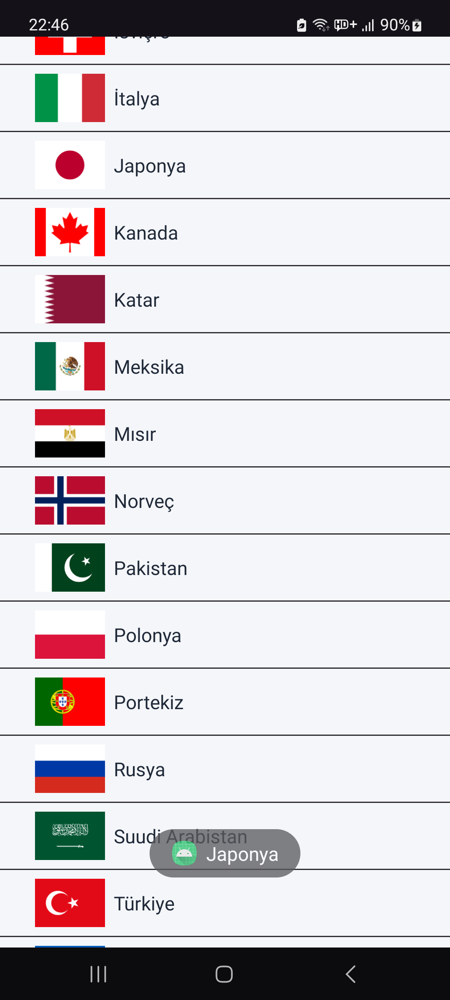

# Country RecyclerView

Bu proje, Android'de `RecyclerView` bileşeninin özel bir Adapter ve ViewHolder kullanılarak nasıl oluşturulabileceğini öğrenmek amacıyla hazırlanmıştır.

Uygulamada ülke isimleri ve bayrak görselleri bir liste içerisinde gösterilir. Kullanıcı, SearchView üzerinden ülke isimlerine göre arama yapabilir. Liste kaydırıldıkça yeni kayıtlar belirli gruplar halinde yüklenerek sayfalama (pagination) mantığı uygulanır.

Veriler `Country` modeli aracılığıyla temsil edilir ve özel bir `CountryAdapter` ile RecyclerView üzerinde görüntülenir.

## Ekran Görüntüsü

<p align="center">
  
</p>

## Ele Alınan Konular

- RecyclerView
- RecyclerView.Adapter
- RecyclerView.ViewHolder
- Custom Adapter
- ViewHolder Pattern
- LinearLayoutManager
- LayoutInflater
- `onCreateViewHolder()`
- `onBindViewHolder()`
- `getItemCount()`
- Item Click Listener
- `bindingAdapterPosition`
- Filterable
- Filter ve FilterResults
- SearchView
- List Filtering
- Pagination
- RecyclerView.OnScrollListener
- `notifyItemRangeInserted()`
- `notifyDataSetChanged()`
- TypedArray ve Resource Arrays

## 1. RecyclerView

`RecyclerView`, verileri liste veya grid gibi farklı düzenlerde görüntülemeyi sağlayan Android UI bileşenidir.

ListView'a benzer şekilde Adapter kullanır ancak ViewHolder yapısını kendi mimarisinin bir parçası olarak sunar. Görünür olmayan satırların View nesnelerini yeniden kullanarak liste performansının korunmasına yardımcı olur.

RecyclerView'ın çalışabilmesi için temel olarak şu bileşenler gerekir:

- **RecyclerView:** Liste öğelerinin görüntülendiği UI bileşenidir.
- **Adapter:** Veri kaynağındaki öğeleri RecyclerView için hazırlar.
- **ViewHolder:** Her liste öğesinin View bileşenlerini tutar.
- **LayoutManager:** Liste öğelerinin ekranda nasıl düzenleneceğini belirler.

Bu projede dikey bir ülke listesi oluşturmak için `LinearLayoutManager` kullanılmıştır.

```kotlin id="k8xr0j"
val layoutManager = LinearLayoutManager(this)

layoutManager.orientation = LinearLayoutManager.VERTICAL
layoutManager.scrollToPosition(0)

rvCountries.layoutManager = layoutManager
```

`LinearLayoutManager`, öğelerin yatay veya dikey olarak sıralanmasını sağlar. Bu projede `VERTICAL` yönü kullanılarak ülkeler alt alta listelenir.

Ayrıca liste öğelerinin arasına ayırıcı çizgi eklemek için `DividerItemDecoration` kullanılmıştır:

```kotlin id="2fap3q"
rvCountries.addItemDecoration(
    DividerItemDecoration(this, layoutManager.orientation)
)
```

## 2. Country Model

Ülke bilgilerini bir arada tutmak için `Country` model sınıfı kullanılır.

Her Country nesnesi bir ülke adını ve ilgili bayrak görselinin resource ID değerini temsil eder.

```kotlin id="a1c4r8"
class Country(name: String, flagId: Int) {
    val name = name
    val flagId = flagId
}
```

Bu model sayesinde ülke adı ve bayrak bilgisi tek bir nesne üzerinden taşınabilir.

## 3. Ülke Verilerini Hazırlama

Ülke isimleri ve bayrak görselleri `strings.xml` içerisinde ayrı kaynaklar olarak tanımlanmıştır.

Ülke isimleri `string-array` içerisinde tutulurken bayrak görselleri `array` kaynağında mipmap resource referanslarıyla saklanır.

### String Array ile Ülke İsimleri

```xml id="v8l7q2"
<string-array name="country_names">
    <item>Almanya</item>
    <item>Amerika Birleşik Devletleri</item>
    <item>Arjantin</item>
    <item>Avustralya</item>
    <item>Avusturya</item>
    <item>Azerbaycan</item>
    <!-- Diğer ülkeler -->
</string-array>
```

Kotlin tarafında `resources.getStringArray()` metodu ile bu kaynağa erişilebilir:

```kotlin id="f1d3v6"
val names: Array<String> =
    resources.getStringArray(R.array.country_names)
```

### TypedArray ile Bayrak Görselleri

Bayrak görselleri `mipmap` kaynaklarından alınarak bir `array` içerisinde tanımlanmıştır.

```xml id="q4m8s1"
<array name="country_flags">
    <item>@mipmap/flag_de</item>
    <item>@mipmap/flag_us</item>
    <item>@mipmap/flag_ar</item>
    <item>@mipmap/flag_au</item>
    <item>@mipmap/flag_at</item>
    <item>@mipmap/flag_az</item>
</array>
```

Bu kaynaklara Kotlin tarafından `resources.obtainTypedArray()` metodu ile erişilir:

```kotlin id="u6e2p9"
val flags: TypedArray =
    resources.obtainTypedArray(R.array.country_flags)
```

`TypedArray`, XML kaynaklarında tanımlanan farklı türlerdeki değerleri okumak için kullanılır.

Bayrak görsellerinin resource ID değerleri `getResourceId()` metodu ile alınabilir:

```kotlin id="m3a8w5"
val flagId = flags.getResourceId(i, 0)
```

Metodun ikinci parametresi, belirtilen konumda geçerli bir resource bulunamadığında kullanılacak varsayılan değerdir.

### Country Nesnelerini Oluşturma

Ülke isimleri ve bayrak resource ID değerleri aynı indeks üzerinden eşleştirilerek `Country` nesneleri oluşturulur.

```kotlin id="p9x4c2"
private fun loadAllCountriesFromResources(): List<Country> {
    val list = ArrayList<Country>()

    val names: Array<String> =
        resources.getStringArray(R.array.country_names)

    val flags: TypedArray =
        resources.obtainTypedArray(R.array.country_flags)

    for (i in names.indices) {
        val name = names[i]
        val flagId = flags.getResourceId(i, 0)

        list.add(Country(name, flagId))
    }

    flags.recycle()
    return list
}
```

Burada:

- `getStringArray()`: Ülke isimlerini alır.
- `obtainTypedArray()`: Bayrak kaynaklarına erişir.
- `names.indices`: Ülke isimlerinin geçerli indeks aralığını sağlar.
- `getResourceId(i, 0)`: İlgili indeksteki bayrak görselinin resource ID değerini alır.
- `list.add()`: Oluşturulan Country nesnesini listeye ekler.
- `flags.recycle()`: Kullanımı tamamlanan TypedArray kaynağını serbest bırakır.

Metot, hazırlanan ülke listesini `List<Country>` olarak döndürür. Böylece MainActivity içerisinde veriler yüklenerek Adapter'a aktarılabilir.

## 4. Custom Adapter

RecyclerView üzerinde verileri görüntülemek için `RecyclerView.Adapter` sınıfından türetilen özel bir Adapter kullanılır.

Projede `CountryAdapter`, ülke listesini yönetir ve RecyclerView'ın ihtiyaç duyduğu ViewHolder nesnelerini oluşturur.

```kotlin id="r4n7b2"
class CountryAdapter(
    private val masterCountries: List<Country>,
    private val itemClick: (position: Int) -> Unit,
) : RecyclerView.Adapter<CountryViewHolder>(), Filterable
```

Constructor üzerinden iki parametre alınır:

- `masterCountries`: Filtreleme işlemlerinde referans alınan tüm ülke verilerini tutar.
- `itemClick`: Liste öğesine tıklandığında çalıştırılacak callback fonksiyonudur.

Adapter ayrıca `Filterable` arayüzünü uygular. Böylece ülke listesi üzerinde filtreleme işlemi gerçekleştirilebilir.

### RecyclerView.Adapter Metotları

RecyclerView.Adapter içerisinde temel olarak üç metot override edilir.

**1. onCreateViewHolder()**

Yeni bir ViewHolder nesnesi oluşturmak için çağrılır.

```kotlin id="t5c9n3"
override fun onCreateViewHolder(
    parent: ViewGroup,
    viewType: Int
): CountryViewHolder {

    val v = LayoutInflater.from(parent.context).inflate(
        R.layout.list_item,
        parent,
        false
    )

    return CountryViewHolder(v, itemClick)
}
```

`LayoutInflater` kullanılarak `list_item.xml` dosyası View nesnesine dönüştürülür. Oluşturulan View, `CountryViewHolder` nesnesine aktarılır.

**2. onBindViewHolder()**

Belirtilen pozisyondaki verilerin ViewHolder içerisindeki View bileşenlerine aktarılmasını sağlar.

```kotlin id="b7k2x4"
override fun onBindViewHolder(
    holder: CountryViewHolder,
    position: Int
) {
    val country = countries[position]

    holder.tvName.text = country.name
    holder.ivFlag.setImageResource(country.flagId)
}
```

`position` parametresi ile ilgili ülke elde edilir. Ülkenin adı TextView'a, bayrak görseli ise ImageView'a atanır.

RecyclerView, bir ViewHolder öğesini görüntülemek veya yeniden kullanmak için bu metodu çağırır.

**3. getItemCount()**

Adapter içerisinde görüntülenecek toplam öğe sayısını döndürür.

```kotlin id="c6w3j8"
override fun getItemCount(): Int {
    return countries.size
}
```

Bu projede döndürülen değer, o anda RecyclerView üzerinde gösterilmek üzere yüklenmiş olan `countries` listesinin eleman sayısıdır.

### CountryViewHolder

`ViewHolder`, RecyclerView içerisindeki her bir liste öğesinin View bileşenlerine ait referansları tutar.

Bu projede ViewHolder ayrı bir `CountryViewHolder` sınıfında tanımlanmıştır.

```kotlin id="h2v6z9"
class CountryViewHolder(
    itemView: View,
    itemClick: (position: Int) -> Unit
) : RecyclerView.ViewHolder(itemView) {

    var ivFlag: ImageView
    var tvName: TextView

    init {
        ivFlag = itemView.findViewById(R.id.ivFlag)
        tvName = itemView.findViewById(R.id.tvName)

        itemView.setOnClickListener {
            val position = bindingAdapterPosition

            if (position != RecyclerView.NO_POSITION) {
                itemClick(position)
            }
        }
    }
}
```

Constructor üzerinden alınan `itemView`, `list_item.xml` dosyasından oluşturulan satır görünümüdür.

ViewHolder içerisinde:

- `ivFlag`: Ülkenin bayrak görselini gösterir.
- `tvName`: Ülkenin adını gösterir.

`findViewById()` ile ilgili View bileşenlerine erişilir ve referansları saklanır.

### Item Click Listener

ViewHolder içerisinde `itemView.setOnClickListener()` kullanılarak liste öğelerine tıklama olayı eklenmiştir.

Tıklama sırasında `bindingAdapterPosition` ile ViewHolder'ın Adapter içerisindeki güncel pozisyonu alınır.

```kotlin id="n8f3y1"
val position = bindingAdapterPosition

if (position != RecyclerView.NO_POSITION) {
    itemClick(position)
}
```

`RecyclerView.NO_POSITION`, ViewHolder'ın geçerli bir Adapter pozisyonuna sahip olmadığını belirtir. Bu kontrol, geçersiz bir pozisyon üzerinden işlem yapılmasını önler.

Tıklama olayı callback fonksiyonu aracılığıyla MainActivity'ye iletilir. MainActivity içerisinde ilgili ülkenin adı Toast ile gösterilir.

```kotlin id="w4j6k2"
private fun onItemClick(position: Int) {
    Toast.makeText(
        this,
        adapter.countries[position].name,
        Toast.LENGTH_SHORT
    ).show()
}
```

## 5. Filtreleme (Filtering)

Projede ülke isimlerine göre arama yapabilmek için `SearchView` ve `Filterable` arayüzü kullanılmıştır.

Kullanıcı SearchView içerisine bir metin yazdığında liste, ülke isimlerine göre filtrelenir.

### Filterable Arayüzü

`Filterable`, Adapter içerisinde filtreleme desteği sağlamak için kullanılan Android arayüzüdür.

`CountryAdapter`, `Filterable` arayüzünü uygulayarak `getFilter()` metodunu override eder.

```kotlin id="e3v7a5"
override fun getFilter(): Filter {
    return object : Filter() {

        override fun performFiltering(
            constraint: CharSequence?
        ): FilterResults {

            val query = constraint?.toString()?.trim().orEmpty()

            val filteredList = if (query.isEmpty()) {
                masterCountries
            } else {
                masterCountries.filter {
                    it.name.contains(query, ignoreCase = true)
                }
            }

            return FilterResults().apply {
                values = filteredList
            }
        }

        @Suppress("UNCHECKED_CAST")
        override fun publishResults(
            constraint: CharSequence?,
            results: FilterResults?
        ) {
            currentFilteredList =
                (results?.values as? List<Country>) ?: masterCountries

            loadInitialPage()
            notifyDataSetChanged()
        }
    }
}
```

Filtreleme işlemi iki temel metot üzerinden gerçekleştirilir.

**1. performFiltering()**

Arama sorgusuna göre filtreleme işlemini gerçekleştirir.

- `constraint`: SearchView üzerinden gelen arama metnidir.
- `trim()`: Metnin başındaki ve sonundaki boşlukları temizler.
- `orEmpty()`: Değer null ise boş String döndürür.
- `contains(query, ignoreCase = true)`: Ülke adının arama metnini içerip içermediğini büyük/küçük harf duyarsız şekilde kontrol eder.
- `FilterResults`: Filtreleme sonucunda elde edilen listeyi taşır.

Arama metni boşsa tüm ülke listesi, doluysa eşleşen ülkeler döndürülür.

**2. publishResults()**

Filtreleme sonucunun Adapter'a uygulanmasını sağlar.

Önce `FilterResults` içerisindeki sonuç alınarak `currentFilteredList` güncellenir. Ardından `loadInitialPage()` çağrılarak filtrelenmiş listenin ilk sayfası yüklenir.

Son olarak `notifyDataSetChanged()` ile RecyclerView'a veri kümesinin değiştiği bildirilir.

### SearchView ile Filtrelemeyi Bağlama

MainActivity içerisinde SearchView'ın metin değişikliği dinlenir.

```kotlin id="j7k2m5"
searchView.setOnQueryTextListener(
    object : SearchView.OnQueryTextListener {

        override fun onQueryTextChange(newText: String?): Boolean {
            adapter.filter.filter(newText)
            return true
        }

        override fun onQueryTextSubmit(query: String?): Boolean {
            adapter.filter.filter(query)
            return true
        }
    }
)
```

- `onQueryTextChange()`: Kullanıcı arama metnini değiştirdikçe çağrılır.
- `onQueryTextSubmit()`: Kullanıcı arama sorgusunu gönderdiğinde çağrılır.
- `adapter.filter.filter()`: Adapter'ın filtreleme işlemini başlatır.

Böylece SearchView ile RecyclerView arasında filtreleme bağlantısı kurulmuş olur.

## 6. Sayfalama (Pagination)

Sayfalama, büyük veri listelerinin tamamını tek seferde göstermek yerine belirli büyüklükteki gruplar halinde yükleme yaklaşımıdır.

Bu projede her seferinde 20 ülke yüklenecek şekilde sayfalama mantığı uygulanmıştır.

Kullanıcı listeyi aşağı kaydırdıkça yeni ülkeler mevcut listeye eklenir.

### Sayfalama İçin Kullanılan Değişkenler

CountryAdapter içerisinde sayfalama işlemini yönetmek için üç değişken kullanılır.

```kotlin id="u1z5g8"
private val pageSize = 20
private var isLoading = false
private var isLastPage = false
```

- `pageSize`: Bir seferde yüklenecek öğe sayısını belirler. Bu projede 20'dir.
- `isLoading`: Yeni bir sayfa yükleme işleminin devam edip etmediğini takip eder.
- `isLastPage`: Yüklenecek başka öğe kalıp kalmadığını belirtir.

Adapter içerisinde ayrıca iki liste bulunur:

```kotlin id="p6c3w9"
private var currentFilteredList: List<Country> = masterCountries
val countries = ArrayList<Country>()
```

- `masterCountries`: Uygulamadaki tüm ülke verilerini tutar ve filtreleme için ana veri kaynağıdır.
- `currentFilteredList`: Arama sonucunda elde edilen güncel filtrelenmiş listeyi tutar.
- `countries`: RecyclerView üzerinde o anda gösterilen, sayfalar halinde yüklenmiş öğeleri tutar.

Bu ayrım sayesinde filtreleme ve sayfalama birlikte çalışabilir.

### İlk Sayfanın Yüklenmesi

Adapter oluşturulduğunda `init` bloğu içerisinde `loadInitialPage()` çağrılır.

```kotlin id="d8m2r4"
init {
    loadInitialPage()
}
```

`loadInitialPage()` metodu mevcut listeyi temizleyerek ilk sayfayı yükler.

```kotlin id="q9v5a1"
private fun loadInitialPage() {
    countries.clear()
    isLastPage = false
    isLoading = false

    val end = minOf(currentFilteredList.size, pageSize)

    countries.addAll(currentFilteredList.subList(0, end))

    if (countries.size >= currentFilteredList.size) {
        isLastPage = true
    }
}
```

Burada:

- `countries.clear()`: Önceden yüklenmiş öğeleri temizler.
- `isLastPage = false`: Sayfalama durumunu sıfırlar.
- `isLoading = false`: Yükleme durumunu sıfırlar.
- `minOf()`: Yüklenecek öğe sayısının mevcut listedeki eleman sayısını aşmasını önler.
- `subList(0, end)`: İlk sayfaya ait verileri seçer.
- `addAll()`: Seçilen verileri RecyclerView'ın görüntülediği listeye ekler.

Eğer filtrelenmiş listede 20 veya daha az öğe varsa ilk sayfada bütün öğeler yüklenir ve `isLastPage` true olur.

### Sonraki Sayfanın Yüklenmesi

Yeni sayfayı yüklemek için `loadNextPage()` metodu kullanılır.

```kotlin id="f2n7k4"
fun loadNextPage() {
    if (isLoading || isLastPage) return

    isLoading = true

    val previousSize = countries.size
    val start = previousSize

    if (start >= currentFilteredList.size) {
        isLastPage = true
        isLoading = false
        return
    }

    val end = minOf(
        currentFilteredList.size,
        start + pageSize
    )

    val newItems = currentFilteredList.subList(start, end)
    countries.addAll(newItems)

    if (countries.size >= currentFilteredList.size) {
        isLastPage = true
    }

    notifyItemRangeInserted(previousSize, newItems.size)
    isLoading = false
}
```

Metodun çalışma adımları:

1. Yükleme devam ediyorsa veya son sayfaya ulaşıldıysa işlem durdurulur.
2. `isLoading` true yapılarak yeni yükleme işlemi başlatılır.
3. `countries.size` üzerinden mevcut öğe sayısı ve yeni sayfanın başlangıç indeksi belirlenir.
4. `minOf()` ile yeni sayfanın bitiş indeksi hesaplanır.
5. `subList()` ile yüklenecek yeni öğeler seçilir.
6. `addAll()` ile yeni öğeler mevcut listeye eklenir.
7. Tüm öğeler yüklenmişse `isLastPage` true yapılır.
8. `notifyItemRangeInserted()` ile eklenen öğeler RecyclerView'a bildirilir.
9. `isLoading` false yapılarak yükleme işlemi tamamlanır.

`notifyItemRangeInserted()` metodu, Adapter'a belirli bir konumdan itibaren yeni öğelerin eklendiğini bildirir. Böylece tüm listeyi yenilemek yerine yalnızca eklenen öğeler güncellenir.

### RecyclerView Scroll Listener

Yeni sayfanın ne zaman yükleneceğini belirlemek için RecyclerView üzerinde `OnScrollListener` kullanılır.

```kotlin id="x5b8m2"
rvCountries.addOnScrollListener(
    object : RecyclerView.OnScrollListener() {

        override fun onScrolled(
            recyclerView: RecyclerView,
            dx: Int,
            dy: Int
        ) {
            super.onScrolled(recyclerView, dx, dy)

            if (dy <= 0) return

            val lastItem = layoutManager.findLastVisibleItemPosition()

            if (lastItem >= adapter.itemCount - 4) {
                adapter.loadNextPage()
            }
        }
    }
)
```

Burada:

- `onScrolled()`: RecyclerView kaydırıldığında çağrılır.
- `dy`: Dikey kaydırma miktarını belirtir.
- `dy <= 0`: Yukarı yöndeki veya dikey ilerleme olmayan kaydırmalarda işlem yapılmasını engeller.
- `findLastVisibleItemPosition()`: Ekranda görünen son öğenin pozisyonunu döndürür.
- `adapter.itemCount - 4`: Listenin son dört öğesine yaklaşıldığını belirleyen eşiktir.
- `loadNextPage()`: Yeni sayfanın yüklenmesini başlatır.

Böylece kullanıcı listenin sonuna ulaşmadan, son dört öğeye yaklaştığında sonraki sayfa yüklenmeye başlanır.

### Filtreleme ve Sayfalamanın Birlikte Çalışması

Filtreleme işlemi tamamlandığında `publishResults()` içerisinde `loadInitialPage()` çağrılır.

Bu sayede arama sonucunda elde edilen yeni liste için sayfalama baştan başlatılır.

Örneğin:

- Kullanıcı arama yapmadan tüm ülkeleri görüntüler.
- Bir ülke adı yazdığında liste eşleşen ülkelere göre filtrelenir.
- Filtrelenmiş listenin ilk 20 öğesi yüklenir.
- Kullanıcı aşağı kaydırdıkça eşleşen diğer ülkeler yüklenir.
- Arama metni temizlendiğinde tüm ülkelerin ilk sayfası yeniden gösterilir.

Bu projedeki sayfalama, API veya veritabanından veri çekmek yerine bellekte bulunan listeyi parçalara ayırarak çalışır. Dolayısıyla burada kullanılan yaklaşım, istemci tarafında liste üzerinden yapılan bir sayfalama uygulamasıdır.

## 7. Adapter'ı RecyclerView'a Bağlama

Ülke verileri hazırlandıktan sonra `CountryAdapter` oluşturulur ve RecyclerView bileşenine atanır.

```kotlin id="c3m8v6"
val allCountries = loadAllCountriesFromResources()

adapter = CountryAdapter(allCountries, this::onItemClick)

rvCountries.adapter = adapter
```

`loadAllCountriesFromResources()` ile tüm ülke verileri hazırlanır.

Ardından `CountryAdapter` oluşturulurken ülke listesi ve tıklama callback fonksiyonu aktarılır.

Son olarak Adapter, RecyclerView'ın `adapter` özelliğine atanır.

## Uygulama Akışı

1. Ülke isimleri ve bayrak görselleri kaynak dosyalarında tanımlanır.
2. `getStringArray()` ile ülke isimleri alınır.
3. `obtainTypedArray()` ile bayrak kaynaklarına erişilir.
4. `getResourceId()` ile bayrak görsellerinin resource ID değerleri elde edilir.
5. Ülke adı ve bayrak bilgileri `Country` nesnelerinde birleştirilir.
6. Oluşturulan ülke listesi `CountryAdapter` sınıfına aktarılır.
7. RecyclerView, LinearLayoutManager ile dikey liste şeklinde yapılandırılır.
8. ViewHolder aracılığıyla liste öğelerinin View bileşenlerine erişilir.
9. Adapter, RecyclerView bileşenine atanır.
10. SearchView üzerinden girilen metinle ülke listesi filtrelenir.
11. İlk 20 öğe yüklenir.
12. Kullanıcı listeyi aşağı kaydırdıkça sonraki öğeler yüklenir.
13. Liste öğesine tıklandığında ilgili ülkenin adı Toast ile gösterilir.

## Kullanılan Teknolojiler

- Kotlin
- Android SDK
- XML Resources
- RecyclerView
- RecyclerView.Adapter
- RecyclerView.ViewHolder
- LinearLayoutManager
- SearchView
- Filterable
- Filter
- ArrayList
- LayoutInflater
- TypedArray
- ImageView
- TextView
- Toast
- DividerItemDecoration
- AndroidX AppCompat
- AndroidX Core KTX

## Öğrenme Kazanımları

- RecyclerView bileşeninin çalışma mantığını anlama.
- RecyclerView.Adapter kullanarak özel Adapter oluşturma.
- ViewHolder yapısını ayrı bir sınıfta tanımlama.
- `onCreateViewHolder()`, `onBindViewHolder()` ve `getItemCount()` metotlarının görevlerini öğrenme.
- Liste öğelerine tıklama olayı ekleme.
- `bindingAdapterPosition` kullanımı ve geçersiz pozisyon kontrolünü öğrenme.
- LinearLayoutManager ile liste düzenini belirleme.
- Filterable ve Filter kullanarak liste filtreleme.
- SearchView ile arama işlemini Adapter'a bağlama.
- Ana veri listesi ile filtrelenmiş ve görüntülenen listeleri ayrı yönetme.
- Pagination mantığını uygulama.
- RecyclerView.OnScrollListener ile kaydırma olaylarını takip etme.
- `notifyItemRangeInserted()` ve `notifyDataSetChanged()` arasındaki kullanım farkını öğrenme.