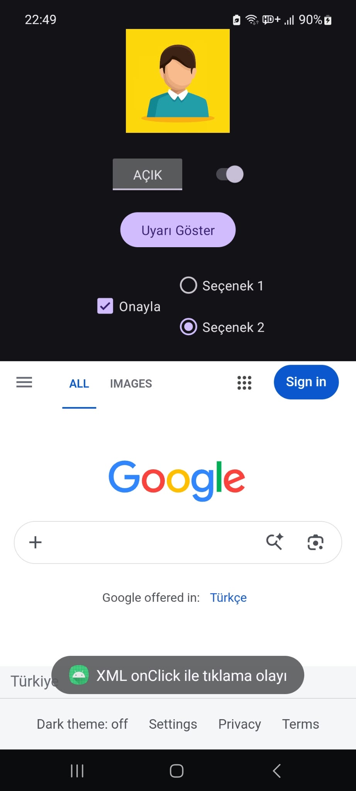

# Event Handling

Bu uygulama, Android'de kullanıcı arayüzü bileşenlerinin olay yönetimini (Event Handling) ve farklı View bileşenlerinin Kotlin üzerinden nasıl kullanılacağını öğrenmek amacıyla hazırlanmıştır.

Projede Button, ToggleButton, Switch, CheckBox, RadioButton, ImageView ve WebView bileşenleri kullanılmıştır. Bu bileşenler üzerinden tıklama, dokunma ve seçim değişikliği gibi kullanıcı etkileşimleri yönetilmiştir.

## Ekran Görüntüsü

<p align="center">
  
</p>

## Konu: Event Handling

Event Handling, kullanıcının uygulama ile gerçekleştirdiği etkileşimlerin algılanması ve bu etkileşimlere uygun işlemlerin yürütülmesidir.

Android'de kullanıcı bir butona tıkladığında, ekrana dokunduğunda veya bir seçim bileşeninin durumunu değiştirdiğinde ilgili olay (event) tetiklenir.

Bu olayları yakalamak ve yönetmek için Listener yapıları kullanılır.

### OnClickListener

`OnClickListener`, bir View bileşenine tıklandığında çalıştırılacak kodları tanımlamak için kullanılır.

```kotlin
btnWarn.setOnClickListener {
    Toast.makeText(
        this,
        "Butona tıklandı",
        Toast.LENGTH_LONG
    ).show()
}
```

Burada `setOnClickListener()` metodu ile butona bir click listener atanmıştır. Kullanıcı butona tıkladığında lambda içerisindeki kod çalıştırılır.

Click listener tanımlamanın bir diğer yolu, `View.OnClickListener` nesnesini ayrı bir değişkende oluşturmaktır.

```kotlin
var warnClickListener = View.OnClickListener {
    Toast.makeText(
        this,
        "Listener değişkeni ile tıklama olayı",
        Toast.LENGTH_LONG
    ).show()
}

btnWarn.setOnClickListener(warnClickListener)
```

Bu yaklaşım, listener kodunun ayrı bir yerde tanımlanmasını ve gerektiğinde tekrar kullanılmasını sağlar.

### OnTouchListener

`OnTouchListener`, bir View üzerine dokunulduğunda gerçekleşen touch olaylarını yakalamak için kullanılır.

```kotlin
window.decorView.rootView.setOnTouchListener(
    View.OnTouchListener { view, motionEvent ->
        Toast.makeText(
            this,
            "Ekrana dokunuldu",
            Toast.LENGTH_LONG
        ).show()

        true
    }
)
```

`OnTouchListener`, `MotionEvent` üzerinden dokunma olayının türü hakkında bilgi sağlar.

Başlıca MotionEvent türleri:

- `ACTION_DOWN`: Parmağın ekrana temas ettiği an.
- `ACTION_MOVE`: Parmağın ekran üzerinde hareket ettiği an.
- `ACTION_UP`: Parmağın ekrandan kaldırıldığı an.
- `ACTION_CANCEL`: Devam eden dokunma olayının iptal edildiği an.

Listener içerisinden döndürülen Boolean değer, olayın tüketilip tüketilmediğini belirtir:

- `true`: Olayın ilgili listener tarafından işlendiğini belirtir.
- `false`: Olayın tüketilmediğini ve uygun durumda başka işlemcilere aktarılabileceğini belirtir.

## ToggleButton ve Switch

ToggleButton ve Switch, iki durumlu seçim bileşenleridir. Genellikle bir özelliği açmak veya kapatmak için kullanılırlar.

Her iki bileşen de `CompoundButton` sınıfından türemiştir ve `isChecked` özelliği üzerinden mevcut durumları kontrol edilebilir.

### ToggleButton

ToggleButton, kullanıcının iki durum arasında geçiş yapmasını sağlayan buton bileşenidir.

XML üzerinde `android:textOn` ve `android:textOff` özellikleriyle iki durum için gösterilecek metinler belirlenebilir.

```xml
<ToggleButton
    android:id="@+id/toggleButton"
    android:layout_width="wrap_content"
    android:layout_height="wrap_content"
    android:textOn="Açık"
    android:textOff="Kapalı" />
```

Kotlin tarafında durum değişikliğini dinlemek için `setOnCheckedChangeListener()` kullanılır.

```kotlin
toggleButton.setOnCheckedChangeListener { button, status ->
    Toast.makeText(
        this,
        "Toggle status: $status",
        Toast.LENGTH_LONG
    ).show()
}
```

`status` parametresi, bileşenin yeni durumunu Boolean olarak belirtir.

### Switch

Switch, genellikle ayar ekranlarında tercih edilen iki durumlu açma-kapama bileşenidir.

```xml
<Switch
    android:id="@+id/switch1"
    android:layout_width="wrap_content"
    android:layout_height="wrap_content" />
```

Kotlin tarafında ToggleButton gibi `setOnCheckedChangeListener()` ile dinlenebilir.

```kotlin
switchBtn.setOnCheckedChangeListener { button, status ->
    toggleButton.visibility =
        if (status) View.VISIBLE else View.INVISIBLE
}
```

Bu projede Switch açıldığında ToggleButton görünür hâle gelir, kapatıldığında ise gizlenir.

## CheckBox ve RadioButton

CheckBox ve RadioButton, kullanıcının seçenekler arasından seçim yapmasını sağlayan bileşenlerdir. Ancak kullanım amaçları birbirinden farklıdır.

### CheckBox

CheckBox, birbirinden bağımsız seçeneklerin işaretlenmesini sağlar. Bu nedenle birden fazla seçeneğin aynı anda seçilmesi gereken durumlarda tercih edilir.

```xml
<CheckBox
    android:id="@+id/checkBox"
    android:layout_width="wrap_content"
    android:layout_height="wrap_content"
    android:text="Onayla" />
```

Seçim durumunu dinlemek için `setOnCheckedChangeListener()` kullanılabilir.

```kotlin
checkBox.setOnCheckedChangeListener { button, status ->
    Toast.makeText(
        this,
        "Seçim: $status",
        Toast.LENGTH_LONG
    ).show()
}
```

### RadioButton ve RadioGroup

RadioButton, seçenekler arasından tek bir seçim yapılması gereken durumlarda kullanılır.

Birden fazla RadioButton'ın aynı seçim grubunda yönetilmesi için RadioGroup kullanılır.

```xml
<RadioGroup
    android:id="@+id/radioGroup"
    android:layout_width="wrap_content"
    android:layout_height="wrap_content"
    android:orientation="vertical">

    <RadioButton
        android:id="@+id/radioButton"
        android:layout_width="wrap_content"
        android:layout_height="wrap_content"
        android:text="Seçenek 1" />

    <RadioButton
        android:id="@+id/radioButton2"
        android:layout_width="wrap_content"
        android:layout_height="wrap_content"
        android:text="Seçenek 2" />

</RadioGroup>
```

RadioGroup içerisindeki seçim değişikliklerini dinlemek için `setOnCheckedChangeListener()` kullanılır.

```kotlin
radioGroup.setOnCheckedChangeListener { group, checkedId ->
    val selectedOption = when (checkedId) {
        R.id.radioButton -> "Seçenek 1"
        R.id.radioButton2 -> "Seçenek 2"
        else -> "Seçim kaldırıldı"
    }

    Toast.makeText(
        this,
        selectedOption,
        Toast.LENGTH_SHORT
    ).show()
}
```

`checkedId`, seçilen RadioButton'ın ID değerini belirtir. Bu değer üzerinden hangi seçeneğin seçildiği belirlenebilir.

## ImageView

ImageView, Android uygulamalarında görsel dosyalarını görüntülemek için kullanılan View bileşenidir.

XML üzerinde ImageView tanımlanabilir ve Kotlin tarafından görsel kaynak atanabilir.

```xml
<ImageView
    android:id="@+id/imageView"
    android:layout_width="120dp"
    android:layout_height="120dp"
    android:scaleType="centerCrop"
    android:contentDescription="Örnek görsel" />
```

Kotlin tarafında `setImageResource()` metodu ile drawable kaynağından görsel yüklenebilir.

```kotlin
imageView.setImageResource(R.drawable.avatar)
```

Bu projede `avatar.png` görseli ImageView içerisinde gösterilmiştir.

`scaleType`, görselin ImageView alanına nasıl yerleştirileceğini belirler. Örneğin `centerCrop`, görselin oranını koruyarak alanı kaplamasını sağlar; gerektiğinde görselin kenarlarından kırpma yapar.

## WebView

WebView, Android uygulaması içerisinde web sayfalarının görüntülenmesini sağlayan bir View bileşenidir.

Harici bir tarayıcı uygulamasına geçmeden web içeriğinin uygulama içerisinde gösterilmesine olanak tanır.

XML üzerinde WebView tanımlanabilir:

```xml
<WebView
    android:id="@+id/webView"
    android:layout_width="match_parent"
    android:layout_height="0dp"
    android:layout_weight="1" />
```

Kotlin tarafında `loadUrl()` metodu ile web sayfası yüklenebilir.

```kotlin
webView.loadUrl("https://www.google.com")
```

WebView üzerinden internet erişimi sağlanabilmesi için AndroidManifest.xml içerisinde INTERNET izninin tanımlanması gerekir.

```xml
<uses-permission android:name="android.permission.INTERNET" />
```

## Uygulama Akışı

1. XML Layout içerisinde ToggleButton, Switch, Button, CheckBox, RadioGroup, ImageView ve WebView bileşenleri tanımlanır.
2. Kotlin tarafında `findViewById()` ile bu bileşenlere erişilir.
3. Button için `setOnClickListener()` kullanılarak click olayı dinlenir.
4. Ekrana dokunma olayları `setOnTouchListener()` ile yakalanır.
5. ToggleButton ve Switch durum değişiklikleri `setOnCheckedChangeListener()` ile takip edilir.
6. CheckBox ve RadioGroup seçimleri dinlenir.
7. ImageView içerisine drawable kaynağından görsel yüklenir.
8. WebView üzerinde belirtilen web adresi açılır.

## Kullanılan Teknolojiler

- Kotlin
- Android SDK
- XML Layout
- LinearLayout
- View
- Button
- ToggleButton
- Switch
- CheckBox
- RadioButton
- RadioGroup
- ImageView
- WebView
- MotionEvent

## Öğrenme Kazanımları

- Android'de event handling kavramını anlama.
- Click ve touch olaylarını dinleme.
- `OnClickListener` ve `OnTouchListener` kullanma.
- Lambda ve listener değişkeni ile olay yönetimi.
- ToggleButton ve Switch bileşenlerinin durumlarını yönetme.
- CheckBox ile bağımsız seçimler yapma.
- RadioGroup ile tekli seçimleri yönetme.
- ImageView içerisinde görsel görüntüleme.
- WebView ile uygulama içinde web sayfası yükleme.
- Listener ve Boolean durum değerleriyle kullanıcı etkileşimlerini yönetme.