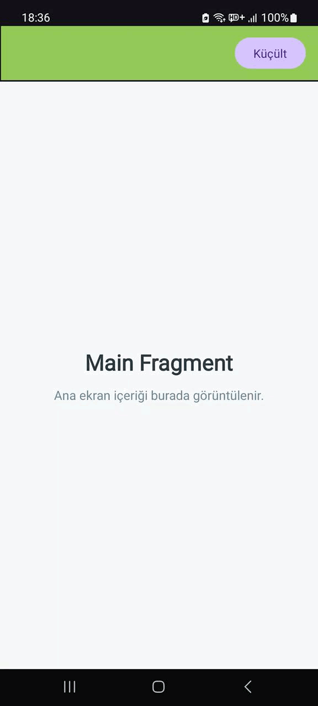

# Fragment Floating View

Bu uygulama, Android'de Fragment yapısını, Fragment yaşam döngüsünü ve Fragment yönetimini öğrenmek amacıyla hazırlanmıştır.

Projede `MainFragment` ve `FloatingFragment` olmak üzere iki farklı Fragment bulunmaktadır. Ana ekranda `MainFragment` görüntülenir. Kullanıcı üst bardaki **Küçült** butonuna bastığında ise `FloatingFragment`, ekranın sağ alt köşesinde bulunan daha küçük bir alanda gösterilir.

## Ekran Görüntüsü

<p align="center">
  
</p>

## Konu: Fragment

Fragment, bir Activity içerisinde kullanıcı arayüzünün belirli bir bölümünü temsil eden ve kendi yaşam döngüsüne sahip olan yeniden kullanılabilir arayüz bileşenidir.

Fragment'lar tek başlarına çalışmaz; bir Activity veya uygun bir Fragment içerisinde barındırılmaları gerekir.

Bir Activity içerisinde birden fazla Fragment kullanılabilir. Bu sayede ekranın farklı bölümleri birbirinden bağımsız şekilde yönetilebilir.

### Fragment ve Activity Arasındaki Farklar

| Activity | Fragment |
|---|---|
| Uygulamanın bir ekranını temsil edebilir. | Activity içerisindeki ekran parçasını temsil eder. |
| Kendi yaşam döngüsüne sahiptir. | Kendine ait bir yaşam döngüsüne sahiptir. |
| Manifest dosyasında tanımlanır. | Manifest dosyasında tanımlanmaz. |
| Intent ile başlatılabilir. | FragmentManager aracılığıyla yönetilir. |

## Fragment Oluşturma

Projede iki Fragment sınıfı bulunmaktadır:

- `MainFragment`: Ana ekranın içeriğini gösterir.
- `FloatingFragment`: Küçültülmüş ekran görünümünü gösterir.

Her Fragment için ayrı bir XML layout dosyası oluşturulmuştur:

- `fragment_main.xml`
- `fragment_floating.xml`

Fragment sınıfları `Fragment` sınıfından türetilir.

```kotlin
class MainFragment : Fragment() {

    override fun onCreateView(
        inflater: LayoutInflater,
        container: ViewGroup?,
        savedInstanceState: Bundle?
    ): View? {
        return inflater.inflate(
            R.layout.fragment_main,
            container,
            false
        )
    }
}
```

### onCreateView()

`onCreateView()`, Fragment'ın kullanıcı arayüzünü oluşturmak için kullanılan yaşam döngüsü metodudur.

- `inflater`: XML layout dosyasını View nesnesine dönüştürür.
- `container`: Fragment arayüzünün ekleneceği ViewGroup'u temsil eder.
- `savedInstanceState`: Önceki durumdan geri yüklenebilecek verileri içerir.
- `inflate()`: İlgili XML layout dosyasını View olarak oluşturur.

`container` parametresinin `inflate()` metoduna verilmesi, layout'un doğru ebeveyn bağlamında oluşturulmasını sağlar. Üçüncü parametrenin `false` olması ise View'ın bu aşamada container'a otomatik olarak eklenmesini engeller. Ekleme işlemini FragmentManager gerçekleştirir.

## Fragment Yönetimi: FragmentManager

Fragment'ları Activity içerisinde eklemek, kaldırmak veya değiştirmek için `FragmentManager` kullanılır.

Fragment üzerindeki değişiklikler `FragmentTransaction` aracılığıyla gerçekleştirilir.

Bu projede Activity içerisindeki `supportFragmentManager` kullanılarak Fragment işlemleri yönetilmiştir.

### Fragment Ekleme ve Değiştirme

```kotlin
val ft = supportFragmentManager.beginTransaction()

ft.replace(R.id.fragmentContainer, MainFragment())

ft.commit()
```

- `supportFragmentManager`: AppCompatActivity içerisindeki Fragment'ları yönetir.
- `beginTransaction()`: Yeni bir FragmentTransaction başlatır.
- `replace()`: Belirtilen container içerisindeki Fragment'ı yenisiyle değiştirir.
- `commit()`: Yapılan işlemi tamamlayarak FragmentTransaction'ın uygulanmasını sağlar.

Burada `R.id.fragmentContainer`, Fragment'ın yerleştirileceği XML container alanıdır.

Projede `MainActivity` açıldığında `MainFragment` bu alana yerleştirilir.

## Floating Fragment Görünümü

Uygulamanın ana ekranında üst bar ve Fragment içerik alanı bulunmaktadır. Ayrıca ana içerik alanının sağ alt köşesine sabitlenmiş, başlangıçta görünmeyen ayrı bir container tanımlanmıştır.

`activity_main.xml` içerisinde iki farklı Fragment container alanı kullanılmıştır:

- `fragmentContainer`: Ana Fragment'ın gösterildiği tam boyutlu alan.
- `floatingFragmentContainer`: Küçültülmüş Fragment'ın gösterileceği 200dp × 300dp boyutlarındaki alan.

Floating container başlangıçta gizlenir:

```kotlin
floatingContainer.visibility = View.INVISIBLE
```

Kullanıcı **Küçült** butonuna bastığında `minimizeFragment()` metodu çağrılır.

```kotlin
fun minimizeFragment() {
    val floatingContainer =
        findViewById<ConstraintLayout>(R.id.floatingFragmentContainer)

    floatingContainer.visibility = View.VISIBLE

    val ft = supportFragmentManager.beginTransaction()
    ft.replace(R.id.floatingFragmentContainer, FloatingFragment())
    ft.commit()
}
```

Bu metot içerisinde:

1. Floating container bulunur.
2. `View.VISIBLE` ile görünür hale getirilir.
3. Yeni bir FragmentTransaction başlatılır.
4. `FloatingFragment`, `floatingFragmentContainer` alanına yerleştirilir.
5. `commit()` ile işlem tamamlanır.

Böylece ana Fragment görünür kalırken ikinci Fragment ekranın sağ alt köşesinde daha küçük bir alanda gösterilir.

## Fragment Yaşam Döngüsü

Fragment'ların Activity'den bağımsız olarak yönetilen kendi yaşam döngüleri bulunur.

Temel yaşam döngüsü metotları şunlardır:

- `onAttach()`: Fragment, bağlı olduğu Context ile ilişkilendirilir.
- `onCreate()`: Fragment oluşturulurken başlangıç işlemleri gerçekleştirilir.
- `onCreateView()`: Fragment'ın kullanıcı arayüzü oluşturulur.
- `onViewCreated()`: Oluşturulan View üzerinde gerekli arayüz işlemleri yapılır.
- `onStart()`: Fragment görünür hale gelir.
- `onResume()`: Fragment kullanıcıyla etkileşime hazır hale gelir.
- `onPause()`: Fragment etkileşim odağını kaybeder.
- `onStop()`: Fragment artık görünür değildir.
- `onDestroyView()`: Fragment'ın View hiyerarşisi kaldırılır.
- `onDestroy()`: Fragment örneği sonlandırılır.
- `onDetach()`: Fragment, bağlı olduğu Activity veya Context ile ilişkisini keser.

Bu metotların tamamı her senaryoda aynı şekilde çalışmak zorunda değildir. Gerçekleşen yaşam döngüsü geçişleri Fragment'ın Activity ve View durumuna bağlıdır.

## Uygulama Akışı

1. Uygulama açıldığında `MainActivity` başlatılır.
2. `supportFragmentManager` ile `MainFragment`, ana container alanına eklenir.
3. Floating container başlangıçta `INVISIBLE` durumundadır.
4. Kullanıcı üst bardaki **Küçült** butonuna basar.
5. `minimizeFragment()` metodu çağrılır.
6. Floating container `VISIBLE` durumuna getirilir.
7. `FloatingFragment`, küçük container alanına eklenir.
8. Ana ekran içeriği korunurken küçültülmüş görünüm ekranın sağ alt köşesinde görüntülenir.

## Kullanılan Teknolojiler

- Kotlin
- Android SDK
- AndroidX Fragment
- AppCompat
- FragmentManager
- FragmentTransaction
- ConstraintLayout
- XML Layout

## Öğrenme Kazanımları

- Android'de Fragment kavramını öğrenme.
- Activity ve Fragment arasındaki farkları anlama.
- Fragment sınıfı oluşturma.
- Fragment için XML layout kullanma.
- `onCreateView()` metodunu kullanma.
- Fragment yaşam döngüsünü tanıma.
- `FragmentManager` ile Fragment yönetme.
- `FragmentTransaction` oluşturma.
- `replace()` ve `commit()` metotlarını kullanma.
- Bir Activity içerisinde birden fazla Fragment container kullanma.
- View görünürlüğünü `VISIBLE` ve `INVISIBLE` ile yönetme.
- Floating görünüm mantığını Fragment kullanarak uygulama.