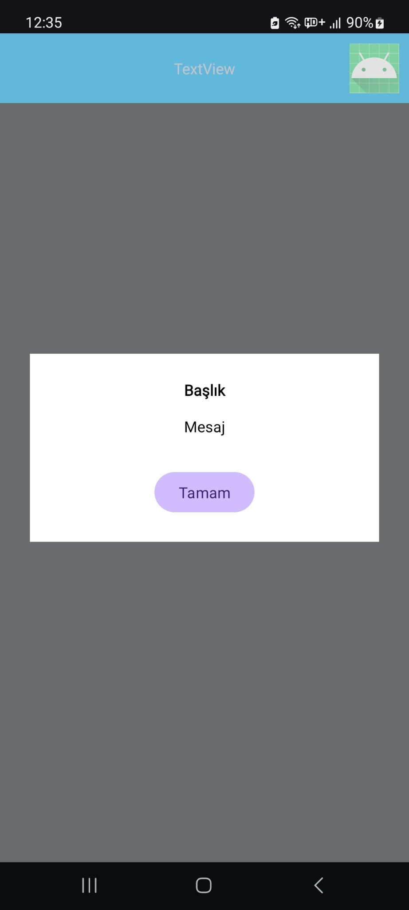

# Info Screen UI

Bu uygulama, Android'de XML Layout kullanarak özel arayüz bileşenleri (Custom UI) oluşturmayı ve farklı layout dosyalarını bir araya getirerek ekran tasarlamayı öğrenmek amacıyla hazırlanmıştır.

Uygulamada bir üst bar ve yarı saydam arka plan üzerinde görüntülenen özel bir uyarı penceresi tasarlanmıştır. Bu bileşenler ayrı XML dosyalarında oluşturulmuş ve ana layout içerisinde `include` etiketi kullanılarak birleştirilmiştir.

## Ekran Görüntüsü

<p align="center">
  
</p>

## Konu: Custom UI

Custom UI, Android uygulamalarında standart arayüz bileşenlerini özelleştirerek veya birden fazla bileşeni bir araya getirerek ihtiyaca uygun kullanıcı arayüzleri oluşturmaktır.

Android'de XML Layout kullanarak TextView, Button, ImageButton ve farklı ViewGroup bileşenleri bir araya getirilebilir. Bu bileşenlerin boyutları, konumları, renkleri ve diğer görsel özellikleri düzenlenerek özel ekran tasarımları hazırlanabilir.

Ayrıca arayüzün farklı bölümleri ayrı XML dosyalarında tanımlanarak yeniden kullanılabilir ve daha düzenli bir yapı elde edilebilir.

### Reusable Layouts

Büyük ekranları tek bir XML dosyasında oluşturmak yerine, arayüzün farklı bölümleri bağımsız layout dosyalarına ayrılabilir.

Bu yaklaşımın avantajları:

- XML dosyalarının daha düzenli ve okunabilir olmasını sağlar.
- Aynı arayüz bileşeninin farklı ekranlarda tekrar kullanılmasını kolaylaştırır.
- Her bileşenin tasarımını bağımsız olarak değiştirmeye olanak tanır.
- Bakım ve geliştirme süreçlerini kolaylaştırır.

Bu projede üst bar ve uyarı penceresi ayrı layout dosyalarında tanımlanmıştır.

### Include

Android XML Layout içerisinde başka bir layout dosyasını kullanmak için `<include>` etiketi kullanılabilir.

Örneğin:

```xml
<include
    layout="@layout/top_bar"
    app:layout_constraintEnd_toEndOf="parent"
    app:layout_constraintStart_toStartOf="parent"
    app:layout_constraintTop_toTopOf="parent" />
```

`layout` özelliği ile eklenecek XML dosyası belirtilir.

Bu projede `activity_main.xml` içerisinde hem `top_bar.xml` hem de `warning_popup.xml` dosyaları kullanılmıştır.

**activity_main.xml**

```xml
<androidx.constraintlayout.widget.ConstraintLayout
    xmlns:android="http://schemas.android.com/apk/res/android"
    xmlns:app="http://schemas.android.com/apk/res-auto"
    android:layout_width="match_parent"
    android:layout_height="match_parent">

    <include
        layout="@layout/top_bar"
        app:layout_constraintEnd_toEndOf="parent"
        app:layout_constraintStart_toStartOf="parent"
        app:layout_constraintTop_toTopOf="parent" />

    <include
        layout="@layout/warning_popup"
        app:layout_constraintEnd_toEndOf="parent"
        app:layout_constraintStart_toStartOf="parent"
        app:layout_constraintTop_toTopOf="parent" />

</androidx.constraintlayout.widget.ConstraintLayout>
```

Bu yöntem sayesinde ana ekran, bağımsız olarak hazırlanan iki layout'un bir araya getirilmesiyle oluşturulmuştur.

### Custom Top Bar

Üst bar, uygulamanın üst bölümünde konumlandırılan ve başlık veya navigasyon kontrolleri gibi bileşenleri içerebilen özel bir arayüz alanıdır.

Bu projede `top_bar.xml` dosyasında ConstraintLayout kullanılarak 70dp yüksekliğinde bir üst bar tasarlanmıştır.

**top_bar.xml**

İçerisinde:

- Mavi arka plan rengi.
- Ortalanmış bir TextView.
- Sağ tarafa hizalanmış bir ImageButton.

bulunmaktadır.

ImageButton bileşeninde `app:srcCompat` özelliği kullanılarak görsel kaynak atanmıştır.

```xml
<ImageButton
    android:layout_width="50dp"
    android:layout_height="50dp"
    android:layout_marginEnd="10dp"
    app:layout_constraintBottom_toBottomOf="parent"
    app:layout_constraintEnd_toEndOf="parent"
    app:layout_constraintTop_toTopOf="parent"
    app:srcCompat="@mipmap/ic_launcher" />
```

### Custom Warning Popup

Android uygulamalarında kullanıcıya önemli bir bilgi, uyarı veya onay mesajı göstermek için popup tasarımları kullanılabilir.

Bu projede `warning_popup.xml` dosyasında özel bir uyarı penceresi tasarlanmıştır.

Tasarım üç temel bölümden oluşur:

- **Background Overlay:** Ekranın tamamını kaplayan yarı saydam arka plan.
- **Content Container:** Uyarı penceresinin beyaz arka planlı içerik alanı.
- **Popup Content:** Başlık, açıklama metni ve Tamam butonu.

Arka plan üzerinde kullanılan renk tanımı:

```xml
android:background="#7EC4C4C4"
```

Bu renk tanımındaki alfa kanalı, arka planın yarı saydam görünmesini sağlar.

Popup içeriği ise ekranın ortasına yerleştirilmiş iç içe bir ConstraintLayout içerisinde oluşturulmuştur. İçerik alanında `padding` ve `layout_marginHorizontal` kullanılarak boşluklar düzenlenmiştir.

**warning_popup.xml** içerisinde kullanılan temel bileşenler:

- Başlık için TextView.
- Açıklama için TextView.
- Kullanıcı etkileşimi için Button.

Bu yapı, standart bir AlertDialog kullanmak yerine XML Layout ile özel bir popup görünümü oluşturma yaklaşımını gösterir.

## Uygulama Akışı

1. Ana ekran için `activity_main.xml` dosyası oluşturulur.
2. Üst bar tasarımı `top_bar.xml` içerisinde hazırlanır.
3. Uyarı penceresi tasarımı `warning_popup.xml` içerisinde oluşturulur.
4. Hazırlanan layout dosyaları ana ekrana `<include>` etiketiyle eklenir.
5. Uygulama çalıştırıldığında iki özel arayüz bileşeni aynı ekranda görüntülenir.

## Kullanılan Teknolojiler

- Kotlin
- Android SDK
- XML Layout
- ConstraintLayout
- TextView
- ImageButton
- Button
- Include

## Öğrenme Kazanımları

- Android'de XML kullanarak özel arayüz tasarımları oluşturma.
- Büyük layout dosyalarını daha küçük ve yönetilebilir parçalara ayırma.
- `<include>` etiketiyle farklı layout dosyalarını bir araya getirme.
- Yeniden kullanılabilir XML Layout yapısını anlama.
- ConstraintLayout ile arayüz bileşenlerini konumlandırma.
- Yarı saydam arka plan (overlay) oluşturma.
- Özel popup ve üst bar tasarımları hazırlama.