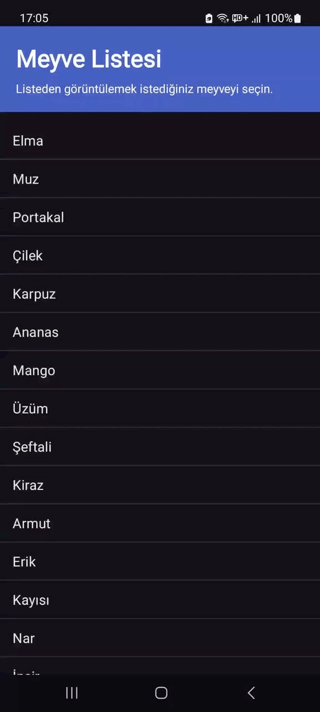

# ListView Basics

Bu proje, Android'de `ListView` bileşenini ve Adapter yapısıyla nasıl kullanıldığını öğrenmek amacıyla hazırlanmıştır.

Uygulamada `strings.xml` içerisinde tanımlanan meyve listesi bir `ArrayAdapter` aracılığıyla ListView bileşenine bağlanır. Kullanıcı liste elemanlarına kısa dokunarak veya uzun basarak farklı işlemler gerçekleştirebilir.

## Ekran Görüntüsü

<p align="center">
    
</p>

## Ele Alınan Konular

- ListView
- Adapter ve ArrayAdapter
- String Array kaynakları
- `ArrayAdapter.createFromResource()`
- `setOnItemClickListener()`
- `setOnItemLongClickListener()`
- AlertDialog
- Click ve Long Click olayları

## 1. ListView Nedir?

`ListView`, verileri dikey bir liste içerisinde görüntülemeyi sağlayan Android UI bileşenidir.

Liste elemanları ekrana sığmadığında kullanıcı listeyi kaydırarak diğer öğelere erişebilir. ListView, verilerin arayüzde gösterilmesi için bir Adapter ile birlikte çalışır.

Adapter, veri kaynağındaki öğeleri ListView tarafından görüntülenebilecek View bileşenlerine dönüştürür.

## 2. ArrayAdapter

`ArrayAdapter`, Array veya List içerisindeki verileri ListView gibi AdapterView bileşenlerine bağlamak için kullanılan Adapter türüdür.

Projede meyve isimleri `strings.xml` dosyasında bir String Array olarak tanımlanmıştır.

```xml
<string-array name="fruits">
    <item>Elma</item>
    <item>Muz</item>
    <item>Portakal</item>
    <item>Çilek</item>
    <item>Karpuz</item>
    <item>Ananas</item>
    <item>Mango</item>
    <item>Üzüm</item>
    <item>Şeftali</item>
    <item>Kiraz</item>
</string-array>
```

Bu kaynağa Kotlin üzerinden `R.array.fruits` referansıyla erişilebilir.

### ArrayAdapter Oluşturma

Projede Adapter, `ArrayAdapter.createFromResource()` metodu kullanılarak oluşturulmuştur.

```kotlin
val adapter = ArrayAdapter.createFromResource(
    this,
    R.array.fruits,
    android.R.layout.simple_list_item_1
)
```

Parametreler:

- **Context:** Adapter'ın kullanılacağı Activity context'ini belirtir.
- **Resource:** Verilerin bulunduğu String Array kaynağını belirtir.
- **Text View Resource:** Her liste öğesinin görünümünü belirleyen hazır Android layout kaynağını belirtir.

`android.R.layout.simple_list_item_1`, tek bir TextView içeren standart liste öğesi görünümüdür.

### ListView'a Adapter Atama

Adapter oluşturulduktan sonra ListView bileşenine atanır:

```kotlin
val listView = findViewById<ListView>(R.id.listView)
listView.adapter = adapter
```

Bu işlem sonucunda Adapter içerisindeki veriler ListView üzerinde görüntülenir.

## 3. Liste Elemanına Tıklama

ListView içerisindeki bir öğeye kısa süreli dokunulduğunda işlem gerçekleştirmek için `setOnItemClickListener()` kullanılır.

```kotlin
listView.setOnItemClickListener { parent, _, position, _ ->
    val selectedFruit = parent.getItemAtPosition(position).toString()

    AlertDialog.Builder(this)
        .setTitle("Meyve Seçildi")
        .setMessage("Seçtiğiniz meyve: $selectedFruit")
        .setPositiveButton("Tamam", null)
        .show()
}
```

`setOnItemClickListener()` parametreleri:

- `parent`: Tıklama olayının gerçekleştiği AdapterView nesnesi.
- `view`: Tıklanan öğenin View nesnesi.
- `position`: Tıklanan öğenin listedeki indeksi.
- `id`: Tıklanan öğenin Adapter tarafından sağlanan kimliği.

Projede `getItemAtPosition(position)` metodu ile tıklanan konumdaki meyve alınır. Ardından seçilen meyvenin adı bir AlertDialog içerisinde gösterilir.

## 4. Liste Elemanına Uzun Basma

ListView içerisindeki bir öğeye uzun süre basıldığında işlem gerçekleştirmek için `setOnItemLongClickListener()` kullanılır.

```kotlin
listView.setOnItemLongClickListener { parent, _, position, _ ->
    val selectedFruit = parent.getItemAtPosition(position).toString()

    AlertDialog.Builder(this)
        .setTitle(selectedFruit)
        .setItems(arrayOf("Meyve bilgisini göster", "İptal")) { dialog, which ->
            when (which) {
                0 -> {
                    AlertDialog.Builder(this)
                        .setTitle("$selectedFruit hakkında")
                        .setMessage("$selectedFruit meyvesini seçtiniz.")
                        .setPositiveButton("Tamam", null)
                        .show()
                }
                1 -> dialog.dismiss()
            }
        }
        .show()

    true
}
```

`setOnItemLongClickListener()` parametreleri:

- `parent`: Uzun basma olayının gerçekleştiği AdapterView nesnesi.
- `view`: Uzun basılan öğenin View nesnesi.
- `position`: Uzun basılan öğenin listedeki indeksi.
- `id`: Uzun basılan öğenin Adapter tarafından sağlanan kimliği.

Uzun basma işleminin sonunda döndürülen `Boolean` değer önemlidir:

- `true`: Uzun basma olayının işlendiğini belirtir.
- `false`: Olayın işlenmediğini belirtir ve başka işlemlerin de gerçekleşmesine izin verebilir.

Projede `true` döndürülerek uzun basma olayının işlendiği belirtilir.

## 5. AlertDialog

`AlertDialog`, kullanıcıya bilgi göstermek veya bir işlem seçtirmek için kullanılan iletişim penceresidir.

Projede iki farklı kullanım örneği bulunmaktadır:

**Bilgi gösterme:** Kullanıcı bir meyveye kısa süreli dokunduğunda seçilen meyvenin adı mesaj olarak gösterilir.

**Seçenek sunma:** Kullanıcı bir meyveye uzun bastığında "Meyve bilgisini göster" ve "İptal" seçenekleri sunulur.

`setItems()` metodu ile AlertDialog içerisinde seçeneklerden oluşan bir liste oluşturulabilir. Kullanıcının seçtiği öğe `which` parametresi üzerinden kontrol edilir.

## Uygulama Akışı

1. Meyve listesi `strings.xml` içerisinde tanımlanır.
2. `ArrayAdapter.createFromResource()` ile Adapter oluşturulur.
3. Adapter, ListView bileşenine atanır.
4. `setOnItemClickListener()` ile kısa dokunma olayı dinlenir.
5. Kısa dokunmada seçilen meyve AlertDialog içerisinde gösterilir.
6. `setOnItemLongClickListener()` ile uzun basma olayı dinlenir.
7. Uzun basmada kullanıcıya seçenekler sunulur.
8. Seçilen işleme göre meyve bilgisi gösterilir veya dialog kapatılır.

## Kullanılan Teknolojiler

- Kotlin
- Android SDK
- XML Layout
- ArrayAdapter
- ListView
- AlertDialog
- AndroidX AppCompat
- AndroidX Core KTX

## Öğrenme Kazanımları

- ListView bileşeninin çalışma mantığını anlama.
- ArrayAdapter ile veri kaynağını ListView'a bağlama.
- String Array kaynaklarını Kotlin üzerinden kullanma.
- Liste elemanlarına kısa dokunma ve uzun basma olaylarını yönetme.
- `getItemAtPosition()` ile seçilen öğeye erişme.
- AlertDialog ile kullanıcıya bilgi ve seçenek sunma.
