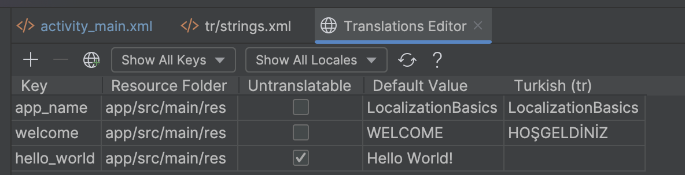

# Localization Basics

Bu uygulama, Android uygulamalarında çoklu dil desteğinin (Localization) nasıl yapılandırıldığını öğrenmek amacıyla hazırlanmıştır.

Uygulamada XML Layout üzerinde oluşturulan metin bileşenlerinin İngilizce ve Türkçe karşılıkları tanımlanmıştır. Kullanıcının cihazında tercih ettiği dile göre Android, ilgili dil için tanımlanmış kaynak dosyasını seçerek arayüz metinlerini görüntüler.

## Ekran Görüntüsü

<p align="center">
    
</p>

## Konu: Localization

Localization, bir uygulamanın farklı dilleri ve bölgesel ayarları destekleyecek şekilde uyarlanmasıdır.

Android uygulamalarında arayüz metinleri doğrudan XML Layout dosyalarına yazılmak yerine `strings.xml` dosyalarında tanımlanabilir. Farklı diller için ayrı kaynak klasörleri oluşturularak aynı metinlerin çevirileri merkezi olarak yönetilebilir.

Android, cihazın tercih edilen dilini ve mevcut kaynakları dikkate alarak uygun yerelleştirme dosyasını otomatik olarak seçer.

Bu projede İngilizce (`en`) ve Türkçe (`tr`) yerelleştirmeleri kullanılmıştır.

### String Resources

Android'de metin kaynakları `res/values/strings.xml` dosyasında tanımlanır.

XML Layout içerisinde bu metinlere `@string/` referansı kullanılarak erişilebilir.

Örneğin:

**activity_main.xml**

```xml
<TextView
    android:id="@+id/tvWelcome"
    android:layout_width="wrap_content"
    android:layout_height="wrap_content"
    android:text="@string/welcome" />
```

**res/values/strings.xml**

```xml
<resources>
    <string name="welcome">WELCOME</string>
</resources>
```

Burada `@string/welcome` referansı, `strings.xml` dosyasındaki `welcome` isimli metin kaynağını ifade eder.

Bu yöntem sayesinde arayüz metinleri layout dosyalarından ayrılarak merkezi olarak yönetilebilir.

### Non-Translatable Strings

Uygulamadaki her metnin farklı dillere çevrilmesi gerekmez. Marka isimleri, ürün adları, özel isimler veya dil değişikliğinden etkilenmemesi gereken sabit ifadeler çevrilebilir kaynakların dışında tutulabilir.

Android'de bunun için `translatable="false"` özelliği kullanılır.

Örneğin:

**res/values/strings.xml**

```xml
<resources>
    <string name="welcome">WELCOME</string>
    <string name="hello_world" translatable="false">Hello World!</string>
</resources>
```

`translatable="false"` olarak işaretlenen `hello_world` kaynağı, Android Studio Translations Editor içerisinde çevrilmesi gereken bir metin olarak değerlendirilmez.

Bu özellik özellikle aşağıdaki durumlarda kullanılabilir:

- Marka ve şirket isimleri.
- Ürün ve uygulama isimleri.
- Çevrilmeden korunması gereken özel isimler.
- Programlama dillerine veya teknik standartlara ait sabit ifadeler.

Bu sayede yalnızca gerçekten yerelleştirilmesi gereken metinler çeviri sürecine dahil edilir.

### Language-Specific Resource Directories

Android, farklı diller için kaynak dosyalarının ayrı klasörlerde tutulmasını destekler.

Her dil için `res` klasörü altında ilgili dil kodunu içeren bir kaynak klasörü oluşturulur.

Bu projede kullanılan dosya yapısı:

```text
res/
├── layout/
│   └── activity_main.xml
│
├── values/
│   ├── strings.xml
│   ├── colors.xml
│   └── themes.xml
│
└── values-tr/
    └── strings.xml
```

- `values/strings.xml`: Varsayılan dildeki metinleri içerir.
- `values-tr/strings.xml`: Türkçe çevirileri içerir.

`values` klasörü, belirli bir dil için özelleştirilmemiş varsayılan kaynakları barındırır.

`values-tr` klasörü ise Türkçe dil seçeneğine ait metinleri içerir.

### Strings.xml

Her dil için oluşturulan `strings.xml` dosyalarında aynı kaynak isimleri kullanılır. Böylece uygulama kodunda veya XML Layout içerisinde herhangi bir değişiklik yapmadan farklı dillerdeki metinler görüntülenebilir.

**res/values/strings.xml**

```xml
<resources>
    <string name="welcome">WELCOME</string>
</resources>
```

**res/values-tr/strings.xml**

```xml
<resources>
    <string name="welcome">HOŞGELDİNİZ</string>
</resources>
```

Burada her iki dosyada da `welcome` isimli kaynak tanımlanmıştır. Ancak değerleri farklıdır.

Android, cihazın tercih edilen dili Türkçe olduğunda `values-tr` içerisindeki karşılığı, eşleşen başka bir yerelleştirme bulunmadığında ise varsayılan `values` kaynağını kullanır.

### Default Resources ve Fallback Mechanism

Android'in kaynak seçme mekanizmasında varsayılan kaynaklar önemli bir yere sahiptir.

Cihazın tercih ettiği dil için uygun bir kaynak bulunamadığında Android, varsayılan `values` klasöründeki kaynakları kullanır.

Örneğin:

| Cihaz Dili | Kullanılan Kaynak                        |
| ---------- | ---------------------------------------- |
| Türkçe     | `values-tr/strings.xml`                  |
| İngilizce  | `values/strings.xml`                     |
| Fransızca  | `values/strings.xml` (varsayılan kaynak) |

Bu nedenle varsayılan kaynak klasöründe uygulamanın desteklediği temel metinlerin mutlaka bulunması gerekir.

### Translations Editor

Android Studio, uygulama kaynaklarındaki çevirileri merkezi olarak yönetmek için Translations Editor aracını sunar.

Bu araç üzerinden:

- String kaynakları listelenebilir.
- Yeni dil seçenekleri eklenebilir.
- Her dil için çeviriler girilebilir.
- Eksik çeviriler görüntülenebilir.
- Dil bazlı kaynak dosyaları yönetilebilir.

Translations Editor, farklı dillerdeki kaynakların karşılaştırılmasını ve yönetilmesini kolaylaştırır.

## Uygulama Akışı

1. `res/values/strings.xml` içerisinde varsayılan İngilizce metinler tanımlanır.
2. `values-tr` klasörü oluşturularak Türkçe kaynak dosyası eklenir.
3. Her iki `strings.xml` dosyasında aynı kaynak isimleri kullanılır.
4. XML Layout içerisindeki metinler `@string/` referanslarıyla çağrılır.
5. Uygulama çalıştırıldığında Android, cihazın tercih edilen diline uygun kaynak dosyasını seçer.

## Kullanılan Teknolojiler

- Kotlin
- Android SDK
- XML Layout
- Android Studio
- String Resources
- Localization
- Translations Editor

## Öğrenme Kazanımları

- Android uygulamalarına çoklu dil desteği ekleme.
- String Resources yapısını anlama.
- `strings.xml` dosyalarının kullanımını öğrenme.
- Dil bazlı kaynak klasörleri oluşturma.
- `values` ve `values-tr` klasörlerinin görevlerini anlama.
- Android kaynak seçme ve varsayılan kaynağa geri dönüş mekanizmasını öğrenme.
- Translations Editor ile çevirileri yönetme.
