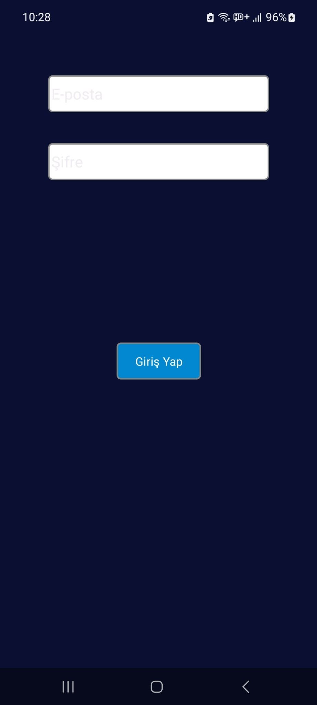

# Login Drawable

Bu uygulama, Android'de XML tabanlı Drawable kaynaklarının kullanılarak arayüz bileşenlerinin görsel özelliklerinin özelleştirilmesini öğrenmek amacıyla hazırlanmıştır.

Uygulamada e-posta ve şifre giriş alanları ile giriş butonundan oluşan basit bir login ekranı oluşturulmuştur. Bileşenlerin arka plan renkleri, köşe yuvarlaklıkları ve kenarlıkları XML Drawable dosyaları aracılığıyla tanımlanmıştır.

## Ekran Görüntüsü

<p align="center">
  
</p>

## Konu: Drawable

Drawable, Android uygulamalarında görsel kaynakları tanımlamak ve arayüz bileşenlerinin görünümünü özelleştirmek için kullanılan bir kaynak türüdür.

Drawable kaynakları XML dosyaları veya görsel dosyalar aracılığıyla oluşturulabilir. XML tabanlı Drawable yapıları sayesinde herhangi bir görsel dosyaya ihtiyaç duymadan şekiller, renkler, kenarlıklar ve farklı görsel efektler tanımlanabilir.

Drawable kaynakları `res/drawable` klasöründe tutulur ve XML Layout dosyalarında `@drawable/` referansıyla kullanılabilir.

### Shape Drawable

Shape Drawable, XML üzerinden geometrik şekiller oluşturmayı ve bu şekillerin görsel özelliklerini belirlemeyi sağlar.

`<shape>` etiketi içerisinde farklı özellikler tanımlanabilir:

- **solid:** Şeklin dolgu rengini belirler.
- **corners:** Şeklin köşelerinin yuvarlaklığını belirler.
- **stroke:** Şeklin kenarlık rengini ve kalınlığını belirler.
- **gradient:** Şekle renk geçişi ekler.
- **padding:** Şeklin iç boşluklarını belirler.

Bu özellikler ihtiyaca göre bir arada kullanılabilir.

### Solid

`solid`, oluşturulan şeklin iç dolgu rengini belirlemek için kullanılır.

Örneğin:

```xml
<shape xmlns:android="http://schemas.android.com/apk/res/android">
    <solid android:color="#FFFFFF" />
</shape>
```

Bu tanımlama, beyaz renkte bir Drawable oluşturur.

### Corners

`corners`, şeklin köşelerini yuvarlaklaştırmak için kullanılır.

```xml
<corners android:radius="5dp" />
```

`android:radius` özelliği ile köşe yuvarlaklığının değeri belirlenir.

### Stroke

`stroke`, şeklin etrafına kenarlık eklemek için kullanılır.

```xml
<stroke
    android:color="#858585"
    android:width="2dp" />
```

- `android:color`: Kenarlık rengini belirler.
- `android:width`: Kenarlık kalınlığını belirler.

### Gradient

`gradient`, Drawable içerisinde bir renkten diğerine geçiş oluşturmak için kullanılır. Renk geçişinin başlangıç ve bitiş renkleri ile yönü tanımlanabilir.

Örneğin:

```xml
<gradient
    android:startColor="#0288D1"
    android:endColor="#0B1032"
    android:angle="0" />
```

Bu özellik, düz renkler yerine geçişli arka planlar oluşturmak için kullanılabilir.

## Projede Kullanılan Drawable Kaynakları

Bu projede iki farklı Shape Drawable dosyası oluşturulmuştur.

### Text Field Background

**res/drawable/text_field.xml**

```xml
<?xml version="1.0" encoding="utf-8"?>
<shape xmlns:android="http://schemas.android.com/apk/res/android">
    <solid android:color="#FFFFFF" />
    <corners android:radius="5dp" />
    <stroke android:color="#858585" android:width="2dp" />
</shape>
```

Bu Drawable, e-posta ve şifre giriş alanlarında kullanılmıştır.

Beyaz dolgu rengi, 5dp köşe yuvarlaklığı ve 2dp kalınlığında gri kenarlık tanımlanmıştır.

### Button Background

**res/drawable/button_background.xml**

```xml
<?xml version="1.0" encoding="utf-8"?>
<shape xmlns:android="http://schemas.android.com/apk/res/android">
    <solid android:color="#0288D1" />
    <corners android:radius="5dp" />
    <stroke android:color="#858585" android:width="2dp" />
</shape>
```

Bu Drawable, giriş butonunun arka planında kullanılmıştır.

Mavi dolgu rengi, 5dp köşe yuvarlaklığı ve 2dp kalınlığında gri kenarlık tanımlanmıştır.

### Drawable Kaynaklarını Layout İçerisinde Kullanma

Oluşturulan Drawable kaynakları, XML Layout içerisindeki bileşenlerin `android:background` özelliği kullanılarak atanabilir.

Örneğin:

```xml
<EditText
    android:layout_width="287dp"
    android:layout_height="48dp"
    android:background="@drawable/text_field" />

<Button
    android:layout_width="wrap_content"
    android:layout_height="wrap_content"
    android:background="@drawable/button_background"
    android:text="Giriş Yap"
    app:backgroundTint="@null" />
```

Burada `@drawable/text_field` ve `@drawable/button_background` referansları, ilgili XML Drawable kaynaklarını bileşenlerin arka planına uygular.

Buton üzerinde kullanılan `app:backgroundTint="@null"` tanımlaması ise varsayılan Material arka plan renklendirmesinin özel Drawable görünümünü etkilemesini önler.

## Uygulama Akışı

1. Login ekranı için ConstraintLayout tabanlı XML Layout oluşturulur.
2. E-posta ve şifre alanlarının görünümü için `text_field.xml` dosyası hazırlanır.
3. Giriş butonunun görünümü için `button_background.xml` dosyası hazırlanır.
4. Drawable kaynakları ilgili bileşenlerin `android:background` özelliklerine atanır.
5. Uygulama çalıştırıldığında özelleştirilmiş login ekranı görüntülenir.

## Kullanılan Teknolojiler

- Kotlin
- Android SDK
- XML Layout
- ConstraintLayout
- Shape Drawable
- Android Studio

## Öğrenme Kazanımları

- Android Drawable kaynaklarının ne amaçla kullanıldığını öğrenme.
- XML tabanlı Shape Drawable oluşturma.
- `solid`, `corners` ve `stroke` özelliklerini kullanma.
- Drawable kaynaklarını XML Layout içerisindeki bileşenlere uygulama.
- Arayüz bileşenlerinin arka plan, kenarlık ve köşe özelliklerini özelleştirme.
- Drawable kaynaklarını merkezi ve yeniden kullanılabilir şekilde yönetme.