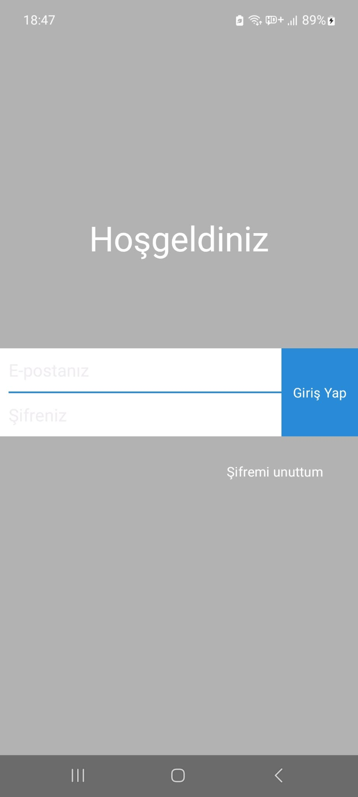

# Login UI

## Açıklama

Bu proje, Android uygulamalarında XML Layout kullanılarak basit bir login ekranı arayüzü oluşturmak amacıyla hazırlanmıştır.

Ekranda e-posta ve şifre giriş alanları, giriş yap butonu ve şifremi unuttum bağlantısı bulunmaktadır.

Arayüz tasarımında `ConstraintLayout` ve `LinearLayout` kullanılarak UI bileşenlerinin konumları, boyutları ve birbirleriyle olan ilişkileri tanımlanmıştır.

## Ekran Görüntüsü

<p align="center">
  
</p>

## Öğrenilen Konular

### Android UI Bileşenleri

Android uygulamalarında kullanıcı arayüzü, farklı görevleri yerine getiren View bileşenleri kullanılarak oluşturulur.

Bu projede aşağıdaki Android UI bileşenleri kullanılmıştır:

- `TextView`: Hoşgeldiniz başlığını göstermek için kullanılır.
- `EditText`: E-posta ve şifre giriş alanlarını oluşturmak için kullanılır.
- `Button`: Giriş yap ve şifremi unuttum butonları.
- `View`: E-posta ve şifre alanları arasındaki ayırıcı çizgiyi oluşturmak için kullanılır.
- `LinearLayout`: E-posta ve şifre alanlarını dikey olarak gruplamak için kullanılır.
- `ConstraintLayout`: Ekrandaki bileşenlerin konumlarını ve birbirleriyle olan ilişkilerini belirlemek için kullanılır.

### XML Layout

Android uygulamalarında XML Layout dosyaları, kullanıcı arayüzünün görsel yapısını tanımlamak için kullanılır.

Bu projede arayüzün tamamı `activity_main.xml` dosyası üzerinden oluşturulmuştur. UI bileşenlerinin hiyerarşisi, boyutları, metinleri, renkleri ve hizalamaları XML özellikleri aracılığıyla düzenlenmiştir.

### ConstraintLayout

`ConstraintLayout`, arayüz bileşenlerinin birbirlerine veya parent layout'a göre konumlandırılmasını sağlayan bir ViewGroup yapısıdır.

Bu projede `ConstraintLayout` kullanılarak:

- Welcome başlığının yatay ve dikey konumu belirlenmiştir.
- Giriş alanlarını içeren LinearLayout ekranın ortasına yerleştirilmiştir.
- Giriş butonu, giriş alanlarının sağ tarafına konumlandırılmıştır.
- Şifremi unuttum butonu, giriş butonunun altında konumlandırılmıştır.

ConstraintLayout içerisinde kullanılan bazı constraint örnekleri:

- **Start / End:** Bileşenlerin yatay konumlarını belirlemek.
- **Top / Bottom:** Bileşenlerin dikey konumlarını belirlemek.
- **Center:** Bir bileşeni yatay veya dikey eksende ortalamak.
- **Spacing / Margin:** Bileşenler arasındaki boşlukları düzenlemek.

Bu ilişkiler sayesinde ekran bileşenlerinin konumları tanımlanmıştır.

### LinearLayout

`LinearLayout`, içerisindeki View bileşenlerini yatay (`horizontal`) veya dikey (`vertical`) olarak sıralamayı sağlar.

Bu projede e-posta ve şifre giriş alanlarını gruplamak için dikey yönlendirmeye sahip bir LinearLayout kullanılmıştır.

Ayrıca `layout_weight` özelliği sayesinde iki EditText bileşeninin container içerisindeki kullanılabilir yüksekliği paylaşması sağlanmıştır.

### EditText ve InputType

`EditText`, kullanıcıdan metin girdisi almak için kullanılan Android UI bileşenidir.

Bu projede iki farklı giriş alanı bulunmaktadır:

- **E-posta:** `textEmailAddress` inputType değeri kullanılarak e-posta girişine uygun klavye türü tanımlanmıştır.
- **Şifre:** `textPassword` inputType değeri kullanılarak girilen karakterlerin gizlenmesi sağlanmıştır.

`hint` özelliği ile kullanıcıya giriş alanlarının amacı hakkında bilgi verilmiştir.

### Edge-to-Edge

Edge-to-Edge yaklaşımı, uygulama arayüzünün sistem çubuklarının arkasına kadar uzanmasını sağlar.

Bu projede `enableEdgeToEdge()` metodu kullanılarak Edge-to-Edge desteği etkinleştirilmiştir.

Ardından `ViewCompat.setOnApplyWindowInsetsListener()` ile sistem çubuklarının kapladığı alanlar alınarak ana layout'a padding olarak uygulanmıştır.

```kotlin
enableEdgeToEdge()

ViewCompat.setOnApplyWindowInsetsListener(findViewById(R.id.main)) { view, insets ->
    val systemBars = insets.getInsets(WindowInsetsCompat.Type.systemBars())
    view.setPadding(
        systemBars.left,
        systemBars.top,
        systemBars.right,
        systemBars.bottom
    )
    insets
}
```

Bu işlem, uygulama içeriğinin durum çubuğu ve gezinme çubuğu gibi sistem arayüzleriyle çakışmasını önlemeye yardımcı olur.

## Arayüz Yapısı

Login ekranı temel olarak üç bölümden oluşur:

1. **Başlık:** Ekranın üst bölümünde bulunan "Hoşgeldiniz" metni.
2. **Giriş alanları:** E-posta ve şifre için iki adet EditText ve giriş işlemi için bir buton.
3. **Şifremi unuttum:** Giriş alanlarının altında konumlandırılmış buton.

E-posta ve şifre alanları aynı LinearLayout içerisinde gruplanmıştır. Bu alanlar arasındaki mavi çizgi ise ayrı bir View bileşeni kullanılarak oluşturulmuştur.

Ana arayüz ConstraintLayout içerisinde düzenlenmiştir.

## Kullanılan Teknolojiler

- Kotlin
- Android SDK
- XML Layout
- ConstraintLayout
- LinearLayout
- AndroidX AppCompat
- AndroidX Core KTX
- Edge-to-Edge

## Öğrenme Kazanımları

- Android UI bileşenlerini kullanarak arayüz oluşturma.
- XML Layout ile kullanıcı arayüzü tasarlama.
- ConstraintLayout ile bileşenlerin konumlarını ve boyutlarını düzenleme.
- LinearLayout ve orientation kullanımını öğrenme.
- EditText ve inputType özelliklerini kullanma.
- layout_weight ile alan paylaşımını yönetme.
- Android Edge-to-Edge yaklaşımını ve WindowInsets kullanımını öğrenme.