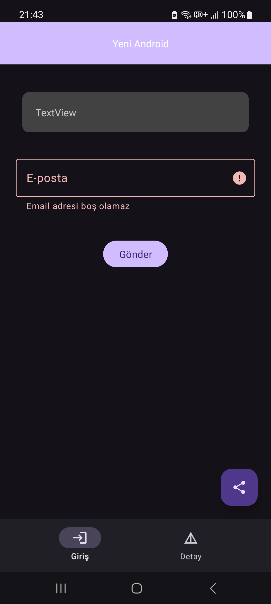

# Material Design Basics

Bu proje, Android uygulamalarında Material Design bileşenlerinin kullanımını ve XML üzerinden modern arayüzler oluşturmayı ele alır.

Projede AppBar, Toolbar, CardView, TextInputLayout, FloatingActionButton ve BottomNavigationView gibi bileşenler kullanılmıştır. Ayrıca form alanında e-posta doğrulaması, Toolbar yapılandırması ve kullanıcı etkileşimleri ele alınmıştır.

Uygulamanın teması `Theme.Material3.DayNight.NoActionBar` olarak yapılandırılmıştır.

## Ekran Görüntüsü

<p align="center">
  
</p>

## Ele Alınan Konular

- Material Design ve Material Components
- Material 3 tema yapılandırması
- `AppBarLayout`
- `CollapsingToolbarLayout`
- `Toolbar`
- `CardView`
- `TextInputLayout` ve `TextInputEditText`
- `FloatingActionButton`
- `BottomNavigationView`
- `NestedScrollView`
- XML layout tasarımı
- E-posta formatı doğrulama
- Toolbar yapılandırması
- `ContextCompat.getColor()`

## 1. Material Design Nedir?

Material Design, Google tarafından geliştirilen bir tasarım sistemidir. Android uygulamalarında tutarlı, erişilebilir ve kullanıcı dostu arayüzler oluşturmak için bileşenler, renkler, tipografi ve etkileşim kuralları sunar.

Android projelerinde Material Design bileşenlerini kullanabilmek için Material Components kütüphanesinden yararlanılabilir.

Projede kullanılan temel tema:

```xml
<style name="Base.Theme.MaterialDesignBasics"
    parent="Theme.Material3.DayNight.NoActionBar">
    ...
</style>
```

`Theme.Material3.DayNight.NoActionBar`, Material 3 tasarım sistemini temel alan ve açık/koyu tema desteği sunan bir temadır. `NoActionBar` sayesinde varsayılan ActionBar gösterilmez. Böylece uygulama kendi Toolbar bileşenini kullanabilir.

## 2. AppBarLayout ve CollapsingToolbarLayout

`AppBarLayout`, uygulamanın üst bölümündeki AppBar alanını yönetmek için kullanılan bir Material Components bileşenidir.

`CollapsingToolbarLayout` ise kaydırma sırasında Toolbar alanının genişleyip daralmasına imkân tanır.

Projede bu bileşenler, ekranın üst bölümündeki başlık alanını oluşturmak için kullanılmıştır.

`AppBarLayout` genellikle `CoordinatorLayout` içerisinde kullanılır. Bu yapı, AppBar ile kaydırılabilir içerik arasındaki scroll koordinasyonunu sağlar.

## 3. Toolbar

`Toolbar`, uygulamanın üst kısmında başlık ve işlem alanı oluşturmak için kullanılır.

Projede Toolbar, Activity içerisinde ActionBar olarak atanmıştır:

```kotlin
setSupportActionBar(toolbar)
```

Bu işlemden sonra Toolbar, Activity'nin ActionBar'ı olarak kullanılabilir.

Başlık metnini değiştirmek için:

```kotlin
setTitle("Android")
```

Toolbar başlık rengini değiştirmek için `setTitleTextColor()` metodu kullanılmıştır:

```kotlin
toolbar.setTitleTextColor(
    ContextCompat.getColor(this, R.color.blue)
)
```

Burada `ContextCompat.getColor()` kullanılarak renk kaynağından renk değeri alınır.

Gerekli import:

```kotlin
import androidx.core.content.ContextCompat
```

`ContextCompat.getColor()` AndroidX Core kütüphanesinin sunduğu uyumluluk metodudur. Eski `resources.getColor()` kullanımına göre tercih edilebilir ve farklı Android sürümlerinde renk kaynağına erişimi kolaylaştırır.

## 4. CardView

`CardView`, içerikleri kart görünümünde sunmak için kullanılan AndroidX bileşenidir.

Kart görünümüne köşe yuvarlaklığı ve elevation gibi görsel özellikler kazandırılabilir.

Projede form ve içerik alanlarının görsel olarak ayrıştırılmasında kullanılmıştır.

CardView, Material Components kütüphanesindeki bir bileşen değildir; AndroidX kütüphanesinin parçasıdır.

## 5. TextInputLayout ve TextInputEditText

`TextInputLayout`, metin giriş alanlarına Material Design görünümü ve ek etkileşim özellikleri kazandırır.

`TextInputEditText` ise kullanıcının metin girişi yaptığı alandır.

Projede e-posta girişi için bu bileşenler birlikte kullanılmıştır:

```xml
<com.google.android.material.textfield.TextInputLayout
    ...>

    <com.google.android.material.textfield.TextInputEditText
        ...
        android:inputType="textEmailAddress" />

</com.google.android.material.textfield.TextInputLayout>
```

`TextInputLayout` üzerinden giriş alanına hata mesajı eklenebilir:

```kotlin
textInputLayout.error = "Geçerli bir e-posta adresi giriniz."
```

Bu sayede doğrulama sonucunda kullanıcıya ilgili alanın altında hata mesajı gösterilebilir.

## 6. E-posta Doğrulama

Projede e-posta adresinin biçimini kontrol etmek için Android'in `Patterns.EMAIL_ADDRESS` yapısı kullanılmıştır.

```kotlin
val email = textInputEditText.text.toString()

if (Patterns.EMAIL_ADDRESS.matcher(email).matches()) {
    textInputLayout.error = null
} else {
    textInputLayout.error = "Geçerli bir e-posta adresi giriniz."
}
```

`Patterns.EMAIL_ADDRESS`, girilen metnin e-posta adresi biçimine uygun olup olmadığını kontrol eder.

Bu kontrol yalnızca biçim doğrulamasıdır. E-posta adresinin gerçekten var olduğunu veya kullanıcıya ait olduğunu doğrulamaz.

## 7. FloatingActionButton

`FloatingActionButton` (FAB), ekranda öne çıkan temel bir işlemi temsil etmek için kullanılan Material Design bileşenidir.

Projede FAB tıklama olayı bir Toast mesajı gösterecek şekilde tanımlanmıştır:

```kotlin
fab.setOnClickListener {
    Toast.makeText(
        this,
        "FAB clicked",
        Toast.LENGTH_SHORT
    ).show()
}
```

FAB genellikle kullanıcıların sık gerçekleştirdiği temel işlemlere hızlı erişim sağlamak için kullanılır.

## 8. BottomNavigationView

`BottomNavigationView`, uygulamanın alt bölümünde birden fazla ana ekran veya bölüm arasında geçiş yapmak için kullanılan Material Components bileşenidir.

Projede menü öğeleri ayrı bir XML dosyasında tanımlanmıştır:

```xml
<item
    android:id="@+id/signIn"
    android:title="Sign In"
    ... />

<item
    android:id="@+id/detail"
    android:title="Detail"
    ... />
```

Menü öğelerine tıklama olayları `setOnItemSelectedListener()` ile dinlenir:

```kotlin
bottomNavigationView.setOnItemSelectedListener { item ->
    when (item.itemId) {
        R.id.signIn -> {
            Toast.makeText(this, "Sign In", Toast.LENGTH_SHORT).show()
            true
        }

        R.id.detail -> {
            Toast.makeText(this, "Detail", Toast.LENGTH_SHORT).show()
            true
        }

        else -> false
    }
}
```

Bu projede menü öğelerine tıklandığında Toast mesajı gösterilmektedir. Gerçek ekran veya Fragment navigasyonu uygulanmamıştır.

## 9. NestedScrollView

`NestedScrollView`, içeriğin ekran boyutunu aşması durumunda kaydırılabilir bir alan oluşturur.

Ayrıca iç içe kaydırılabilir bileşenlerle çalışabilmesi için nested scrolling desteği sunar.

Projede form alanlarının ekran boyutunu aşması durumunda dikey kaydırma sağlamak için kullanılmıştır.

## 10. Projede Kullanılan Diğer Bileşenler

| Bileşen | Kullanım amacı |
| --- | --- |
| `AppBarLayout` | Üst uygulama çubuğunu yönetmek |
| `CollapsingToolbarLayout` | Kaydırma sırasında daralıp genişleyen başlık alanı oluşturmak |
| `Toolbar` | Uygulama başlığı ve üst işlem alanı |
| `CardView` | Kart görünümünde içerik sunmak |
| `TextInputLayout` | Metin giriş alanlarına Material görünümü ve hata göstergesi eklemek |
| `TextInputEditText` | Kullanıcıdan metin almak |
| `FloatingActionButton` | Öne çıkan bir işlem sunmak |
| `BottomNavigationView` | Alt navigasyon menüsü oluşturmak |
| `NestedScrollView` | Kaydırılabilir içerik alanı oluşturmak |

## Öğrenilenler

- Material Design ve Material 3 tema yapılandırması
- Material Components bileşenlerinin XML içerisinde kullanımı
- AppBar ve Toolbar yapılandırması
- CollapsingToolbarLayout ile daralabilir başlık alanı oluşturmak
- CardView ile kart görünümü oluşturmak
- TextInputLayout ile form alanlarını düzenlemek
- Patterns.EMAIL_ADDRESS ile e-posta formatı kontrolü
- FloatingActionButton tıklama olaylarını yönetmek
- BottomNavigationView menü öğelerini dinlemek
- NestedScrollView ile kaydırılabilir içerik oluşturmak
- ContextCompat ile kaynaklardan renk değerlerini almak

## Kullanılan Teknolojiler

- Kotlin
- Android SDK
- Material Components for Android
- AndroidX AppCompat
- AndroidX Core
- AndroidX CardView
- ConstraintLayout
- XML Layouts
