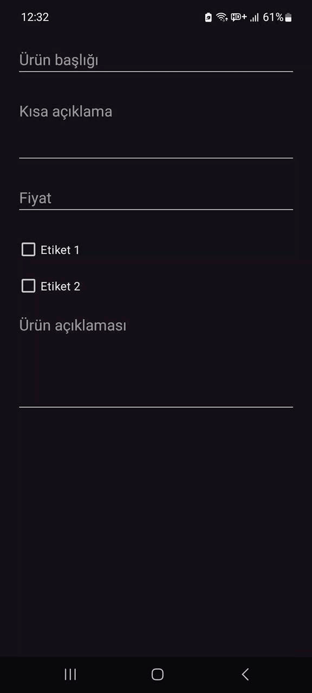

# Product Form UI

Bu uygulama, Android'de iç içe kaydırılabilir alanlar oluşturmak için kullanılan NestedScrollView bileşenini öğrenmek amacıyla hazırlanmıştır.

Projede ürün ekleme ekranı tasarlanmıştır. Ürün başlığı, kısa açıklama, fiyat, etiketler ve detaylı açıklama alanlarından oluşan form içerisinde hem ScrollView hem de NestedScrollView kullanılmıştır.

## Ekran Görüntüsü

<p align="center">
  
</p>

## Konu: NestedScrollView

NestedScrollView, Android'de iç içe kaydırma (nested scrolling) desteği sağlayan bir ViewGroup bileşenidir.

Özellikle bir kaydırılabilir alanın içerisinde başka bir kaydırılabilir bileşen bulunduğunda kullanılır. İç içe kaydırma davranışını destekleyerek parent ve child bileşenlerin scroll hareketlerini koordineli şekilde yönetmesine yardımcı olur.

`NestedScrollView`, AndroidX Core kütüphanesinde bulunur ve `ScrollView` yapısına benzer şekilde varsayılan olarak dikey kaydırmayı destekler.

### ScrollView ve NestedScrollView

ScrollView ve NestedScrollView benzer amaçlarla kullanılır ancak iç içe kaydırma senaryolarında farklılık gösterirler.

| Özellik | ScrollView | NestedScrollView |
| --- | --- | --- |
| Dikey kaydırma | Destekler | Destekler |
| Tek child View | Evet | Evet |
| Nested scrolling desteği | Yerleşik koordinasyon desteği yok | Destekler |
| AndroidX | Framework bileşeni | AndroidX Core bileşeni |

NestedScrollView, özellikle kendisi de kaydırılabilir bir parent içerisinde bulunan kaydırılabilir içeriklerde tercih edilebilir.

### Nested Scrolling

Nested scrolling, birbiri içerisinde bulunan kaydırılabilir bileşenlerin scroll hareketlerini koordineli şekilde yönetmesini sağlayan mekanizmadır.

Örneğin:

- Dış ScrollView, formun tamamını kaydırır.
- İç NestedScrollView, kendi sınırları içerisindeki etiket listesini kaydırır.

Kullanıcı iç alanda kaydırma yaptığında nested scrolling mekanizması, hareketin parent ve child bileşenler arasında nasıl paylaşılacağını yönetir.

Bu sayede her iki alanın kaydırma davranışı birlikte çalışabilir.

### NestedScrollView Kullanımı

NestedScrollView, XML Layout içerisinde diğer ViewGroup bileşenleri gibi tanımlanabilir.

Örneğin:

```xml
<androidx.core.widget.NestedScrollView
    android:layout_width="match_parent"
    android:layout_height="100dp"
    android:fillViewport="true">

    <LinearLayout
        android:layout_width="match_parent"
        android:layout_height="wrap_content"
        android:orientation="vertical">

        <CheckBox
            android:layout_width="match_parent"
            android:layout_height="wrap_content"
            android:text="Etiket 1" />

        <CheckBox
            android:layout_width="match_parent"
            android:layout_height="wrap_content"
            android:text="Etiket 2" />

    </LinearLayout>

</androidx.core.widget.NestedScrollView>
```

Burada:

- `layout_width`: Kaydırma alanının genişliğini belirler.
- `layout_height`: Kaydırma alanının yüksekliğini belirler.
- `fillViewport`: İçeriğin görünür alanın yüksekliğini doldurmasını sağlar.

NestedScrollView da doğrudan yalnızca bir child View kabul eder. Birden fazla bileşen kullanılacaksa bunlar LinearLayout veya ConstraintLayout gibi bir ViewGroup içerisinde toplanmalıdır.

### NestedScrollView İçerisinde ScrollView Kullanımı

Bir ScrollView içerisinde başka bir kaydırılabilir alan oluşturulması gerektiğinde NestedScrollView tercih edilebilir.

Bu yapıda dış ScrollView ve iç NestedScrollView birbirinden bağımsız kaydırılabilir alanlar oluşturur.

İç alanın yüksekliği sınırlandırıldığında, içerisindeki içerik bu alanı aştığı takdirde kendi içerisinde kaydırılabilir.

## Projede Kullanımı

Bu projede ürün ekleme formunun tamamı bir ScrollView içerisinde tutulmuştur. Formun etiket listesi ise ayrıca NestedScrollView içerisine yerleştirilmiştir.

**activity_main.xml**

```xml
<ScrollView
    android:layout_width="0dp"
    android:layout_height="0dp">

    <LinearLayout
        android:layout_width="match_parent"
        android:layout_height="wrap_content"
        android:orientation="vertical">

        <!-- Ürün başlığı -->
        <EditText
            android:layout_width="match_parent"
            android:layout_height="wrap_content"
            android:hint="Ürün başlığı" />

        <!-- Kısa açıklama -->
        <EditText
            android:layout_width="match_parent"
            android:layout_height="wrap_content"
            android:hint="Kısa açıklama"
            android:inputType="textCapSentences|textMultiLine" />

        <!-- Fiyat -->
        <EditText
            android:layout_width="match_parent"
            android:layout_height="wrap_content"
            android:hint="Fiyat"
            android:inputType="numberDecimal" />

        <!-- Etiket listesi -->
        <androidx.core.widget.NestedScrollView
            android:layout_width="match_parent"
            android:layout_height="100dp">

            <LinearLayout
                android:layout_width="match_parent"
                android:layout_height="wrap_content"
                android:orientation="vertical">

                <!-- CheckBox bileşenleri -->

            </LinearLayout>

        </androidx.core.widget.NestedScrollView>

        <!-- Ürün açıklaması -->
        <EditText
            android:layout_width="match_parent"
            android:layout_height="wrap_content"
            android:hint="Ürün açıklaması"
            android:inputType="textCapSentences|textMultiLine"
            android:minLines="5" />

    </LinearLayout>
</ScrollView>
```

Formun bölümleri:

| Alan | Kullanılan bileşen |
| --- | --- |
| Ürün başlığı | EditText |
| Kısa açıklama | EditText |
| Fiyat | EditText |
| Etiket listesi | NestedScrollView + CheckBox |
| Ürün açıklaması | EditText |

Etiket listesinin yüksekliği `100dp` olarak sınırlandırılmıştır. Böylece uzun etiket listesi formun tamamını genişletmek yerine kendi kaydırılabilir alanında görüntülenebilir.

### Keyboard ve WindowInsetsCompat

Form ekranlarında klavye açıldığında kullanılabilir ekran alanı daralır. Bu nedenle sistem çubukları ve klavye tarafından kaplanan alanların dikkate alınması gerekir.

Bu projede `WindowInsetsCompat.Type.systemBars()` ve `WindowInsetsCompat.Type.ime()` birlikte kullanılmıştır.

```kotlin
ViewCompat.setOnApplyWindowInsetsListener(findViewById(R.id.main)) { v, insets ->
    val systemBars = insets.getInsets(
        WindowInsetsCompat.Type.systemBars() or
            WindowInsetsCompat.Type.ime()
    )

    v.setPadding(
        systemBars.left,
        systemBars.top,
        systemBars.right,
        systemBars.bottom
    )

    insets
}
```

Bu kullanım, sistem çubukları ve sanal klavye tarafından kaplanan alanların hesaplanmasına ve ana layout'a padding olarak uygulanmasına yardımcı olur.

## Uygulama Akışı

1. Ana ekran için ConstraintLayout oluşturulur.
2. ConstraintLayout içerisine dış ScrollView yerleştirilir.
3. ScrollView içerisinde dikey LinearLayout oluşturulur.
4. Ürün başlığı, kısa açıklama ve fiyat alanları eklenir.
5. Etiket listesi için 100dp yüksekliğinde NestedScrollView oluşturulur.
6. NestedScrollView içerisine CheckBox bileşenleri yerleştirilir.
7. Ürün açıklaması alanı formun devamına eklenir.
8. WindowInsetsCompat ile sistem çubukları ve klavye inset değerleri yönetilir.

## Kullanılan Teknolojiler

- Kotlin
- Android SDK
- XML Layout
- ConstraintLayout
- LinearLayout
- ScrollView
- NestedScrollView
- EditText
- CheckBox
- WindowInsetsCompat

## Öğrenme Kazanımları

- Android'de NestedScrollView kullanımını öğrenme.
- Nested scrolling mekanizmasını anlama.
- ScrollView ve NestedScrollView arasındaki farkları öğrenme.
- İç içe kaydırılabilir alanlar oluşturma.
- NestedScrollView içerisinde birden fazla View kullanma.
- Kaydırma alanlarının yüksekliğini kontrol etme.
- Uzun formlarda iç içe kaydırma yapısını uygulama.
- Klavye ve sistem inset alanlarını yönetme.