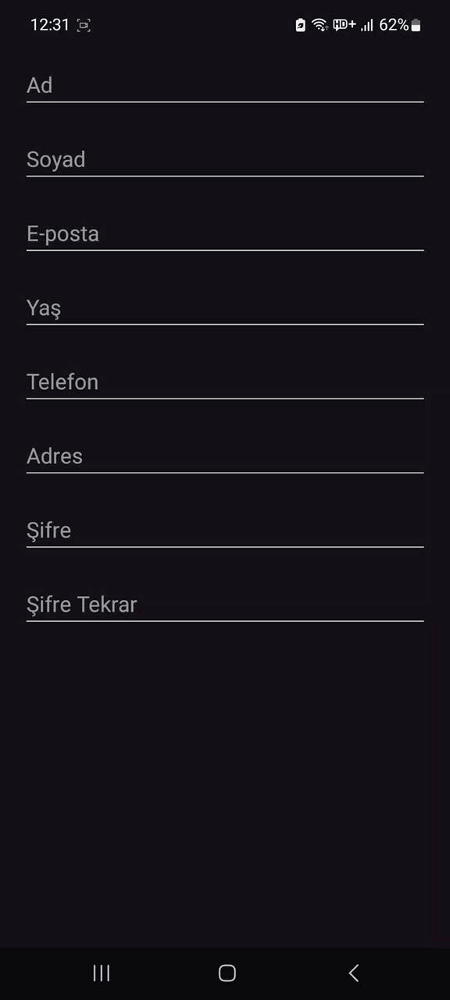

# Sign Up Form UI

Bu uygulama, Android'de ScrollView kullanarak kaydırılabilir arayüzler oluşturmayı öğrenmek amacıyla hazırlanmıştır.

Projede kullanıcıların ad, soyad, e-posta, yaş, telefon, adres, şifre ve şifre tekrar bilgilerini girebileceği bir kayıt formu tasarlanmıştır. Form alanları tek bir ekrana sığmayabileceğinden ScrollView kullanılarak dikey kaydırma desteği eklenmiştir.

## Ekran Görüntüsü

<p align="center">
  
</p>

## Konu: ScrollView

ScrollView, Android'de içerik alanının ekran boyutunu aşması durumunda kullanıcıların içeriği kaydırarak görüntülemesini sağlayan bir ViewGroup bileşenidir.

Özellikle uzun formlar, ayarlar ekranları ve dikey olarak sıralanmış içeriklerin bulunduğu arayüzlerde kullanılır.

ScrollView varsayılan olarak dikey kaydırmayı destekler. Yatay kaydırma için ise `HorizontalScrollView` bileşeni kullanılır.

### ScrollView Kullanımı

ScrollView, içerisinde kaydırılabilir içeriği barındırır. Önemli bir kural olarak doğrudan yalnızca bir child View kabul eder.

Birden fazla bileşen kullanılacaksa bu bileşenler LinearLayout veya ConstraintLayout gibi bir ViewGroup içerisinde toplanabilir.

Örneğin:

```xml
<ScrollView
    android:layout_width="match_parent"
    android:layout_height="match_parent">

    <LinearLayout
        android:layout_width="match_parent"
        android:layout_height="wrap_content"
        android:orientation="vertical">

        <TextView
            android:layout_width="match_parent"
            android:layout_height="wrap_content"
            android:text="İlk içerik" />

        <TextView
            android:layout_width="match_parent"
            android:layout_height="wrap_content"
            android:text="İkinci içerik" />

    </LinearLayout>

</ScrollView>
```

Burada ScrollView, LinearLayout bileşenini tek child olarak içerir. LinearLayout içerisinde ise birden fazla arayüz bileşeni tanımlanabilir.

### ScrollView Attributes

ScrollView kullanılırken bazı layout özellikleri önemlidir.

**layout_width ve layout_height**

ScrollView'ın genişlik ve yüksekliğini belirler.

- `match_parent`: Üst bileşenin kullanılabilir alanını kaplar.
- `wrap_content`: İçeriğin gerektirdiği boyutu kullanır.

Kaydırılabilir bir ekran oluştururken ScrollView'ın yüksekliğinin genellikle `match_parent` olarak tanımlanması tercih edilir.

**fillViewport**

`android:fillViewport` özelliği, içerik alanının ScrollView'ın kullanılabilir yüksekliğini doldurmasını sağlar.

```xml
<ScrollView
    android:layout_width="match_parent"
    android:layout_height="match_parent"
    android:fillViewport="true">
```

Bu özellik etkinleştirildiğinde içerik, mevcut görünür alanı dolduracak şekilde genişletilir. Ancak içerik zaten daha uzunsa doğal olarak kaydırılmaya devam eder.

### ScrollView İçerisinde LinearLayout

ScrollView içerisinde birden fazla form bileşeni kullanmak için LinearLayout tercih edilebilir.

```xml
<LinearLayout
    android:layout_width="match_parent"
    android:layout_height="wrap_content"
    android:orientation="vertical"
    android:padding="20dp">

    <EditText
        android:layout_width="match_parent"
        android:layout_height="wrap_content"
        android:hint="Ad"
        android:inputType="textPersonName" />

    <EditText
        android:layout_width="match_parent"
        android:layout_height="wrap_content"
        android:hint="Soyad"
        android:inputType="textPersonName" />

</LinearLayout>
```

`orientation="vertical"` kullanılarak form alanları alt alta sıralanır.

`wrap_content` yüksekliği sayesinde LinearLayout, içerisindeki bileşenlerin ihtiyaç duyduğu kadar alan kaplar. Böylece içerik ScrollView'ın görünür alanını aşarsa kaydırılabilir.

### Keyboard ve ScrollView

Form ekranlarında kullanıcı metin girişi yaparken sanal klavye açılır. Klavye, ekranın kullanılabilir alanını daralttığı için kaydırılabilir formlarda pencere boyutlandırma ve sistem inset yönetimi önemlidir.

Bu projede `MainActivity` içerisinde `WindowInsetsCompat.Type.ime()` kullanılarak klavyeye ait inset bilgileri de dinlenmektedir.

```kotlin
ViewCompat.setOnApplyWindowInsetsListener(findViewById(R.id.main)) { v, insets ->
    val systemBars = insets.getInsets(
        WindowInsetsCompat.Type.systemBars() or
            WindowInsetsCompat.Type.ime()
    )

    v.setPadding(
        systemBars.left,
        systemBars.top,
        systemBars.right,
        systemBars.bottom
    )

    insets
}
```

Burada:

- `WindowInsetsCompat.Type.systemBars()`: Sistem çubuklarının kapladığı alanları belirtir.
- `WindowInsetsCompat.Type.ime()`: Ekran klavyesinin kapladığı alanı belirtir.
- `setPadding()`: Elde edilen inset değerlerini ana layout'un iç boşluklarına uygular.

Bu yaklaşım, kenardan kenara (edge-to-edge) çalışan arayüzlerde sistem alanlarının ve klavyenin dikkate alınmasına yardımcı olur.

## Projede Kullanımı

Projede `activity_main.xml` içerisinde ScrollView, ana ConstraintLayout içerisine yerleştirilmiştir. ScrollView'ın child bileşeni olarak dikey yönlendirilmiş bir LinearLayout kullanılmıştır.

Formda aşağıdaki giriş alanları bulunmaktadır:

| Alan | Input Type |
| --- | --- |
| Ad | `textPersonName` |
| Soyad | `textPersonName` |
| E-posta | `textEmailAddress` |
| Yaş | `number` |
| Telefon | `phone` |
| Adres | `text` |
| Şifre | `textPassword` |
| Şifre Tekrar | `textPassword` |

Her EditText bileşeninde `hint` ile kullanıcıya giriş alanının amacı gösterilir. `inputType` özelliği ise ilgili alan için uygun klavye türünün açılmasını sağlar.

## Uygulama Akışı

1. Ana ekran için ConstraintLayout oluşturulur.
2. ConstraintLayout içerisine ScrollView eklenir.
3. ScrollView'ın child bileşeni olarak dikey LinearLayout tanımlanır.
4. Form alanları EditText bileşenleriyle oluşturulur.
5. Her giriş alanına uygun `inputType` ve `hint` özellikleri atanır.
6. `fillViewport` ile içerik alanının görünür alanı doldurması sağlanır.
7. Klavye ve sistem çubuklarının kapladığı alanlar WindowInsetsCompat üzerinden yönetilir.

## Kullanılan Teknolojiler

- Kotlin
- Android SDK
- XML Layout
- ConstraintLayout
- LinearLayout
- ScrollView
- EditText
- WindowInsetsCompat

## Öğrenme Kazanımları

- Android'de ScrollView kullanımını öğrenme.
- Uzun içerikler için kaydırılabilir ekranlar oluşturma.
- ScrollView içerisinde tek child View kuralını anlama.
- LinearLayout ile form alanlarını dikey olarak sıralama.
- `fillViewport` özelliğinin görevini anlama.
- EditText ve farklı inputType seçeneklerini kullanma.
- Sanal klavye ve sistem inset alanlarını yönetme.