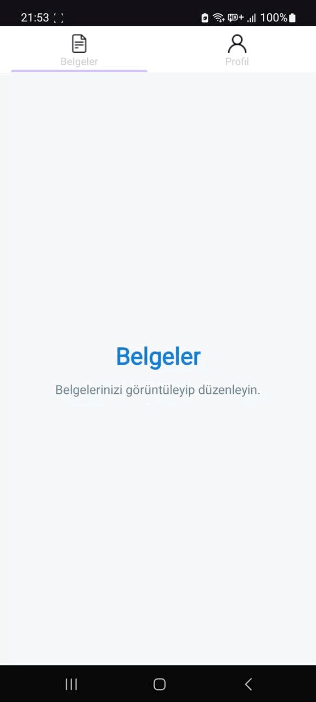

# Tab Navigation

Bu uygulama, Android'de sekmeli navigasyon oluşturmayı, `TabLayout` ve `ViewPager2` yapılarını birlikte kullanmayı ve özel sekme tasarımları hazırlamayı öğrenmek amacıyla geliştirilmiştir.

Projede **Belgeler** ve **Profil** olmak üzere iki sekme bulunmaktadır. Her sekme kendisine ait bir Fragment gösterir. Kullanıcı sekmelere dokunarak veya ViewPager2 üzerinde kaydırma hareketi yaparak ekranlar arasında geçiş yapabilir.

## Ekran Görüntüsü

<p align="center">
  
</p>

## Konu: Custom Tab ve ViewPager2

Android uygulamalarında kullanıcıların farklı içeriklere kolayca erişebilmesi için sekmeli navigasyon (Tab Navigation) kullanılabilir.

Bu yapıda:

- **TabLayout:** Sekmelerin gösterilmesini ve seçilmesini sağlar.
- **ViewPager2:** Sayfalar arasında kaydırma yapılmasını sağlar.
- **Fragment:** Her sekmenin görüntülediği içerik alanını oluşturur.
- **TabLayoutMediator:** TabLayout ile ViewPager2 arasındaki bağlantıyı kurar.

Bu projede iki Fragment kullanılmıştır:

- `DocumentFragment`: Belgeler sekmesinin içeriğini gösterir.
- `ProfileFragment`: Profil sekmesinin içeriğini gösterir.

## TabLayout

`TabLayout`, uygulama içerisinde sekmeli navigasyon alanı oluşturmak için kullanılan Material Components bileşenidir.

Sekmeler arasında geçiş yapılmasını sağlar ve seçili sekmenin görsel olarak belirtilmesine yardımcı olur.

Bu projede TabLayout, `activity_main.xml` içerisinde tanımlanmıştır.

```xml
<com.google.android.material.tabs.TabLayout
    android:id="@+id/tabLayout"
    android:layout_width="0dp"
    android:layout_height="60dp"
    android:background="@color/white" />
```

Kotlin tarafında `findViewById()` ile erişilir:

```kotlin
tabLayout = findViewById(R.id.tabLayout)
```

## ViewPager2

`ViewPager2`, kullanıcıların sayfalar arasında yatay veya dikey kaydırma hareketiyle geçiş yapmasını sağlayan Android bileşenidir.

Önceki ViewPager yapısının geliştirilmiş sürümüdür. RecyclerView altyapısını kullanır ve Fragment'larla birlikte çalışabilir.

Bu projede her sayfa bir Fragment ile temsil edilmiştir.

```xml
<androidx.viewpager2.widget.ViewPager2
    android:id="@+id/viewPager"
    android:layout_width="0dp"
    android:layout_height="0dp"
    app:layout_constraintBottom_toBottomOf="parent"
    app:layout_constraintEnd_toEndOf="parent"
    app:layout_constraintStart_toStartOf="parent"
    app:layout_constraintTop_toBottomOf="@+id/tabLayout" />
```

## FragmentStateAdapter

ViewPager2 içerisinde gösterilecek sayfaları yönetmek için bir adapter kullanılır.

Fragment'larla çalışırken `FragmentStateAdapter` tercih edilir.

Bu projede `ViewPageAdapter` adında özel bir adapter oluşturulmuştur.

```kotlin
internal class ViewPageAdapter(
    activity: AppCompatActivity
) : FragmentStateAdapter(activity) {

    private val fragmentList: MutableList<Fragment> = ArrayList()

    override fun createFragment(position: Int): Fragment {
        return fragmentList[position]
    }

    override fun getItemCount(): Int {
        return fragmentList.size
    }

    fun addFragment(fragment: Fragment) {
        fragmentList.add(fragment)
    }
}
```

Adapter içerisinde üç temel işlem bulunmaktadır:

- `createFragment(position)`: İstenen pozisyondaki Fragment örneğini döndürür.
- `getItemCount()`: Adapter içerisinde bulunan toplam sayfa sayısını döndürür.
- `addFragment()`: Gösterilecek Fragment'ı listeye ekler.

### Adapter'a Fragment Eklemek

`MainActivity` içerisinde adapter oluşturulur ve gösterilecek Fragment'lar eklenir.

```kotlin
fun createViewPager() {
    val adapter = ViewPageAdapter(this)

    adapter.addFragment(DocumentFragment())
    adapter.addFragment(ProfileFragment())

    viewPager.adapter = adapter
}
```

Fragment'ların listeye eklenme sırası, ViewPager2 içerisindeki sayfa sırasını belirler.

İlk pozisyon `DocumentFragment`, ikinci pozisyon ise `ProfileFragment` olarak ayarlanmıştır.

## TabLayoutMediator

TabLayout ile ViewPager2'nin birbirinden bağımsız çalışması yerine senkronize hareket etmesi gerekir.

Bu bağlantıyı kurmak için `TabLayoutMediator` kullanılır.

```kotlin
TabLayoutMediator(tabLayout, viewPager) { tab, position ->
    createTab(tab, position)
}.attach()
```

- `tabLayout`: Sekmelerin gösterileceği TabLayout bileşenidir.
- `viewPager`: Sayfa geçişlerini yöneten ViewPager2 bileşenidir.
- `position`: İlgili sekmenin pozisyonunu belirtir.
- `attach()`: TabLayout ile ViewPager2 arasındaki bağlantıyı etkinleştirir.

Bu bağlantı sayesinde kullanıcı bir sekmeye bastığında ilgili sayfa açılır. ViewPager2 üzerinde kaydırma yapıldığında da seçili sekme otomatik olarak güncellenir.

Eski ViewPager kullanımında bulunan `setupWithViewPager()` yaklaşımı bu projede kullanılmamıştır; ViewPager2 için `TabLayoutMediator` tercih edilmiştir.

## Custom Tab Tasarımı

TabLayout'un varsayılan sekme görünümü yerine özel bir tasarım kullanmak mümkündür.

Bu projede her sekmede bir ikon ve metin gösterilmesi için `custom_tab.xml` isimli bir layout oluşturulmuştur.

Layout içerisinde:

- `ImageView`: Sekmeye ait ikonu gösterir.
- `TextView`: Sekmenin başlığını gösterir.

### Custom Tab Oluşturma

Sekme tasarımını programatik olarak oluşturmak için `LayoutInflater` kullanılır.

```kotlin
private fun createTab(tab: TabLayout.Tab, position: Int) {
    val customTab = LayoutInflater.from(this)
        .inflate(R.layout.custom_tab, null)

    val textView = customTab.findViewById<TextView>(R.id.textView)
    val imageView = customTab.findViewById<ImageView>(R.id.imageView)

    when (position) {
        0 -> {
            textView.text = "Belgeler"
            imageView.setImageResource(R.drawable.ic_document)
        }

        1 -> {
            textView.text = "Profil"
            imageView.setImageResource(R.drawable.ic_profile)
        }
    }

    tab.customView = customTab
}
```

Burada gerçekleştirilen işlemler:

1. `LayoutInflater.from(this)` ile mevcut Context üzerinden LayoutInflater elde edilir.
2. `inflate()` ile `custom_tab.xml` View nesnesine dönüştürülür.
3. `findViewById()` ile layout içerisindeki ImageView ve TextView bileşenlerine erişilir.
4. `position` değerine göre sekmenin metni ve ikonu belirlenir.
5. `tab.customView` ile hazırlanan özel görünüm ilgili sekmeye atanır.

### LayoutInflater

LayoutInflater, XML formatında tanımlanan layout dosyalarını çalışma zamanında View nesnelerine dönüştürmek için kullanılır.

Özellikle dinamik olarak oluşturulan arayüz bileşenlerinde ve özel sekme tasarımlarında kullanışlıdır.

## Uygulama Akışı

1. Uygulama `MainActivity` ekranında açılır.
2. `TabLayout` ve `ViewPager2` bileşenlerine erişilir.
3. `createViewPager()` metodu ile adapter oluşturulur.
4. Adapter'a `DocumentFragment` ve `ProfileFragment` eklenir.
5. Adapter, ViewPager2 bileşenine atanır.
6. `TabLayoutMediator` ile TabLayout ve ViewPager2 birbirine bağlanır.
7. Her sekme için `createTab()` metodu çağrılır ve özel görünüm oluşturulur.
8. Kullanıcı sekmeye dokunduğunda veya sayfayı kaydırdığında ilgili Fragment görüntülenir.

## Kullanılan Teknolojiler

- Kotlin
- Android SDK
- AndroidX Fragment
- ViewPager2
- FragmentStateAdapter
- TabLayout
- TabLayoutMediator
- Material Components
- ConstraintLayout
- XML Layout

## Öğrenme Kazanımları

- Android'de sekmeli navigasyon oluşturma.
- TabLayout kullanma.
- ViewPager2 ile sayfa geçişlerini yönetme.
- Fragment'ları ViewPager2 içerisinde kullanma.
- FragmentStateAdapter oluşturma.
- `createFragment()` ve `getItemCount()` metotlarını uygulama.
- TabLayoutMediator ile sekmeleri ve sayfaları senkronize etme.
- Custom Tab tasarımı hazırlama.
- LayoutInflater ile XML layout dosyasını View nesnesine dönüştürme.
- Sekmelere özel ikon ve metin atama.