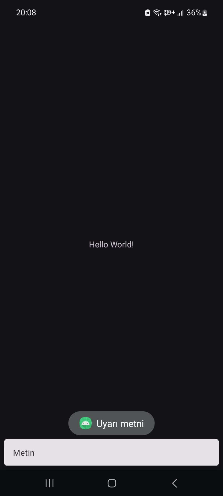

# Toast n Snackbar

Bu uygulama, Android'de kullanıcıya kısa süreli bilgilendirme ve uyarı mesajları göstermek için kullanılan Toast ve Snackbar bileşenlerini öğrenmek amacıyla hazırlanmıştır.

Projede Android'in yerleşik Toast API'si ve Material Components kütüphanesindeki Snackbar yapısı kullanılmıştır.

## Ekran Görüntüsü

<p align="center">
  
</p>

## Konu: Toast ve Snackbar

Android uygulamalarında kullanıcıya bir işlem hakkında bilgi vermek, uyarı göstermek veya işlem sonucunu bildirmek için geçici mesaj bileşenleri kullanılabilir.

Toast ve Snackbar, bu amaçla kullanılan iki farklı bildirim yöntemidir. İkisi de ekranda belirli bir süre görünür ve kullanıcıdan ayrıca bir pencereyi kapatmasını beklemez.

### Toast

Toast, uygulama içerisinde kısa süreli bilgilendirme mesajları göstermek için kullanılan Android bileşenidir.

Toast mesajları uygulamanın mevcut arayüzünden bağımsız olarak görüntülenir. Genellikle basit ve kullanıcı etkileşimi gerektirmeyen bildirimlerde tercih edilir.

Toast oluşturmak için `Toast.makeText()` metodu kullanılır.

**Kullanımı:**

```kotlin
Toast.makeText(
    this@MainActivity,
    "Uyarı metni",
    Toast.LENGTH_LONG
).show()
```

Parametreler:

- **Context:** Toast mesajının hangi uygulama bağlamında gösterileceğini belirtir.
- **Text:** Kullanıcıya gösterilecek mesajı belirler.
- **Duration:** Mesajın ekranda kalma süresini belirler.

Toast için iki temel süre seçeneği bulunur:

- `Toast.LENGTH_SHORT`: Kısa süreli gösterim.
- `Toast.LENGTH_LONG`: Daha uzun süreli gösterim.

`show()` metodu, oluşturulan Toast mesajının görüntülenmesini sağlar.

### Snackbar

Snackbar, Material Components kütüphanesi içerisinde bulunan ve kullanıcıya geçici bilgilendirme mesajları sunan bir bileşendir.

Toast'tan farklı olarak belirli bir View'a bağlanarak gösterilir. Mesajın yanında kullanıcı etkileşimi sağlayan bir aksiyon butonu da eklenebilir.

Snackbar oluşturmak için `Snackbar.make()` metodu kullanılır.

**Kullanımı:**

```kotlin
Snackbar.make(
    window.decorView.rootView,
    "Metin",
    Snackbar.LENGTH_LONG
).show()
```

Parametreler:

- **View:** Snackbar'ın ilişkilendirileceği arayüz bileşenini belirtir.
- **Text:** Görüntülenecek mesajı belirler.
- **Duration:** Mesajın ekranda kalma süresini belirler.

Snackbar için kullanılan süre seçenekleri:

- `Snackbar.LENGTH_SHORT`: Kısa süreli gösterim.
- `Snackbar.LENGTH_LONG`: Daha uzun süreli gösterim.
- `Snackbar.LENGTH_INDEFINITE`: Manuel olarak kapatılana veya başka bir işlem gerçekleşene kadar görünür kalır.

### Snackbar Action

Snackbar'ın önemli özelliklerinden biri, mesajın yanında bir aksiyon butonu sunabilmesidir.

`setAction()` metodu kullanılarak kullanıcıya ek bir işlem seçeneği verilebilir.

Örneğin:

```kotlin
Snackbar.make(
    window.decorView.rootView,
    "Dosya silindi",
    Snackbar.LENGTH_LONG
).setAction("GERİ AL") {
    // Silme işlemini geri alma
}.show()
```

Bu örnekte kullanıcıya dosyanın silindiği bildirilir. Aynı zamanda GERİ AL butonuyla silme işlemini geri alma seçeneği sunulur.

Bu özellik, kullanıcıya yalnızca bilgi vermek yerine bildirim üzerinden işlem gerçekleştirme imkânı sağlar.

### Toast ve Snackbar Arasındaki Farklar

Her iki bileşen de geçici bildirimler göstermek için kullanılsa da kullanım şekilleri ve sundukları özellikler farklıdır.

| Özellik | Toast | Snackbar |
| --- | --- | --- |
| Kullanım amacı | Basit bilgilendirme | Bilgilendirme ve aksiyon |
| Görüntülenme | Uygulama arayüzünden bağımsız | Bir View'a bağlı |
| Aksiyon butonu | Bulunmaz | Eklenebilir |
| Süre seçenekleri | SHORT, LONG | SHORT, LONG, INDEFINITE |
| Kütüphane | Android SDK | Material Components |

**Hangi durumda kullanılmalı?**

- Toast: Kullanıcıya kısa ve basit bir bilgilendirme mesajı gösterilecekse.
- Snackbar: Kullanıcıya bildirimle birlikte bir işlem seçeneği sunulacaksa veya bildirimin belirli bir arayüz alanıyla ilişkili olması gerekiyorsa.

## Projede Kullanılan Yapı

Uygulamada Toast ve Snackbar, `MainActivity.kt` içerisinde `onCreate()` metodu içinde oluşturulmuştur.

```kotlin
// Toast bildirimi
Toast.makeText(
    this@MainActivity,
    "Uyarı metni",
    Toast.LENGTH_LONG
).show()

// Snackbar bildirimi
Snackbar.make(
    window.decorView.rootView,
    "Metin",
    Snackbar.LENGTH_LONG
).show()
```

Uygulama başlatıldığında iki bildirim de gösterilir.

Snackbar kullanımı için `com.google.android.material.snackbar.Snackbar` sınıfı import edilmiştir.

## Uygulama Akışı

1. Ana ekran `activity_main.xml` içerisinde oluşturulur.
2. `MainActivity.kt` içerisinde Toast sınıfı import edilir.
3. `Toast.makeText()` ile bilgilendirme mesajı hazırlanır.
4. Material Components içerisinden Snackbar sınıfı import edilir.
5. `Snackbar.make()` ile View'a bağlı bir bildirim oluşturulur.
6. `show()` metodu ile her iki bildirim de ekranda görüntülenir.

## Kullanılan Teknolojiler

- Kotlin
- Android SDK
- XML Layout
- ConstraintLayout
- Material Components
- Toast
- Snackbar

## Öğrenme Kazanımları

- Android'de Toast mesajları oluşturma.
- `Toast.makeText()` metodunu kullanma.
- Toast gösterim sürelerini belirleme.
- Material Components Snackbar yapısını kullanma.
- `Snackbar.make()` ile bildirim oluşturma.
- Snackbar üzerinden aksiyon butonu ekleme.
- Toast ve Snackbar arasındaki farkları anlama.